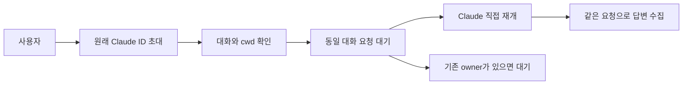
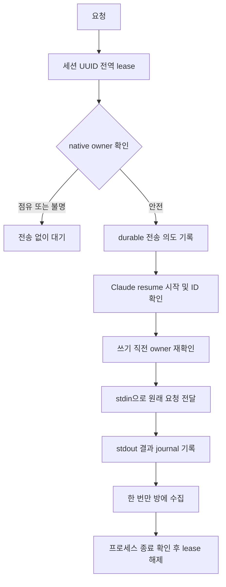
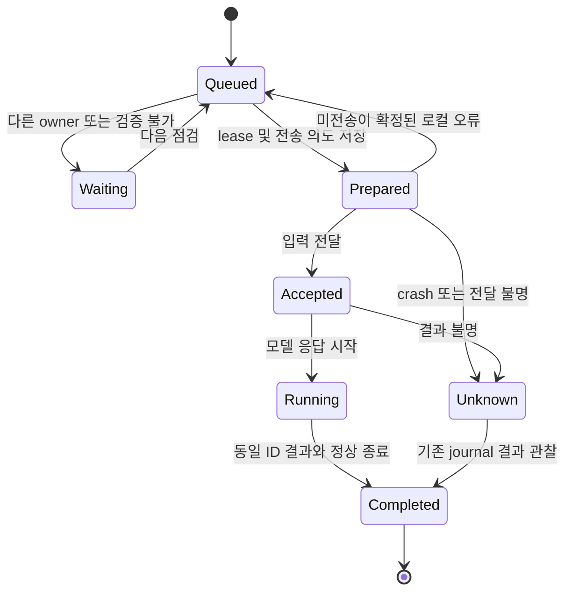
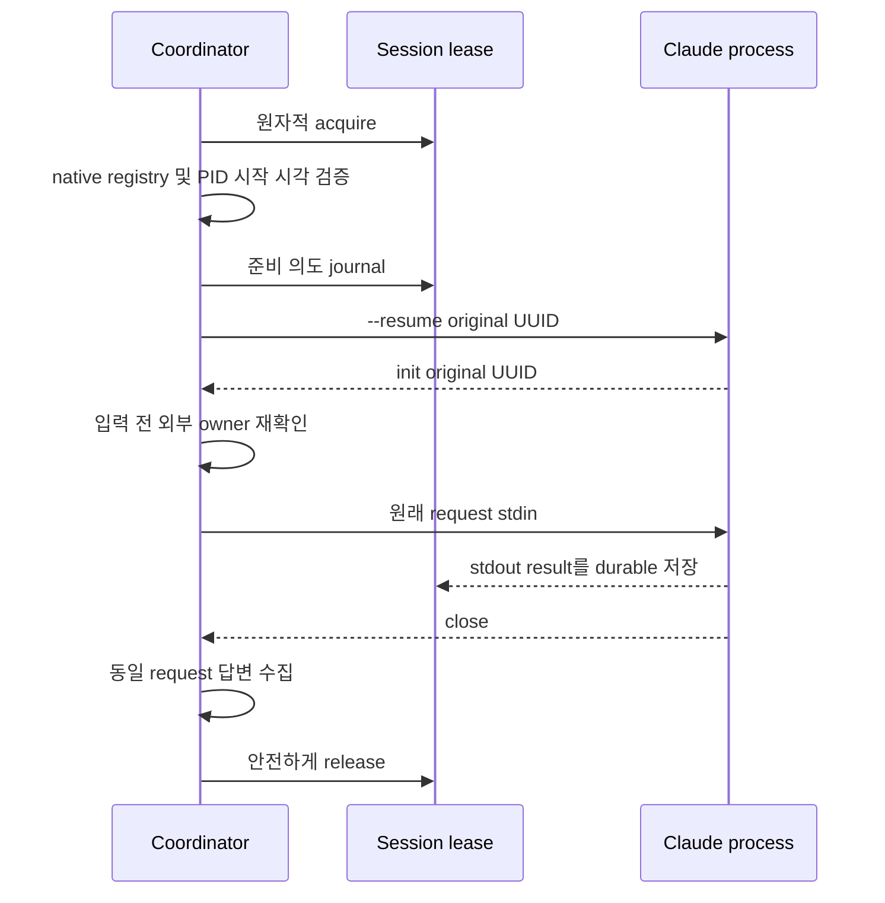
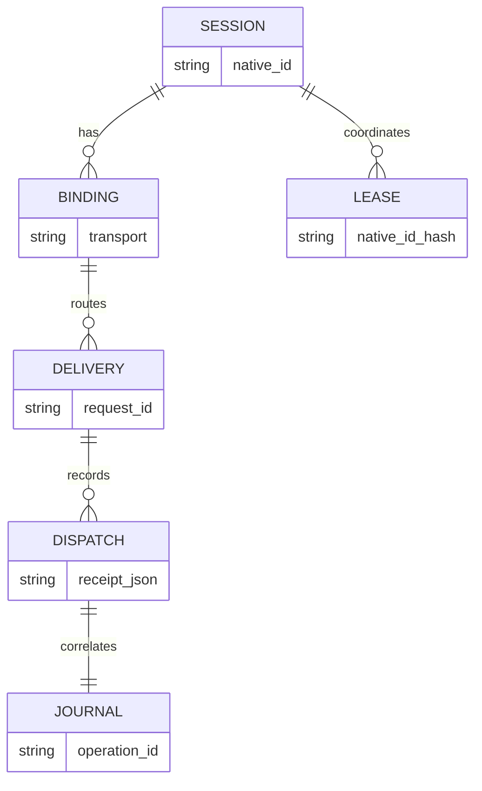

# Claude session direct resume

## 1. 의도 (Intent)

| 항목 | 내용 |
|---|---|
| 문제 | Claude 대화 ID를 골라도 실제 전달이 Orca 실행 핸들 및 내부 모듈에 묶여 있다. |
| 왜 지금 | 사용자가 Orca 필수 의존 제거와 원래 대화의 직접 재개를 명시적으로 요청했다. |
| 주 사용자 | 기존 Claude 대화를 토론장 참여자로 계속 사용하는 사용자 |
| 불변식 | 원래 native ID, cwd, 별칭, 권한, 요청 ID, 대화 파일을 보존한다. 기존 프로세스와 실행 중 작업을 종료하지 않는다. 미확인 전송을 다시 실행하지 않는다. |
| 비목표 | 기존 Codex/terminal 전송 제거, 원래 대화 복제 또는 fork, Claude 설정/인증 변경, 외부 CLI 사용자의 실행을 강제 종료하는 전역 제어 |
| 승인 근거 | 2026-11-19 사용자의 직접 구현 요청: Orca 의존 제거, 기존 대화/작업 보존, 같은 세션 중복 실행 방지. 이 범위로 구현한다. |

## 2. 수용 기준 (Acceptance)

| ID | 수용 기준 | 검증 방법 |
|---|---|---|
| AC-1 | Claude 참여자는 원래 세션 UUID와 cwd로 직접 resume하며 Orca RPC/내부 모듈 없이 응답한다. | adapter command fixture, coordinator HTTP, 실제 격리된 Claude 대화의 두 번째 turn 재개 |
| AC-2 | 동일 Claude ID의 두 Session Rooms 실행은 전역 원자적 lease로 겹치지 않는다. | 별도 Node 프로세스 2개의 acquire 경쟁 및 coordinator 2개 충돌 테스트 |
| AC-3 | 기존 Claude native registry의 살아 있는 동일 세션 owner가 있거나 소유권을 확인하지 못하면 새 작업을 보내지 않는다. 기존 프로세스는 종료하지 않는다. | 실제 registry+PID 시작 시각 읽기, fixture live/stale/reused PID/파싱 실패, no-spawn/no-kill assertion |
| AC-4 | 준비/전송 후 crash는 같은 작업을 재실행하지 않는다. durable 결과만 같은 요청에 한 번 수집한다. | prepared/unknown/restart/journal 결과/중복 관찰 테스트 |
| AC-5 | 기존 참여자 별칭/방/권한과 대기 요청은 유지한다. 기존 active/unknown 작업의 binding과 receipt는 보존하고 완료될 때까지 전환하지 않는다. | mixed-state Store migration 및 기존 DB 복사본의 before/after 비교 |
| AC-6 | 초대와 기존 참여자의 자동 전달이 직접 경로를 사용하며 세션 점유/보류 이유가 API와 카드에 드러난다. | HTTP/renderer integration, 사용자 초대 flow 확인 |
| AC-7 | 설치본의 기존 이미지/UI와 다른 provider 경로를 보존하며 교체 후 실제 버전·경로를 확인한다. | 정확한 1.5.1 소스에 통합, 공식 web/Electron/packaged smoke, 설치본 파일 및 API 확인 |

## 3. 확정 사실 (Findings)

| 항목 | 확인된 사실 | 설계 반영 |
|---|---|---|
| 현재 전송 | adapters/orca/native-chat.js가 Orca 설치 내부 RuntimeClient와 mutation builder를 require한다. | Claude direct 경로는 해당 import/호출을 사용하지 않는다. |
| ID 분리 | catalog는 Claude UUID를 nativeId로 저장하고 native adapter는 별도 handle/runtime를 요구한다. | provider identity와 실행 수단을 별도 capabilities/receipt로 표현한다. |
| CLI | 설치 Claude Code 2.1.327의 --help에서 --resume UUID, stream-json, agents --json을 확인했다. | fork/session-id 없이 --resume만 사용한다. |
| Native registry | 실제 ~/.claude/sessions JSON에 sessionId,pid,cwd,procStart,status가 있고 공식 agents --json도 같은 owner를 반환한다. | status idle도 프로세스 소유 중이면 새 resume를 막는다. |
| Windows 시작 시각 | 실제 registry procStart가 Get-Process.StartTime.ToFileTimeUtc()와 정확히 같았다. DateTime.Ticks와는 epoch가 다르다. | PID 재사용 검사는 Windows FILETIME 정수 문자열을 사용한다. |
| 기존 상태 | Store writer와 participant_dispatches가 전송 불명 요청을 보존한다. | 레거시 active/unknown을 자동 migration/resend하지 않는다. |

공식 빌드의 상태 파일 교체에서 Windows EPERM을 관찰했다. 같은 임시 파일의 atomic rename만 최대 8회 짧게 재시도하고, 지속 오류는 원래 파일을 보존한 채 중단한다. Claude 요청 재전송은 하지 않는다. 새 단위 검증 2건을 포함해 상태/잠금/재시작 20건을 통과했다. (직접 측정, 2026-11-19)

## 4. 유스케이스 / 시나리오

주 시나리오: 원래 세션을 확인하고 직접 경로로 연결한다. 외부 실행이 없으면 lease를 획득하고 Claude를 재개한다.
예외 시나리오: 기존 세션이 살아 있으면 작업과 대화 파일에 쓰지 않고 대기한다. 미확인 전송은 관찰만 한다.

## 5. 파이프라인 (flowchart)

## 6. 액션 · 상태 전이 (action diagram)

| 상태 | 저장/이벤트 | UI 반응 |
|---|---|---|
| Waiting | queued, 점유/확인 불가 이유 | 기존 실행 종료 대기 |
| Prepared/Accepted/Running | 원래 request, operation, fingerprint, lease token, child PID/start identity | 실행 중 |
| Unknown | receipt/lease/journal 보존, 재전송 없음 | 결과 확인 필요 |
| Completed | trusted direct stdout 결과, request unique reply | 대기 중 |

## 7. 타이밍 (sequence)

모델 작업의 시간 초과로 원래/외부 프로세스를 종료하지 않는다. timeout 또는 coordinator crash는 unknown 관찰 상태이며 자동 재실행하지 않는다. 짧은 registry/프로세스 조회만 bounded timeout을 사용한다.

## 8. 데이터 (ER)

기존 session/member/message FK는 바꾸거나 CASCADE 삭제하지 않는다. direct receipt는 기존 receipt와 다른 transport discriminator로 검증한다. lease/journal은 대화 원본 외 별도 경로에 기록한다.

## 9. 변경 지점

| 파일 | 변경 |
| `adapters/claude/atomic-file.js` | 일시적인 파일 교체 잠금에 한정한 atomic 상태 저장 |
| `tests/claude-atomic-file.test.js` | 일시/지속 교체 실패와 이전 상태 보존 검증 |
|---|---|
| `adapters/claude/direct-session.js` | 직접 Claude resume, native registry 검사, durable journal |
| `adapters/claude/session-lease.js` | 전역 원자적 lease와 PID 시작 identity 검사 |
| `services/coordinator/store.js` | 동일 세션의 안전한 direct 전환 및 trusted reply 검증 |
| `services/coordinator/participant-dispatcher.js` | direct 전송/관찰 분리, 기존 prompt/권한 보존 |
| `services/coordinator/server.js` | direct 기본 routing, 초대/카탈로그/자동 전환 |
| `apps/desktop/app.js` | Claude ID 직접 초대 |
| `apps/desktop/delivery-status.js` | 점유 및 보류 이유 표시 |
| `tests/claude-direct-session.test.js` | adapter/lease 경계 검증 |
| `tests/claude-direct-runtime.test.js` | Store/HTTP migration 및 요청 회수 검증 |

## 10. 잠재 문제 & 대응

| 문제 | 대응 |
|---|---|
| CLI registry 미노출/파싱 실패/권한 거절 | 안전 확인 불가로 대기; 원래 프로세스 또는 registry 수정 금지 |
| PID 재사용, exe 업데이트 rename | PID와 procStart를 함께 검증; 이름만으로 판정하지 않음 |
| 외부 CLI가 앱 lease를 따르지 않음 | 기존 owner 검사 및 입력 전 재검사. 앱은 자체 시작만 제어하며 외부 실행을 kill하지 않음 |
| coordinator가 child 시작 직후 종료 | durable launching 상태를 unknown으로 보존; 자동 재실행 금지 |
| 원래 대화의 권한/모델이 다른 host에만 존재 | CLI의 원래 cwd/config를 사용, 권한을 올리는 flag 추가 금지. 확인되지 않은 설정은 추측해 복원하지 않음 |
| legacy unknown receipt는 Orca 관찰이 필요 | 기존 요청의 증거 보존; direct 작업으로 대체하지 않음 |

## 11. 착수 순서

- [x] 1. direct adapter와 전역 lease, 실제 owner 읽기 검증 (AC-1, AC-2, AC-3, AC-4)
- [x] 2. Store/dispatcher/server 직접 경로와 안전한 기존 세션 migration (AC-1, AC-4, AC-5)
- [x] 3. 초대/API/상태 표시와 통합 검증 (AC-6)
- [ ] 4. 실제 격리 Claude 재개 및 기존 설치본 보존 배포 검증 (AC-1, AC-3, AC-5, AC-7)

## 12. 추적성

| AC | 구현 커밋 | 테스트 | 위험 항목 |
|---|---|---|---|
| AC-1 | 구현 후 기록 | direct adapter/real resume | 잘못된 ID 및 fork |
| AC-2 | 구현 후 기록 | cross-process lease | 동시 시작 |
| AC-3 | 구현 후 기록 | registry/PID checks | 외부 owner 및 PID 재사용 |
| AC-4 | 구현 후 기록 | journal restart | 중복 실행 |
| AC-5 | 구현 후 기록 | migration matrix | 기존 작업 손실 |
| AC-6 | 구현 후 기록 | HTTP/renderer | 상태 오표시 |
| AC-7 | 구현 후 기록 | official release pipeline | 이미지/UI 손실 |
