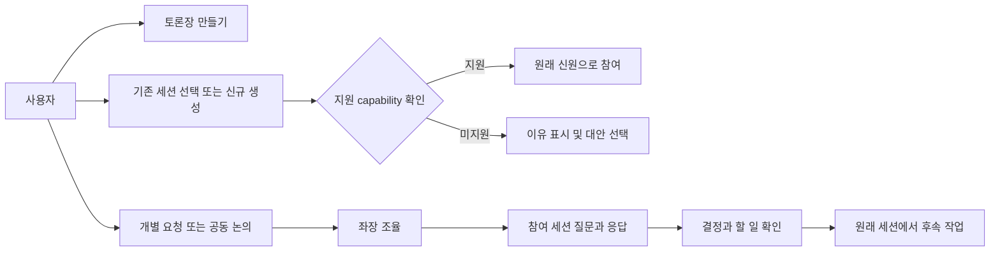
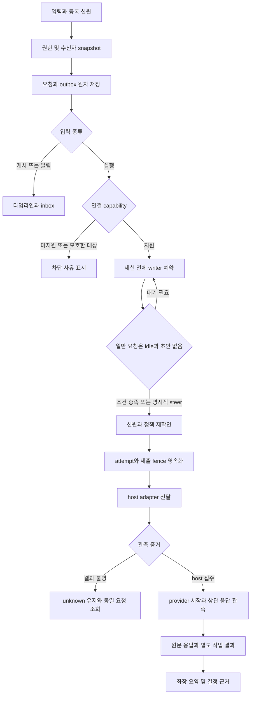
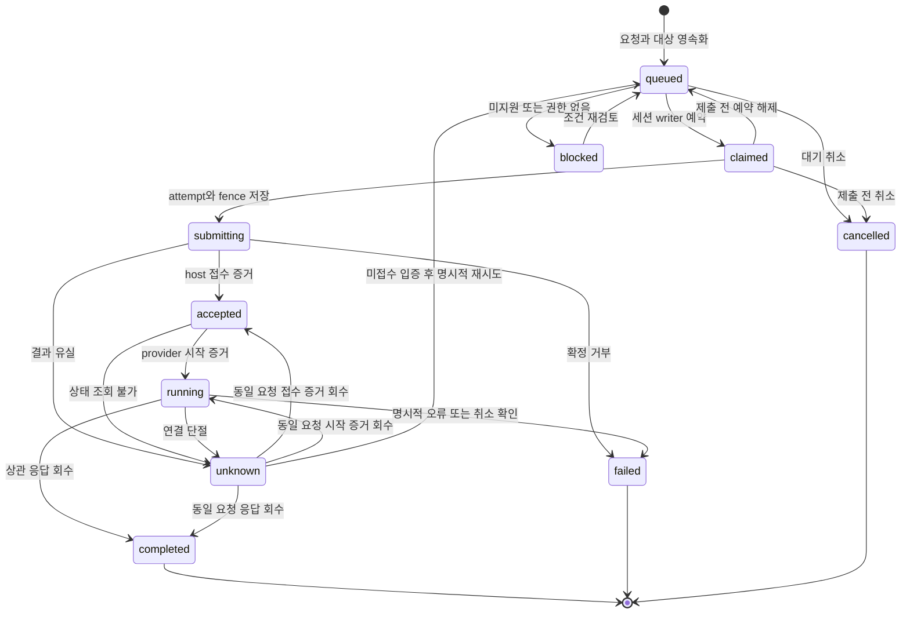
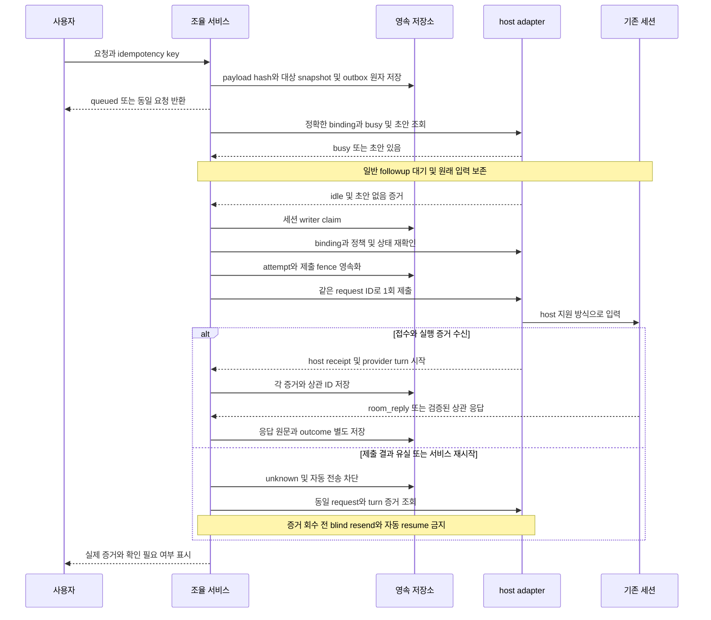
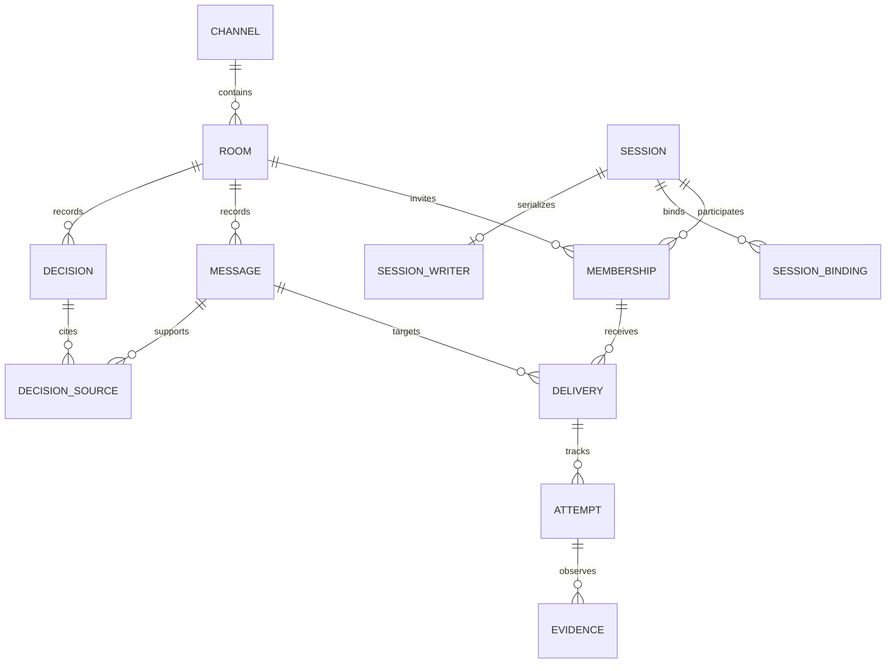

<!-- sr:plan
{
  "document_type": "decision",
  "reader_questions": ["만들 도구의 범위는 무엇인가", "기존 제품에서 무엇을 가져오는가", "기존 세션을 어떻게 연결하는가", "첫 구현의 완료 기준은 무엇인가"],
  "visual_plan": [
    {"kind":"decision_matrix","content":"벤치마킹 후보와 채택할 동작 비교","required":true},
    {"kind":"flowchart","content":"초대, 전달, 응답 회수와 지원 불가 분기","required":true},
    {"kind":"state_diagram","content":"요청 전달의 불확실성과 복구","required":true},
    {"kind":"sequence_diagram","content":"실행 중 세션에 들어온 요청 처리","required":true},
    {"kind":"er_diagram","content":"토론, 참여 세션, 메시지, 전달 시도 관계","required":true}
  ],
  "visual_waiver": []
}
-->

# 세션 토론장 — 벤치마킹과 첫 버전 설계

> 개인용 Windows 협업 앱. 기존 Codex·Claude 작업 세션을 한 토론장에 모아 논의하고 원래 작업으로 결과를 돌려보낸다.

## 한눈에 보기

- 목적: 사람이 세션 사이에서 복사·요약·전달하는 일을 줄인다.
- 현재 상태: building. Node·SQLite·브라우저 UI·MCP 실행판을 구현했고, 새 Codex·Claude의 상관 응답 3건과 좌장 제안 1건을 검증했다. 전체 명세 완료는 아니다.
- 핵심 결론: 채널 UI와 좌장은 직접 만들고, 기존 세션 연결은 호스트별 어댑터로 분리한다.
- 원인 또는 판단 근거: 고정 소스 근거 46건을 계약에 반영했다. 실제 canary 원문·request/reply-to, MCP stdio 및 테스트 16개, 두 해상도 UI는 [[session-room-runtime-validation]]에 기록했다. 기존 작업 세션의 자동 제어는 미검증이다.
- 결정: 2026-10-22 사용자가 개정 spec 검토 후 구현 착수를 승인했다. 수용 기준을 구현 기준으로 삼으며 실제 연결의 지원 범위는 host capability로 확인한다.
- 다음 행동: 기존 세션의 native ID·권한·busy/draft·host 제출/응답을 함께 확인하는 어댑터를 구현하고 원래 V-01~V-13을 수행한다.
- 최종 갱신: 2026-10-22, Asia/Seoul.

## 1. 의도 (Intent)

### 맥락

사용자는 Windows PC의 Orca 등에서 서로 다른 프로젝트를 작업하는 Codex·Claude 세션을 운영한다. 세션들이 이미 알고 있는 내용을 다른 세션에 전달하고 협의시키는 중개 작업이 번거롭다. 현재 대화에서 개인용 개발 방향을 선택했다. 시장성 평가와 상용 서비스 설계는 범위에 포함하지 않는다.

| 항목 | 내용 |
|---|---|
| 주 사용자 | 이 PC에서 여러 작업 세션을 운영하는 사용자 한 명 |
| 핵심 경험 | 토론장 생성 → 기존/신규 세션 초대 → 개인/공동 입력 → 상호 논의 → 결과를 각자의 작업에 반영 |
| 불변식 | 기존 대화 ID·작업 위치·권한 정책 보존. 미지원 연결을 신규 세션으로 조용히 대체하지 않는다. |
| 관측 원칙 | 메시지 접수, 전달, 실행 시작, 응답 완료를 별도 증거로 표시한다. |
| 소유권 | 외부 host가 소유한 기존 세션은 빌려 연결한다. 앱이 만든 세션과 수명 관리가 다르며, 토론 이탈·창 닫기가 기존 프로세스를 종료하지 않는다. |
| 입력 원칙 | 일반 후속 요청은 idle·초안 없음 조건에서 전달한다. steer는 지원되는 현재 turn에 대한 명시적 선택이며 권한 정책도 별도 선택 없이 바꾸지 않는다. |
| 비목표 | 첫 버전의 외부 팀 협업, SaaS 계정, 모바일, 원격 PC, 모든 CLI 지원, 완전한 IDE, 자동 Git 병합 |
| Engram 관계 | 실시간 메시지 저장·전달의 필수 의존성이 아니다. 확정된 결론을 남기는 내보내기는 후속 기능이다. |

### 평가기준

우선순위는 기존 세션 연속성, Windows/Orca 호환, 전달·응답의 추적 가능성, 사용자의 개입 가능성, 구현·유지 부담 순서다. 채팅 화면의 화려함보다 이 조건을 먼저 검증한다.

## 2. 수용 기준 (Acceptance)

아래는 승인된 구현 수용 기준이며 현재 통과한 기능 목록이 아니다. V 번호는 [[benchmark-validation-plan]]의 전체 절차 미완료 시나리오다. 격리 테스트·신규 canary·기존 작업 세션 검증을 구분한 현황은 §12와 [[session-room-runtime-validation]]에 있다.

| ID | 수용 기준 | 검증 방법 |
|---|---|---|
| AC-1 | 서로 다른 프로젝트의 기존 Codex·Claude 세션을 같은 토론에 초대한다. provider·host·native session ID·cwd·profile을 식별하고 이름·prefix·latest만으로 모호한 대상을 선택하지 않는다. | V-01, V-02: 실제 두 세션의 초대 전후 신원·실행 주체 대조, 유사 대상은 선택 보류, 오수신 0건 확인 |
| AC-2 | 개별·선택·전체·좌장 입력을 수신자 snapshot에만 전달한다. 게시/알림과 실행 요청을 구분하며 같은 세션의 입력은 여러 토론에 걸쳐 직렬화한다. | V-10, V-11: canary로 대상 수신·비대상 미수신 및 중간 초대자 제외 확인, 두 토론의 전송 순서 대조 |
| AC-3 | busy 일반 요청과 사용자 초안이 있는 요청은 대기한다. steer는 capability와 expected turn ID를 확인하고 사용자가 선택한 경우만 시도한다. | V-04~V-06: 기존 turn 비개입, idle 후 1회 처리, 초안 보존 및 stale turn 거부 확인 |
| AC-4 | 저장·claim·전송 중·host 접수·provider 시작·상관 응답을 구분한다. 증거가 부족하면 unknown이며 idle·socket ACK·enqueue만으로 성공 판정하지 않는다. | V-03, V-07, V-08: 접수만 성공, 시작 전후 단절, 응답 유실을 주입해 DB·UI·host 이력을 대조 |
| AC-5 | 발언 원문과 좌장 요약을 보존하고 request ID/reply-to/provider turn ID로 응답을 토론과 원래 세션에 연결한다. MCP 발언자는 등록된 신원에서 결정한다. | V-03, V-11, V-13: 원문·요약·원래 host 응답 대조, 다른 room/sender 위조 요청 거부 확인 |
| AC-6 | 외부 전송 전에 요청·수신자·outbox와 시도 기록을 영속화한다. 같은 idempotency key와 payload는 같은 요청, 다른 payload는 충돌이다. 불확실한 제출을 자동 재전송하지 않는다. | V-07~V-09: 전송 전후 강제 종료, 반복 제출과 payload 충돌을 재현해 저장 순서와 provider 중복 실행 유무 확인 |
| AC-7 | 좌장이 필요한 참여자에게 질문하고 원문 근거로 합의·불일치·결정·담당을 구분한다. 사용자 확정과 좌장 제안을 구분한다. | V-13: 두 provider가 합의/불일치하는 안건 수행, 근거 연결 및 사용자 확정 이력 확인 |
| AC-8 | 좌장 자동 진행은 사용자 설정 범위·한도 안에서 동작한다. 정지는 새 배포를 멈추고 취소와 구분한다. 이탈·창 닫기·패널 해제는 외부 소유 세션을 종료하지 않는다. | V-12, V-13: 정지·한도·이탈·UI 종료 후 새 배포 중단과 원래 프로세스·작업 보존 확인 |
| AC-9 | 참석자 카드·공동 대화·개별 보기·대상 입력이 한 화면에서 동작한다. 연결 모드·소유권·유효 권한·증거 수준을 볼 수 있다. | V-01, V-12의 UI 경로를 1440×900 및 1280×800에서 실행해 오버플로·대상·상태·정책 표시 확인 |
| AC-10 | live_attach/read_only/resume/fork/new를 UI·데이터에서 구분한다. 미지원/실패 시 무단 전환하지 않는다. 참여 자체가 provider 승인 정책을 바꾸지 않으며 명시적 자동화 선택은 유효 정책으로 표시한다. | V-01, V-05, V-12에 모드별 원본/새 ID·프로세스·정책 before/after 비교 추가. 미지원 사유, live 실패 후 resume 미실행, 선택 없는 정책 변경 0건 확인 |

## 3. 확정 사실 (Facts)

관측일은 2026-10-22다. 네 제품의 고정 revision 소스·LICENSE, OpenClaw 선택 파일, 설치된 Orca 가이드와 NotebookLM 현재 파일을 확인했다. 이는 정적 조사이며 제품 설치·Windows E2E 검증이 아니다. 46개 파일/행 근거와 archive hash는 [[benchmark-sources]]에 있다.

| 확인된 사실 | 근거 문서 | 증거 범위 |
|---|---|---|
| feat/session-rooms와 문서 기준점 b3bb253을 만들고 Node·SQLite·브라우저 앱 및 stdio MCP를 구현했다. | [[session-room-runtime-validation]], package.json·실제 실행 | 로컬 실행판. 배포·설치형 패키지 아님 |
| 사용자 지정 신규 Codex·Claude 두 세션에서 응답 3건과 좌장 제안 1건을 저장했고 테스트 16개가 통과했다. | [[session-room-runtime-validation]]의 request/reply ID 및 tests/*.test.js | 실제 모델은 HTTP helper 사용. stdio MCP는 별도 프로토콜 검증 |
| magents에는 live 전달 실패 후 resume 경로와 외부 전송 뒤 mailbox 기록 경로가 있다. | [[magents-benchmark]], revision 0dd29e28f8170150b0135d93e55ee1d3b8ffa45a | 소스 분기·순서 확인. 실패 재현은 아님 |
| agent-intercom은 busy Codex에 steer하며, Claude socket ACK는 300ms 연결 유지 기준이다. claim 복구 후 재시도 경계도 있다. | [[intercom-benchmark]], revision 610cc64f489cba940bab27ff88d0e5f77c004359 | 모델 소비 ACK와 다름. 중복 실행 가능성은 미재현 가설 |
| agentmux는 영속 대기열·writer·submission fence·unverified 상태를 구현한다. native 채택 경로는 자동화 권한 설정도 변경한다. | [[agentmux-benchmark]], revision 3d4244dd7f69254b379814d8bc1231f42c4d93ae | native는 runtime backend 구분. Windows 지원 증거가 아님 |
| Orchestra는 같은 프로젝트 대상 제한이 있고 claim에서 running 표시가 먼저 생긴다. | [[orchestra-benchmark]], revision 50ecf08e96be01c03eb3ee0e4a686d0dfe84b0c5 | terminal write 이전 상태 전이 확인 |
| OpenClaw는 입력 provenance와 세션 간 전송·알림·steer·중복 제어를 구분한다. gateway 관리 세션을 대상으로 한다. | [[host-reference-benchmark]], OpenClaw revision d920bfc80fe14a6fac9a0019fc7887da66dfa189 | 선택한 소스 9개. 임의 기존 CLI 연결 증거가 아님 |
| 설치된 Orca 1.4.229 가이드에서 send 성공은 durable enqueue다. 그룹 주소는 Run의 live Dispatch 멤버 범위다. | [[host-reference-benchmark]], 설치 가이드 캡처 | 수신·실행 성공 및 임의 세션 편입은 미검증 |
| NotebookLM ChatPanel은 notebook/chat/API/Studio와 결합된다. TerminalPanel은 PowerShell PTY를 만들고 unmount 시 kill한다. MarkdownImage에도 source URL 의존성이 있다. | [[host-reference-benchmark]], 실제 파일 hash와 HEAD fc60ae3531f95fee914ca715ff882f540bf6abae 기록 | 현재 worktree 파일 관측. 추출 실행은 미검증 |
| 조사한 네 외부 제품 LICENSE는 MIT다. | [[benchmark-sources]]의 revision별 LICENSE | 실제 도입 시 고지 보존 필요. 제품 코드 복사 없음 |

### 선택지와 결정

| 대안 | 요구와의 차이 | 설계 판단 |
|---|---|---|
| 기존 제품 사용 | 원하는 room UI와 Windows/Orca 기존 세션 연결을 함께 입증하지 못함 | 제품별 검증 후보로 보관 |
| 전체 fork | 기존 host·프로젝트·권한·수명 가정도 함께 승계 | 현 단계 선택하지 않음 |
| 독립 앱 + host adapter | 직접 연결 계약과 UI를 검증해야 함 | 개인용 개발 방향에 맞는 제안. 외부 제품 필수 의존성은 미결정 |

### 비교

| 대상 | 채택할 방식 | 바꿔야 할 경계 |
|---|---|---|
| magents | 기존 세션 우선, 정확한 ID, 응답 mailbox | live 실패 자동 resume 금지, 제출 전 영속화 |
| agent-intercom | MCP 창구와 별도 wake 경로 | 기본 busy steer 금지, socket ACK와 모델 소비 분리 |
| agentmux | 영속 queue, session writer, 제출 fence, unverified | 원래 권한 보존 기본값, 외부 exactly-once 보장 주장 금지 |
| Orchestra | inbox·reply-to·idle 전달 | claim과 실행 시작 분리, cross-project room 지원 |
| OpenClaw / Orca | provenance·중복 제어 / host 신원·메시징 | gateway 또는 Run 범위를 임의 room 멤버십으로 오인하지 않음 |
| NotebookLM | 작은 표시 컴포넌트·패널 UX | domain DTO·URL resolver·스타일 분리, 외부 PTY 수명 분리 |

### 로컬 UI 재사용 판단

ChatPanel 전체 이식 대신 MarkdownCodeBlock·패널 레이아웃 같은 작은 단위부터 검토한다. MarkdownImage도 순수 컴포넌트가 아니므로 source URL resolver를 분리해야 한다. TerminalPanel의 새 PowerShell 생성·unmount kill은 앱 소유 세션에만 검토 가능하며 빌린 세션의 attach UI에 그대로 쓰지 않는다.

첫 실행판은 의존 패키지 없는 Node 24·내장 SQLite·HTML/CSS/JavaScript로 구현했다. NotebookLM 코드를 복사하지 않았다. 설치형 shell과 React/TypeScript·Tauri 전환은 후속 선택이며 데이터·MCP 계약은 패키징과 분리한다.

## 4. 유스케이스 (Use Cases)



예시: API 프로젝트의 Claude와 클라이언트 프로젝트의 Codex를 초대한다. 사용자가 호환성 논의를 요청하면 좌장이 각 세션에 질문한다. 두 세션은 자기 작업 맥락에서 답하고 상대 발언에 reply한다. 좌장이 불일치와 합의를 원문 인용으로 남기고 사용자가 후속 작업을 지시한다.

## 5. 구조와 처리 흐름 (Flow)

아래는 목표 host 자동 연결 흐름이다. 현재 실행판은 등록된 참여자가 inbox를 직접 읽는 협력 방식이며, 검증자는 새 canary에만 명시적으로 호출했다. inbox 응답 전에 writer·attempt/fence를 저장하고 unknown이면 후속 제공을 막는다. 이 경로가 기존 host의 idle·초안·권한 제어를 대체하지 않으며 자동 wake·steer는 지원하지 않는다.



UI, 조율 서비스, host adapter, MCP, 좌장 세션을 분리한다. 서비스는 신원·정책·queue·이벤트를, 좌장은 질문·쟁점·요약을 담당한다. 좌장은 queue나 권한 검사를 우회할 수 없다. 한 세션이 여러 토론에 참여해도 하나의 writer를 공유한다. 다른 host의 사용자 입력은 이 lease만으로 통제되지 않으므로 전송 직전 초안·상태 재확인이 필요하다.

### 연결 모드와 소유권

| 모드 | 의미 | 전환 규칙 |
|---|---|---|
| live_attach | 원래 host의 현재 실행 세션에 연결, 외부 소유 | 정확한 실행 주체·현재 session 대응과 양방향 경로를 입증해야 함 |
| read_only | 이력 또는 상태만 조회 | 실행 가능 참여자로 표시하지 않음 |
| resume | 기존 대화 이력을 명시적으로 재개 | 같은 대화 ID여도 기존 프로세스 attach와 다름. 실행 주체·동시 접근 확인 후 선택 |
| fork | 맥락을 가져와 별도 대화 생성 | 원본과 새 ID·소유권 표시 |
| new | 새 대화와 실행 주체 생성 | 사용자가 고른 provider·정책으로 앱이 소유 |

`provider + host + native session ID + cwd + profile`로 신원을 대조하고 별도 runtime binding에 현재 handle·incarnation을 기록한다. 이름·prefix·latest가 여러 대상을 가리키면 선택을 보류한다. live_attach 실패를 resume/fork/new로 자동 대체하지 않는다. 외부 소유 프로세스는 room 이탈·창 닫기·UI unmount로 종료하지 않는다. 앱 소유 세션 종료도 진행 중 요청과 취소 정책을 확인하는 별도 동작이다.

### 연결 경로

| 경로 | 책임 | 확인할 capability |
|---|---|---|
| Orca host adapter | 기존 host 소유 세션 조회와 제한된 제어 | exact identity, draft/state, enqueue, wake, start/reply evidence, reconcile |
| Codex/Claude owned adapter | 앱이 명시적으로 생성·재개·분기한 참여자와 좌장 | 모드별 ID·동시 소유권·권한·응답 이벤트 |
| 외부 세션 MCP | 등록된 room의 context·발언·요청·응답 | 등록 신원과 room scope, request correlation. MCP 연결 자체가 idle CLI wake를 보장하지 않음 |
| 실험적 push adapter | 다른 경로가 없는 host의 제한된 입력 | 별도 opt-in, 대상 버전·실패 범위. 미지원/모호한 결과를 그대로 보존 |

Orca Run/Dispatch 멤버십과 room 멤버십은 다르다. room의 선택 대상을 기존 Run에 자동 편입하거나 Run 전체로 확장하지 않는다. transcript 발견이나 raw terminal 출력만으로 참여·응답 완료를 표시하지 않는다.

### MCP와 출처

| 도구 | 역할과 제약 |
|---|---|
| room_context | 허용 room의 목표·선택 발언·결정 조회 |
| room_post | 등록된 발언자의 게시/알림. 실행 요청과 구분 |
| room_request | 허용 대상에게 followup 또는 명시적 steer 요청 생성 |
| room_reply | 자신에게 온 정확한 request ID에 원문 응답 연결 |
| room_inbox | 자신에게 온 요청 조회. 읽음·실행 시작은 별도 증거 |
| room_result | 결정·할 일·근거 제출. 좌장 제안과 사용자 확정 구분 |

sender는 모델이 입력한 임의 ID를 신뢰하지 않고 MCP 등록/앱 인증에서 결정한다. 각 메시지에 external_user/inter_session/internal_system 출처와 원래 발언자·request/reply 관계를 보존한다. 세션 간 발언을 사용자 직접 명령으로 승격하지 않는다.

공유 범위와 자동 요청 범위는 membership에 기록하고 provider 원래 승인 정책을 기본으로 유지한다. 사용자가 자동화 모드를 명시적으로 선택하면 유효 정책과 적용 범위를 표시한다. 참여 동작만으로 yolo/skip-permissions 설정을 바꾸지 않는다.

### 화면 구성

왼쪽은 채널/토론 목록, 상단은 참석자 카드, 중앙은 공동 대화, 오른쪽은 결정·할 일이다. 카드는 provider·역할·cwd·상태·최근 활동을 보여주며 연결 모드·소유권·유효 권한·증거를 펼쳐 볼 수 있다. 클릭하면 개별 대화/raw 보기가 열린다.

```text
┌ 채널/토론 ┬ 좌장 · Codex     Claude · API     Codex · Client ┐
│ # 개발    │ 조율 중           작업 중           응답 대기     │
│  호환성   ├──────────────────────────┬───────────────────┤
│ # 분석    │ 공동 대화 / 쟁점별 스레드 │ 현재 목표         │
│           │ 사용자·좌장·참여자 발언  │ 결정·미해결·할 일  │
│           ├──────────────────────────┴───────────────────┤
│           │ 대상: 좌장 ▼    입력...     게시 / 실행 요청    │
└───────────┴──────────────────────────────────────────────┘
```

개별 입력도 공통 queue·정책을 거친다. 전체 입력은 저장 시 선택된 멤버에 한 번씩 배정한다. 이후 초대자가 기존 요청을 소급 수신하지 않는다. 좌장 입력은 좌장이 대상과 질문 순서를 제안하며 사용자 범위·한도 안에서만 배포한다.

## 6. 상태 전이 (State)



| 상태 | 필요한 저장·증거 | UI 판정 |
|---|---|---|
| queued | 요청·대상 snapshot·outbox·생성 이벤트 원자 저장 | 저장됨/대기 중. 수신·실행은 미확인 |
| claimed | session writer lease와 fencing token | 전달 예약. 실행 중이라고 표시하지 않음 |
| submitting | attempt ID·binding incarnation·정책 snapshot·제출 fence가 외부 전송보다 먼저 저장 | 전송 중 |
| accepted | 해당 host가 정의한 입력 접수 증거와 evidence kind | host 접수. socket ACK만 있으면 그 수준만 표시 |
| running | 정확한 request/turn 대응과 provider 시작 이벤트 | 해당 요청 실행 시작 |
| completed | request-correlated 응답 원문과 근거 | 응답 회수. 요청 작업의 성공 여부는 별도 outcome |
| unknown | 마지막 확정 증거·불확실 사유·미해결 시도 | 확인 필요. 동일 세션의 후속 자동 전송도 대조 전 차단 |
| blocked | capability·권한·모호한 대상·탈퇴 등 사유 | 차단 사유와 해결 행동 |
| failed / cancelled | 명시적 오류·거부 / 제출 전 취소 기록 | 오류 또는 대기 취소. 작업 중 취소는 provider 확인 전 확정하지 않음 |

delivery 관측 상태와 작업 outcome(success/failure/cancelled/unknown)을 별도 필드로 둔다. completed는 파일 변경·테스트 통과의 증거가 아니다. 세션 idle도 성공이 아니고 disconnected도 종료가 아니다.

정상 응답에도 작업 실패가 포함될 수 있으므로 outcome은 응답 내용과 작업 증거로 판정한다. 지원 host가 시작 이벤트를 주지 않으면 running을 추측하지 않는다. 중간 이벤트 없이 상관 응답을 회수한 경우 실제 받은 증거만 기록해 completed로 종결할 수 있다.

steer는 expected turn ID를 가진 별도 delivery kind다. busy 일반 followup을 steer로 자동 변경하지 않는다. submitting 이후 취소 요청은 원래 요청의 제출/실행 증거를 보존한 채 별도 제어 이벤트로 남긴다.

## 7. 타이밍 (Timing)



request·대상·outbox 저장 전에는 외부 부작용을 일으키지 않는다. attempt/fence 저장 뒤 crash하면 아직 전송되지 않았을 수도 있지만 자동 미전송 판정은 하지 않는다. idempotency는 로컬 반복 접수와 지원 host의 동일 ID 대조 범위에 한정하며 외부 exactly-once를 보장한다고 주장하지 않는다.

통신 응답 timeout, 작업 실행 한도, writer lease 만료를 분리한다. 값은 host spike 측정 후 정한다. timeout은 미접수 증거가 아니며 lease 만료도 제출 결과를 지우지 않는다. 복구 시 submitting/accepted/running은 증거부터 대조한다.

일반 요청은 idle·초안 없음, steer는 지원되는 현재 expected turn 일치 조건을 사용한다. binding incarnation·멤버십·정책이 snapshot과 달라지면 전송 전에 재평가하고 필요한 사용자 선택을 받는다.

## 8. 데이터 (ER)



| 엔터티 | 필드와 제약 |
|---|---|
| SESSION | 내부 ID, provider·host·native session ID·cwd·profile의 정규화 신원. 표시명은 식별 키가 아님 |
| SESSION_BINDING | session ID, connection mode, borrowed/app-owned, runtime handle, incarnation, capability와 유효 policy revision. 영속 신원과 현재 실행 주체 분리 |
| SESSION_WRITER | session ID unique, lease owner·expiry·fencing token·미해결 submission 참조. room을 넘어 하나만 허용 |
| MEMBERSHIP | room/session ID, 역할·공유 범위·자동 요청 범위·참여/이탈 시각. 프로젝트와 독립 |
| MESSAGE | room, 인증된 sender·provenance·body·reply-to·원문 참조·request key·payload hash. 같은 scope/key의 다른 payload 거부 |
| DELIVERY | message, recipient membership snapshot, request ID, binding/policy revision, followup/steer/notify, expected turn ID, delivery state, 별도 outcome, host/turn ID. 요청과 수신자 중복 금지 |
| ATTEMPT | delivery ID, attempt ID·제출 fence·제출 시각·관측 시각·불확실성. lease 교체가 과거 제출 기록을 덮지 않음 |
| EVIDENCE | attempt, evidence kind, source host, request/turn ID, 시각, 참조. receipt와 start/reply를 구분 |
| DECISION / DECISION_SOURCE | 제안/확정 상태·담당·내용과 원문 메시지 연결. 요약이 원문을 대체하지 않음 |

messages/outbox/event는 한 transaction으로 저장한다. claim과 submission fence는 외부 전송 전 commit한다. idempotency key는 인증된 요청 주체 범위에서 unique이며 재접수 시 기존 요청·고정 수신자 목록을 돌려준다. 같은 요청을 재시도해도 새 논의 요청으로 위장하지 않는다.

room은 보관하고 membership은 이탈 시각을 기록한다. 이탈이나 UI 종료로 SESSION·MESSAGE·ATTEMPT·EVIDENCE를 cascade 삭제하지 않는다. 앱 재시작 시 저장 이벤트로 화면을 복원하고 외부 binding은 재확인한다. 기존 대화 전체를 자동 수집하지 않고 선택한 공유 범위와 최소 검증 증거를 저장한다.

## 9. 변경 지점 (Change Surface)

아래는 현재 구현과 남은 변경 지점이다. 실행 증거와 제약은 [[session-room-runtime-validation]]에 연결한다.

| 경로 | 변경 계획 |
|---|---|
| `README.md` | 프로젝트 목적, 설계 및 검증 상태 진입점 |
| `docs/design/0001-session-rooms.md` | 이 명세의 로컬 원본 |
| `docs/index.html` | 같은 본문에서 생성한 검토용 HTML |
| `tools/render_design.py` | Markdown → HTML 및 본문 동등성 hash |
| `apps/desktop/` | 구현: 브라우저 채널·참석자·공동 대화·대상 입력·개별 출력 |
| `services/coordinator/` | 구현: SQLite 이벤트/outbox·writer/fence·HTTP·협력 inbox/reply |
| `adapters/orca/` | 구현: 읽기 전용 discovery·선택한 멤버 출력. 미구현: 자동 입력·응답 재대조 |
| `adapters/codex/` | (신규) 후속: 앱 소유 참여자/좌장 lifecycle |
| `adapters/claude/` | (신규) 후속: 앱 소유 참여자/좌장 lifecycle |
| `packages/contracts/` | 구현: 신원·멤버십·delivery 공통 계약 |
| `packages/mcp/` | 구현: 실제 stdio 6개 room 도구 및 비공개 설정 기반 HTTP helper |
| `tests/` | 구현: storage 14·HTTP/MCP 통합 1·stdio 초기화 1, live runbook·제약 목록 |
| `docs/runtime-validation.md` | Wiki 보고서의 동일 본문 및 HTML·스크린샷·검증 JSON |

## 10. 잠재 문제 (Risks)

| 미확정/위험 | 대응과 검증 조건 |
|---|---|
| Orca 기존 실행 세션을 그대로 제어·관측할 수 있는지 | 읽기 전용 discovery 후 exact request/reply 검증. 실패하면 제약을 기록하고 연결 모드 재검토 |
| 같은 ID resume가 기존 프로세스와 경합 | 실행 주체·incarnation·소유권 확인. live 실패를 resume 성공으로 대체하지 않음 |
| host ACK·claim·idle을 실행 성공으로 오인 | evidence kind와 outcome 분리. 구조화 상관 응답이 없으면 완료 추정 금지 |
| host 접수 직후 crash 및 중복 부작용 | 제출 fence·unknown·동일 ID 대조. 외부 중복 방지는 host 능력에 좌우되므로 불명 상태에서 blind retry 금지 |
| 여러 room·외부 사용자 입력이 충돌 | session writer와 초안 보호, 전송 직전 상태 재확인. 원자적 host 제어가 없으면 미지원/불확실 표시 |
| 채택 경로에서 권한이 달라짐 | 원래 정책 기본값·effective policy 표시, 명시적 선택과 policy revision 확인 |
| 좌장 반복 발언·다른 세션 입력의 지시 승격 | provenance, 목적에 필요한 맥락, 라운드·실행 한도·배포 정지 |
| 참여자가 같은 파일을 수정 | 담당 파일·cwd 표시. 실제 코드 수정은 별도 worktree 또는 명시적 파일 소유 범위 |
| NotebookLM PTY·도메인 결합 승계 | DTO/resolver/style 추출, borrowed binding UI에서 PTY 생성·kill 제외 |
| 비공개 push와 Windows 호환이 깨짐 | host/provider 버전·native/WSL·지원 범위 기록. native backend 명칭으로 Windows 지원 단정 금지 |
| 다른 로컬 프로세스가 조율 API를 호출 | loopback·앱 인증·MCP registration/room scope. provider 자격증명을 메시지로 공유하지 않음 |

### 재검토 조건

- 기존 Orca 두 세션의 정확한 요청·응답이 불가능하면 연결 방식과 첫 버전 범위를 재검토한다.
- 상태·초안·권한 관측이 불충분하면 자동 입력을 지원한다고 표시하지 않는다.
- 특정 제품 의존성과 스택 확정은 capability spike 결과로 판단한다.
- 정적 조사에서 도출한 crash 중복 가능성은 실제 재현 전 확정 결함으로 표현하지 않는다.

## 11. 착수 순서 (Slices)

### 결정

2026-10-22 구현 착수 승인에 따라 독립 앱과 adapter를 분리했다. A0의 capability 목록을 완료했고 나머지 slice는 부분 구현·검증 상태다. 사용자 지정 새 canary 검증을 기존 작업 세션의 검증으로 대체하지 않는다.

- [x] Slice A0 — 현재 host/provider 버전과 읽기 전용 capability·모호한 대상·소유권·정책을 목록화했다. 자동 입력·실효 정책·draft 관측 미지원 범위를 기록했다. AC-1, AC-10의 전체 통과와는 구분한다.
- [ ] Slice A — 기존 Orca 두 provider 세션을 제한된 canary로 검증한다. exact identity·request·reply와 before/after 정책·프로세스 증거를 남긴다. AC-1, AC-4, AC-5, AC-10.
- [ ] Slice B — 영속 outbox·writer·attempt/fence·멱등 접수로 대상별 전달과 busy/초안 보호·crash 복구를 연결한다. AC-2, AC-3, AC-4, AC-6.
- [ ] Slice C — 채널/토론/참석자 카드/개별 보기/대상 입력에서 실제 상태·연결 모드·소유권·정책을 표시한다. AC-1, AC-2, AC-9, AC-10.
- [ ] Slice D — 명시적 new/live_attach/read_only/resume/fork와 등록 신원 기반 MCP 요청·응답을 연결하고 외부 수명 보존을 확인한다. AC-5, AC-8, AC-10.
- [ ] Slice E — 좌장 전용 세션과 사용자 범위·한도·정지·출처가 있는 결정/할 일을 연결한다. AC-7, AC-8.
- [ ] Slice F — 원래 Windows/Orca 환경에서 V-01~V-13과 각 AC의 추가 관측을 수행한다. 실제 UI 두 해상도와 정책·소유권·위조 거부도 검증한다. AC-1, AC-2, AC-3, AC-4, AC-5, AC-6, AC-7, AC-8, AC-9, AC-10.

## 12. 추적성 (Traceability)

### 벤치마킹에서 바뀐 설계

| 근거 | 이번 반영 | 명세 / 기준 / 실행 계획 |
|---|---|---|
| R-01 magents live 실패 후 resume, intercom 대상 선택 | 정확한 신원, live/read-only/resume/fork/new 구분, 자동 대체 금지 | §2·§5·§8 / AC-1, AC-10 / V-01, V-02 |
| R-02 intercom busy steer, Orchestra idle 경로 | 일반 요청 대기, 명시적 expected-turn steer, 초안 보호 | §5~§7 / AC-3 / V-04~V-06 |
| R-03 Orchestra claim, intercom ACK, Orca enqueue | claimed/accepted/running 증거 분리, outcome 별도 | §6·§8 / AC-4, AC-5 / V-03, V-08 |
| R-04 magents 기록 순서, intercom replay 가설, agentmux fence | 제출 전 영속화, 멱등 키, unknown 복구, blind retry 금지 | §5~§8 / AC-6 / V-07~V-09 |
| R-05 agentmux native adoption 권한 변경 | 원래 정책 기본값, 유효 정책·변경 선택·재확인 | §2·§5·§7 / AC-10 / V-01, V-05에 정책 관측 추가 |
| R-06 Orchestra 프로젝트 제한, Orca Run 범위 | cross-project room snapshot과 room 간 session writer | §1·§5·§8 / AC-1, AC-2 / V-10, V-11 |
| R-07 NotebookLM PTY lifecycle와 domain 결합 | borrowed 수명 보존, 작은 UI 단위 추출, 스택 확정 보류 | §3·§5·§10 / AC-8~AC-10 / V-12 및 두 해상도 UI 확인 |
| R-08 OpenClaw provenance, intercom MCP/wake 분리 | 인증된 발언자와 room scope, 실행/알림 구분, 원문과 좌장 제안 분리 | §5·§8 / AC-5, AC-7, AC-8 / V-03, V-13 및 위조 거부 확인 |

각 근거의 고정 revision·파일/행은 [[benchmark-sources]]와 제품별 분석에 연결된다. 위 표는 설계 결정 추적표이며 동작 검증 통과표가 아니다.

### 결과와 남은 증거

| 기준 | 담당 slice | 필요한 실행 증거 / 현재 상태 |
|---|---|---|
| AC-1 | A0, A, C | 신규 두 canary 신원 확인·등록. 기존 cross-project 조건 UNVERIFIED |
| AC-2 | B, C | 실제 대상 요청 및 snapshot·room 간 writer 격리 테스트. 전체 E2E UNVERIFIED |
| AC-3 | B | 미지원 steer 차단·브라우저 초안 유지. host busy/draft 제어 UNVERIFIED |
| AC-4 | A, B | 실제 응답 회수·unknown/fence 격리 테스트. host 제출 재대조 UNVERIFIED |
| AC-5 | A, D | 실제 원문·등록 신원·reply-to 및 room 위조 거부. provider turn 상관 UNVERIFIED |
| AC-6 | B | 원자 저장·멱등 접수/응답·재시작 격리 테스트. provider crash E2E UNVERIFIED |
| AC-7 | E | 좌장 질문·답변·근거 4개 제안. 별도 좌장·전체 의사결정 흐름 UNVERIFIED |
| AC-8 | D, E | 한도·정지·이탈·늦은 reply 격리 테스트. 외부 수명 전체 E2E UNVERIFIED |
| AC-9 | C | PASS: 브라우저 실행판, 1440×900·1280×800 실제 사용자 경로·개별 출력 확인 |
| AC-10 | A0, A, C, D | mode·borrowed·관측 정책 표시. provider lifecycle·실효 정책 자동 검증 UNVERIFIED |
| 전체 | F | 원래 V-01~V-13 전체 절차 미완료. building 유지 |

고정 소스 조사·분석 8개 문서에 이어 로컬 실행판과 테스트 16개를 구현했다. 새 Codex·Claude의 상관 응답 3건, 미확정 좌장 제안 1건, 두 해상도 UI를 검증했다. 모델의 room-scoped HTTP helper 사용과 별도 MCP stdio 검증을 구분한다. 실제 canary 호출은 검증자가 수행했으며 기존 세션 자동 wake, new/resume/fork, 세 번째 전용 좌장, 설치형 패키지는 미구현이다. 상세 증거와 한계는 [[session-room-runtime-validation]]에 있다.

## 참고

- [[session-personas]] — 후속 세션 프로필·별칭 멘션·메시지 이모지 기능 명세.
- [[session-room-runtime-validation]] — 첫 실행판·실제 두 canary·수용 기준별 검증 범위.
- [[inter-session-index]] — 프로젝트 진입점.
- [[benchmark-analysis]] — 종합 판단과 설계 재검토 근거.
- [[benchmark-sources]] — 46개 소스 근거, archive·LICENSE·로컬 hash.
- [[magents-benchmark]], [[intercom-benchmark]], [[agentmux-benchmark]], [[orchestra-benchmark]] — 제품별 분석.
- [[host-reference-benchmark]] — OpenClaw·설치 Orca·NotebookLM 분석.
- [[benchmark-validation-plan]] — 미실행 V-01~V-13과 실행 전 기록 항목.
- 로컬 열람본: [벤치마킹 조사](../research/index.html). Wiki에서는 위 관련 노트 링크를 사용한다.

## 후속 기능

2026-10-22 후속 [[dedicated-chair]]에서 별도 앱 소유 Claude 좌장, 공용 질문·발화·제안 타임라인, 서버 재시작 인증 복구와 메신저 최대 폭·좌우 정렬을 구현했다. 실제 전용 좌장과 두 검증용 참여자의 질문/응답/자동 취합 및 동일 ID 재개를 확인했고 테스트 38개가 통과했다.

이 후속 범위의 AC-1~AC-5는 완료했으며 원래 프로젝트 전체 AC 완료를 뜻하지 않는다. 기존 외부 세션의 자동 wake·busy/draft 제어·기존 host 응답 대조와 전용 좌장의 초기화 실패 재시도 UI는 남아 있다.
