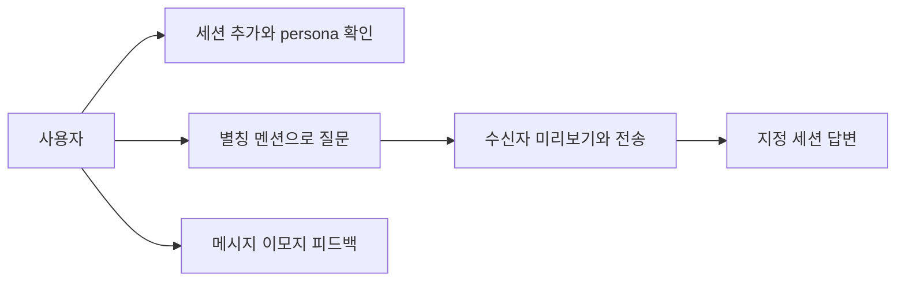
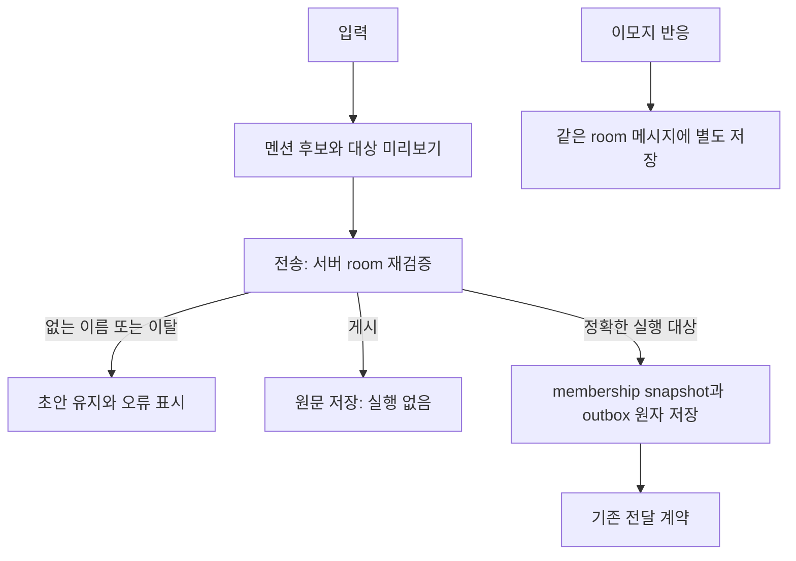
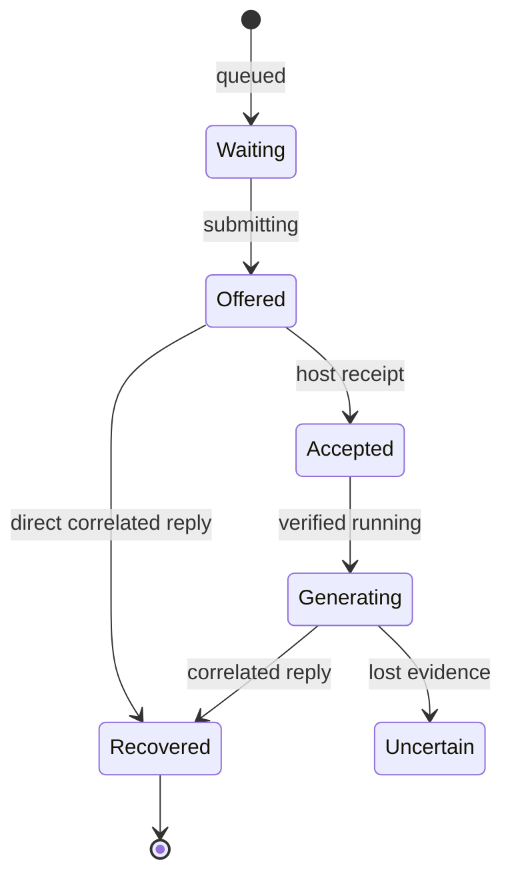
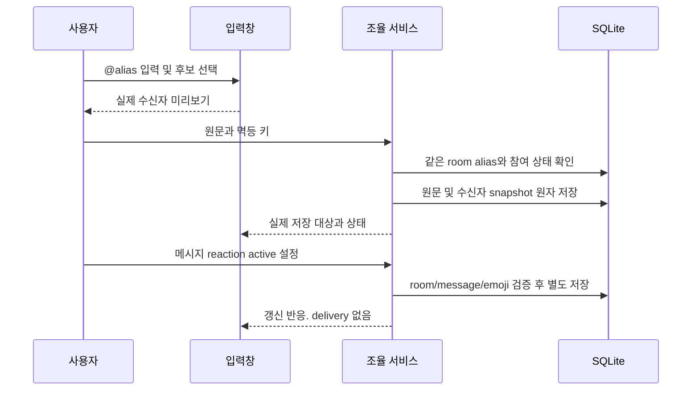
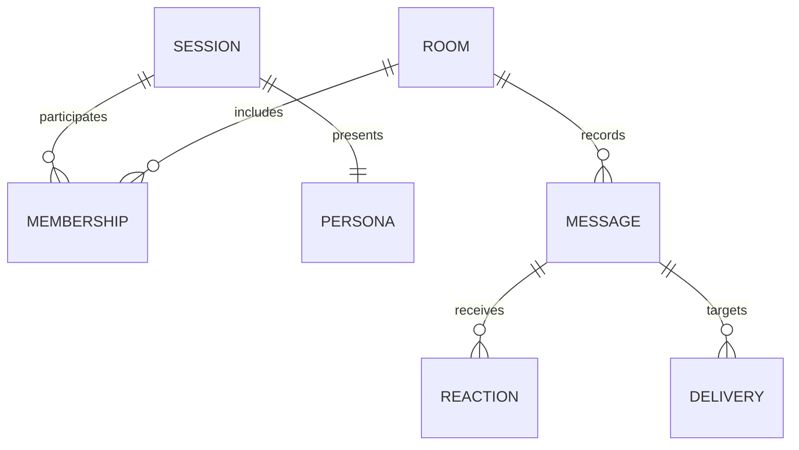
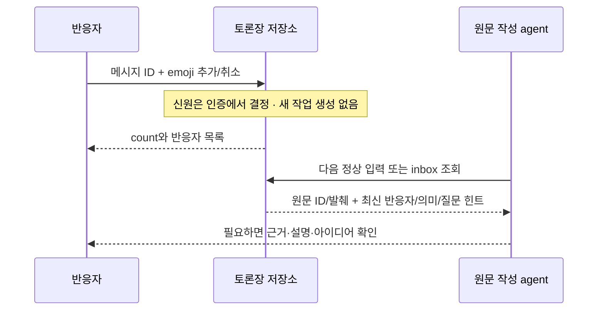

<!-- sr:plan
{"document_type":"decision","reader_questions":["세션을 어떻게 구별하는가","멘션은 누구에게 전달되는가","실행 중 표시의 근거는 무엇인가","이모지 반응은 무엇을 하는가"],"visual_plan":[{"kind":"decision_matrix","content":"드롭다운과 별칭 멘션 비교","required":true},{"kind":"flowchart","content":"멘션 해석과 고정 수신자 저장","required":true},{"kind":"state_diagram","content":"관측된 응답 상태 표시","required":true},{"kind":"sequence_diagram","content":"입력과 서버 재검증","required":true},{"kind":"er_diagram","content":"세션 persona와 메시지 반응","required":true}],"visual_waiver":[]}
-->

# 세션 페르소나·멘션·이모지 반응

> 세션을 사람처럼 구별하고 @별칭으로 정확히 지정하되, 원래 신원과 전달 증거는 보존한다.

## 한눈에 보기

- 목적: 대상 드롭다운을 기억하기 쉬운 별칭·프로필·멘션으로 바꾸고 메시지 피드백을 가볍게 남긴다.
- 현재 상태: 초기 AC-1~AC-7 및 반응 피드백 후속 RF-1~RF-4 구현·실행 검증 완료. 현재 전체 테스트67개 통과. 원래 프로젝트 전체 상태는 building이다.
- 핵심 결론: 식별 가능한 사용자·agent 반응을 저장하고 원문 작성 agent의 다음 입력에 의미와 반응자를 전달한다. 반응 자체는 실행·공식 승인을 만들지 않는다.
- 원인 또는 판단 근거: 기존 앱은 display_name과 provider를 텍스트로 표시하고 별도 대상 드롭다운·체크박스를 사용한다. 반응 테이블이 없고 delivery state가 이미 존재한다. 직접 코드 확인, 2026-10-22.
- 결정: provider는 작은 보조 배지로 먼저 표시한다. provider별 아바타 강제 구분과 실제 모델명 노출은 후속 검토한다.
- 다음 행동: 현재 별칭·provider 배지 표현을 사용해보고, 원래 남아 있는 host 자동 연결 어댑터를 이어 개발한다.
- 최종 갱신: 2026-10-23, Asia/Seoul.

최초 구현 당시의 분리 수신 버튼·무멘션 전체 전달 정책은 아래 역사 기록에 남아 있다. 현재 멘션·좌장 라우팅은 [[mention-routing]], 현재 반응 정책은 §13이 우선한다.

## 1. 의도 (Intent)

사용자가 추가하는 세션에 지수·민수·유리아·알렉스 같은 기억하기 쉬운 이름과 로컬 아바타를 임의 배정한다. alias는 표현용이며 provider/host/native ID/cwd/profile과 runtime binding은 바꾸지 않는다. 기존 세션도 한 번 배정하고 재등록·앱 재시작·다른 room에서 유지한다. 외부 아바타 서비스는 사용하지 않는다.

최초 범위는 사용자 UI와 로컬 저장·검증이었다. §13 후속에서 인증된 참여자와 좌장 반응·다음 입력 피드백을 확장한다. 모델 자동 wake·provider lifecycle은 별도 후속이다.

## 2. 수용 기준 (Acceptance)

| ID | 사용자에게 보이는 결과 | 검증 방법 |
|---|---|---|
| AC-1 | 신규·기존 세션마다 유일한 지속 alias와 아바타가 생기고 카드·대화·수신자 표시가 일치한다. 원래 이름·provider는 보조 정보다. | SQLite 기존 DB migration/reopen·동일 신원 재등록·중복 방지 테스트, 실제 UI |
| AC-2 | 입력의 정확한 @alias 한 개 또는 여러 개로 대상이 한정되고 제안 목록·대상 미리보기를 볼 수 있다. 대상 드롭다운은 제거한다. | 한국어·영문·중복·오타·이탈자·email/code/escape 테스트 및 실제 입력 경로 |
| AC-3 | 서버가 room 멤버십으로 멘션을 다시 검증하고 membership snapshot만 저장한다. 모르는 이름·모호함은 전송 차단, 전체로 대체 금지. 게시/실행은 구분한다. | HTTP room scope·잘못된/이탈 대상·멱등 재접수 테스트. 멘션 파싱 자체로 모델 호출 없음 |
| AC-4 | 카드에 실제 running 근거일 때만 생성 중 테두리가 움직인다. queued/submitting/accepted/unknown은 별도 문구, 완료 시 종료한다. | 상태별 렌더링·격리 UI fixture, reduced-motion 정적 테두리 확인. fixture를 실제 모델 실행 증거로 보고하지 않음 |
| AC-5 | 메시지의 미니 이모지 반응을 추가·해제하고 새로고침 후 유지한다. 반응으로 deliveries가 생기지 않는다. | DB/HTTP idempotent set·cross-room/미지원 emoji 거부·기존 메시지 보존, 브라우저 토글/재로드 |
| AC-6 | 1280 폭·800 높이 이하와 1440×900에서 프로필·대화·입력이 보이며 키보드 멘션 선택과 polling 중 초안이 유지된다. | 실제 브라우저 1280×720·1440×900 및 입력·제안 선택·polling·스크린샷. 720은 계획한 800보다 낮은 높이 |
| AC-7 | 좌장에게 보내기를 선택하면 실제 좌장 프로필을 미리 보여주고, 그 한 세션만 취합·중재 요청을 받는다. 좌장 없음·모호함·읽기 전용이면 차단하고 전체로 대체하지 않는다. | role 변경 전후 멱등 snapshot·store/HTTP 테스트, 격리 UI 선택·전송·좌장 부재 안내. 본문 멘션은 좌장에게 전달할 참고이며 다른 대상에 배포하지 않음 |

## 3. 확정 사실 (Facts)

| 관측 | 근거 | 경계 |
|---|---|---|
| 기준 커밋은 65df471, 새 기능 브랜치는 feat/session-personas다. | git status/branch/worktree, 2026-10-22 | 기존 작업 트리 clean |
| sessions.display_name, room memberships와 delivery state가 있다. | services/coordinator/store.js | alias는 별도 필드로 추가 |
| HTTP는 Host/Origin/CSRF와 room-scoped output을 사용한다. | services/coordinator/server.js | 반응도 기존 브라우저 인증을 사용 |
| 현재 provider 자동 wake와 start/reply adapter가 없다. | [[session-room-runtime-validation]] | VFX는 없는 실행 증거를 만들지 않는다 |

### 평가기준

기억하기 쉬운 표현, 정확한 수신자, 기존 데이터 이관, 실행 상태의 정직성을 우선한다. provider 배지는 보조 정보로 두며 작은 UI 피드백이 실행 요청을 만들면 안 된다.

### 선택지

기존 드롭다운 유지, 표시 문자열 파싱, 영속 alias를 사용하는 세 가지 대안을 비교한다.

### 비교

| 대안 | 기억하기 쉬움 | 잘못된 대상 방지 | 저장/이관 | 판단 |
|---|---|---|---|---|
| 기존 대상 드롭다운 | 낮음 | 명시 ID | 기존 | 주 UI에서 제거 |
| 표시 문자열만 @파싱 | 높음 | 이름 변경·충돌에 취약 | 없음 | 사용하지 않음 |
| 영속 alias와 서버 재검증 | 높음 | room ID snapshot·검증 | additive migration | 채택 |

### 결정

영속 alias·로컬 아바타·서버 멘션 재검증을 채택한다. provider는 작은 배지로 보조하고 반응은 별도 저장한다.

## 4. 유스케이스 (Use Cases)

사용자는 채널의 토론에 세션을 추가하고 아바타·alias로 구분한다. @ 입력 시 멤버 후보를 선택해 질문한다. 여러 멘션은 여러 수신자로 고정한다.

멘션 없는 실행 요청은 화면에 보이는 참여 가능 대상 전체로 표시하고, 게시 모드는 실행하지 않는다. 👍 등 반응은 발언의 가벼운 피드백이다.

취합·중재는 명시적인 ‘좌장에게’ 수신 모드로 맡긴다. 실제 좌장 alias와 프로필을 미리 보여주고, 본문의 다른 멘션은 좌장에게 전달할 참고로 보존한다. 이 모드에서 다른 멤버에게 요청을 추가 배포하지 않는다.

## 5. 구조와 처리 흐름 (Flow)

멘션은 정확한 token을 사용한다. email·escaped @·inline/fenced code는 실행 멘션으로 취급하지 않는다. 중복 멘션은 한 명으로 합친다.

모르는 이름이 있으면 일부만 보내지 않는다. 원문과 실제 수신자는 별도로 보존한다. 멱등 키로 재접수한 요청은 원래 저장 snapshot을 유지해야 한다.

| 수신 모드 | 서버가 저장하는 실제 대상 | 실패 조건 |
|---|---|---|
| 참여자에게 | 정확한 멘션 대상. 멘션 없으면 참여 가능한 전체 | 알 수 없음·빈 멘션·이탈·읽기 전용 |
| 좌장에게 | 현재 활성 좌장 한 명 | 좌장 부재·모호함·읽기 전용. 전체로 대체하지 않음 |

좌장이 바뀌어도 같은 멱등 키의 재접수는 원래 좌장 snapshot을 반환한다. 새 요청만 새 좌장을 대상으로 한다. 게시·알림은 두 수신 모드 모두 실행을 만들지 않는다. 좌장 수신 선택은 자동 wake나 중재 루프 구현과 구분한다.

## 6. 상태 전이 (State)

| 증거 | UI |
|---|---|
| queued/claimed | 대기/예약, 생성 효과 없음 |
| submitting/accepted | 요청 제공/호스트 접수, 생성 효과 없음 |
| running | 생성 중 테두리. reduced-motion이면 정적 표시 |
| completed | 응답 회수, 생성 효과 종료 |
| unknown/blocked | 확인 필요/차단, 생성 효과 없음 |

## 7. 타이밍 (Timing)

## 8. 데이터 (ER)

PERSONA는 sessions의 additive alias/avatar 필드로 저장한다. alias는 영속 unique이고 기존 display_name은 보존한다. REACTION은 message/user/emoji unique로 현재 한 명인 로컬 사용자의 반응을 idempotent set/remove한다. 브라우저 클라이언트가 발신 세션을 위조할 수 없고 reaction은 outbox를 만들지 않는다.

## 9. 변경 지점 (Change Surface)

| 경로 | 변경 |
|---|---|
| `services/coordinator/store.js` | persona migration·정확한 대상·반응 저장 |
| `services/coordinator/server.js` | 브라우저 멘션·반응 계약과 scope |
| `apps/desktop/` | 카드·message avatar·mention 입력·상태·반응 |
| `packages/contracts/` | 필요 시 순수 파서·표현 계약 |
| `tests/` | migration·routing·reaction·HTTP·상태 검증 |
| `docs/design/0002-session-personas.md` | (신규) 이 기능 명세 |
| `docs/session-personas.html` | (신규) 같은 본문의 로컬 열람본 |

## 10. 잠재 문제 (Risks)

| 위험 | 대응 |
|---|---|
| 이름 충돌/변경 | unique persistent alias, 부족하면 숫자 suffix. native identity와 별개 |
| 멘션 오타가 전체 문의로 확장 | 서버가 전체 전송 거부, 명확한 오류 |
| polling이 입력·선택을 덮음 | composer state 유지, 현재 room 응답만 적용 |
| 제공/접수 상태를 생성 중으로 오인 | running 근거만 VFX |
| 반응 더블 클릭/재시도 | 명시 active 상태 set, composite unique |
| 원래 진행 중인 세션에 UI 검증 메시지 | 격리 DB·브라우저 fixture 사용, 실제 provider 새 입력 없음 |

## 11. 착수 순서 (Slices)

- [x] Persona additive migration과 동일 identity 재사용 — AC-1.
- [x] 멘션 파서·서버 대상 snapshot과 UI 후보·미리보기 — AC-2, AC-3.
- [x] 별도 반응 저장·HTTP·UI 토글 — AC-5.
- [x] 카드·대화 프로필·실행 근거 VFX와 실제 브라우저 검증 — AC-1, AC-4, AC-6.
- [x] 좌장 전용 수신자 선택과 서버의 단일 좌장 snapshot·부재 차단 — AC-7.

### 재검토 조건

별칭 충돌이나 알 수 없는 멘션이 비대상 전달을 만들거나 상태 증거 없이 생성 효과가 켜지면 해당 경로를 수정한다. provider 표시는 사용자가 읽기 어렵다고 판단하면 배지·색상·정보 위치를 다시 조정한다.

## 12. 추적성 (Traceability)

| 기준 | 근거 파일 | 현재 판정 |
|---|---|---|
| AC-1 | tests/personas.test.js, 실제 DB 전후 hash | PASS: 옛 schema 이관·재열기·이관 후 신규 추가·신원 보존 |
| AC-2 | 공유 mentions.js, 실제 키보드 Enter 후보 선택·수신자 미리보기 | PASS |
| AC-3 | tests/store.test.js·tests/http.test.js·tests/personas.test.js, 격리 HTTP/UI 저장 | PASS: 오타·빈 @·읽기 전용·room 범위·멱등 snapshot |
| AC-4 | 격리 fixture running/accepted/unknown UI·CSSOM | PASS: renderer 범위. OS 모션 감소 emulation 및 실제 신규 모델 실행은 미실행 |
| AC-5 | storage/HTTP 및 실제 브라우저 반응 추가·재로드·해제 | PASS: 사용자 반응. delivery 생성 없음 |
| AC-6 | 1440×900·1280×720 실제 화면·초안 유지·기존 기능 보존 | PASS: 보내기 하단 890/710px, 가로 넘침 없음 |
| AC-7 | tests/personas.test.js·tests/http.test.js, 격리 UI와 현재 앱 | PASS: 좌장만 수신·다른 멘션은 참고·부재 안내·원래 snapshot 유지. 자율 중재 실행 아님 |

### 결과

자동화 테스트는 22/22 통과했다. 구형 DB의 컬럼 순서 차이를 위해 세션 INSERT에 컬럼 이름을 명시하고, 이관 뒤 신규 세션 추가까지 테스트했다. 현재 실제 세션은 수아·Claude와 마야·Codex로 표시된다.

기존 실제 sessions/messages/deliveries/decisions는 2/6/3/1로 유지됐고 canonical 내용의 전후 SHA-256은 5aeb6a8987a64d704153ef12a9eadc521589678612b45678243b92312a5337d4로 동일하다. 기존 이름·native ID·cwd·profile·원문·대상·결정은 바꾸지 않았다. 반응·멘션·생성 효과 테스트는 별도 DB에서 수행했고 실제 provider에 새 입력을 보내지 않았다.

근거는 로컬 docs/validation/personas.json과 docs/screenshots/personas-1440x900.png, personas-1280x720.png, personas-mentions.png에 있다. 생성 효과는 의도적으로 설정한 격리 상태로 검증했으며 실제 모델 실행 증거로 보고하지 않는다. 모션 감소는 CSSOM의 media query와 animation:none을 확인했고 OS 설정 변경은 하지 않았다.

초기 UI 변경에서 누락된 원래 출력·정책·소유권·좌장/발급/이탈·한도·discovery·결정 근거/확정 컨트롤을 복구했다. 독립 수용 검토에서 이 기능의 AC-1~AC-6을 확인했다. 전체 프로젝트의 자동 wake·기존 세션 연결 미완료 상태는 유지한다.

2026-10-22 후속: ‘참여자에게 / 좌장에게’ 수신 선택과 좌장 프로필 미리보기·전용 전송 버튼을 추가했다. 전체 테스트 23/23, 추가 부재·읽기 전용·모호함 사례가 포함된 targeted 검사 4/4를 통과했다. 격리 UI에서 @리아를 본문에 넣어도 좌장 수아 한 명에게만 요청이 저장됐고, 좌장이 없는 토론에서는 입력을 유지하며 지정 안내를 보였다. 1280×720의 보내기 하단은 710px이며 가로 넘침이 없다.

현재 앱에도 적용했다. 근거는 docs/validation/chair-routing.json과 docs/screenshots/chair-recipient.jpg다. 실제 provider에 새 요청을 보내거나 자동 중재 루프를 실행한 검증은 아니다. 기존 원문과 신원은 보존했고, 실제 앱에서 추가된 입력을 삭제하거나 기준 DB로 되돌리지 않았다.

## 13. 참여자 반응과 다음 입력 피드백

2026-10-23 사용자 요청에 따른 기존 반응 기능의 확장이다. 저장·표시 전용이던 반응을 식별 가능한 참여자 의견과 다음 입력 문맥으로 사용한다.

| 기준 | 사용자 결과 | 실행 검증 |
|---|---|---|
| RF-1 | 기본 순서는 👍 좋아요 → 👎 반대 → ❓ 모르겠음 → ✅ 확인(알았음) → 💡 아이디어 있음이다. emoji별 실제 사람 수와 이름·프로필·provider 목록을 확인한다. 사용자 토글은 다른 agent 반응과 독립이다. | 격리 브라우저 사용자/agent 혼합·목록 열기·취소·새로고침, 기존 초안/멘션 보존 |
| RF-2 | 참여자는 room_react MCP/helper로 본인 자격의 반응을 남기고 좌장은 구조화 응답으로 반응한다. | 실제 HTTP·stdio/helper의 신원/범위/이탈/읽기전용/멱등 검증, 좌장 잘못된 출력의 원자적 거부 |
| RF-3 | agent가 쓴 응답의 반응을 원문 ID·발췌·반응자·emoji·시각과 묶어 그 agent의 다음 inbox 입력 및 좌장 입력에 포함한다. | 입력 전 반응 변경/취소 반영, 자기 작성 메시지만 포함하는 제한된 최신 snapshot, 격리 실제 좌장의 피드백 수신·후속 발화 확인 |
| RF-4 | 반응 자체는 새 delivery·자동 실행·결정 확정을 만들지 않고 기존 본문/hash/native ID/기록을 보존한다. | 전체 회귀, 원래 DB snapshot·초안 대조, 추가 delivery 없이 반응만 저장 |

반응 actor는 서버가 인증한 session:<sessionId> 또는 기존 local-human으로 정하며 별칭/클라이언트 입력으로 신원을 만들지 않는다. 기존 reaction 행은 유지하고 표시 메타데이터를 조회 시 결합한다. 이탈자의 과거 반응은 표시하지만 새 쓰기는 차단한다.

반응 추가/취소 → 저장 → 다음 명시 입력에서 최신 snapshot 제공 순서다. 피드백은 의견 데이터이며 명령·찬반 투표의 공식 확정으로 해석하지 않는다. 반응별 해석과 필요한 질문은 아래 표를 따른다.

기존 ❤️ 공감·👀 확인 중은 과거 의미와 반응 기록을 유지하며 기본 선택지에서 제외한다. agent가 MCP inbox를 읽지 않는 기존 자동 wake 문제는 별도 후속이다.

구현·실행 검증을 완료했다. 원래 사용자 토론장에는 테스트 입력을 보내지 않았으며 실제 모델 검증은 별도 fixture의 Claude 좌장만 사용했다.

### 반응별 의미와 다음 차례

| 기본 순서 | 의미 | 받은 agent의 다음 입력에서 참고할 행동 |
|---|---|---|
| 👍 좋아요 | 응답에 대한 긍정 평가 | 현재 방향을 참고한다. 공식 결정 확정으로 취급하지 않는다. |
| 👎 반대 | 주장이나 접근에 대한 이견 | 이미 설명된 근거가 없다면 반응자에게 반대 이유를 묻는다. |
| ❓ 모르겠음 | 이해가 어렵거나 설명이 부족함 | 어느 지점인지 확인하고 설명을 보완한다. |
| ✅ 확인(알았음) | 수신 또는 이해 확인 | 동의·승인·작업 완료로 확대하지 않는다. |
| 💡 아이디어 있음 | 반응자가 제안을 가지고 있음 | 구체적인 내용이 없다면 해당 반응자에게 아이디어를 역질문한다. |

반응만으로 전달을 생성하지 않는다. 다음에 원래 입력이 들어왔을 때 최신 반응을 참고해 필요한 질문을 구성한다. 참여 agent는 인증된 현재 membership에, 사람에게는 좌장/agent 발화로 질문한다. 설명이 이미 대화에 있으면 중복 질문하지 않는다. 이탈·읽기 전용 반응자의 과거 의견은 볼 수 있으나 실행 대상으로 만들지 않는다.

### 실행 검증 결과

| 기준 | 관측과 근거 | 결과 |
|---|---|---|
| RF-1 | 실제4318 기본 순서 👍👎❓✅💡. 격리4320에서 💡2→사용자 추가3→사용자 취소2, 목록은 민수(Codex)·지수(Claude)·사용자 프로필을 구분. 마우스 및 Enter로 목록 열기/닫기 확인 | PASS |
| RF-2 | 실제 room_react HTTP·stdio·participant helper 요청. 신원 위조 입력과 무관하게 인증된 actor만 저장, 읽기전용·이탈·다른 room·emoji·boolean 검증. 잘못된 좌장 반응 출력은 발화·질문·반응 모두 취소 | PASS |
| RF-3 | 실제 Claude 좌장이 민수의 틀린 주장에 👎. 그 좌장 응답에 사용자는 ✅, 민수는 💡. 다음 turn에서 ✅를 수신 확인으로 해석하고 민수 한 명에게만 아이디어 질문. 실제 peer inbox에도 자기 발언의 👎 피드백 포함 | PASS |
| RF-4 | npm test67/67, 최신 반응 취소·자기 작성 메시지 필터·본문 및 실제 payload_hash 보존·이전 ❤️👀/이탈자 표시·추가 delivery 없음. 4318 재시작·연결 복구와 미전송 초안 보존, 원래11개 테이블 전후 SHA 동일 | PASS |

검증 중 첫 좌장 응답에서 session ID와 membership ID를 비교해 신원 불일치로 잘못 해석하는 사례를 관측했다. participants.sessionId와 메시지의 senderSessionId·senderMembershipId·senderAlias를 함께 제공하도록 보완했고, 같은 실제 native 대화의 추가 turn에서 민수의 신원이 일치함과 새 질문0개를 확인했다.

실제 모델 범위는 새로 만든 별도 Claude 좌장 하나, 초기화1회와 요청3회다. 민수·지수는 MCP/helper를 검증하는 가상 협력 membership이며 Codex·Claude 두 모델이 실제로 반응했다고 주장하지 않는다. 기존 참여자는 MCP inbox를 읽을 때 다음 피드백을 받으며 자동 wake는 별도 후속이다. 의견 반응에 따라 늘 재질문하도록 강제하지 않고, 이미 설명된 내용은 반복하지 않도록 문맥 지침을 전달한다.

반응 feedback은 최신20개 행, 원문 발췌240자로 제한한다. actor와 원문 ID를 유지하고 기존 본문/hash에 합치지 않는다. 원래11개 테이블의 SHA-256은 `9a5d07bb14c6aeed2bd3fa732f542a3ddf6582a9690e27ecaf15fe0a37f0bb5f`로 일치했다.

독립 수용 검토: RF-1~RF-4 PASS. 검토자는 구현과 실행 근거를 대조했으며 실제 좌장과 가상 peer membership의 검증 범위를 구분했다.

- [검증 JSON](validation/reaction-feedback.json)
- [반응자 목록 화면](screenshots/reaction-roster.jpg) · [실제 앱 순서](screenshots/reactions-main.jpg)

## 14. 좌장 중앙 정렬과 세션 색상

2026-10-23 사용자 요청에 따라 이모지 버튼의 hover 툴팁은 이름만 표시한다. 상세 의미는 반응자 목록과 agent 피드백 문맥에 유지한다. 반응자 숫자 버튼의 이름 목록은 그대로 제공한다.

토론장의 참여자 응답은 왼쪽, 사용자 입력은 오른쪽, 좌장 발화·질문·정리 응답은 중앙에 배치한다. 본문과 작성자 프로필은 각 응답 박스 안에서 왼쪽부터 읽힌다. 응답 너비 제한은 유지한다.

이미 저장된 session avatar 색상을 공통 색원으로 사용해 상단 프로필 카드와 해당 세션의 응답 배경·테두리를 일치시킨다. 어두운 기본색에 색상을 혼합해 본문 대비를 유지하며, 새로고침·다른 토론장에서도 같은 세션의 색원이 유지된다. 생성 중 테두리 효과는 기존 상태 의미를 유지한다.

실제 4318 브라우저 1280×720에서 좌장 응답 8개의 양쪽 여백 일치, 사용자 오른쪽 및 참여자 왼쪽 정렬, 프로필 3개의 응답 배경색 일치, 기본 툴팁 5개 이름만 표시, 가로 넘침 없음 확인. 기존 메시지를 읽어 검증했으며 새 테스트 메시지나 모델 요청은 보내지 않았다. 관련 레이아웃·마크다운 회귀 테스트 9/9 및 app.js 구문 검사를 통과했다.

- [표시 검증 JSON](validation/conversation-persona-colors.json)
- [프로필과 좌장 응답 화면](screenshots/conversation-persona-colors.jpg)

## 참고

- [[session-room-foundation]] — 원래 세션 신원과 전달 불변식.
- [[session-room-runtime-validation]] — 실행판 검증 범위.
- [[inter-session-index]] — 프로젝트 진입점.
