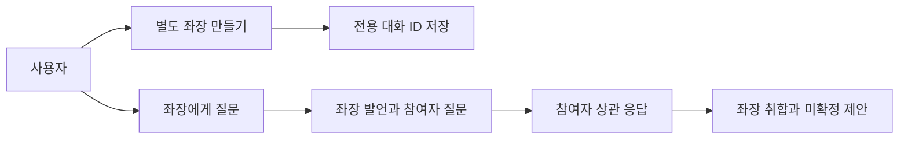
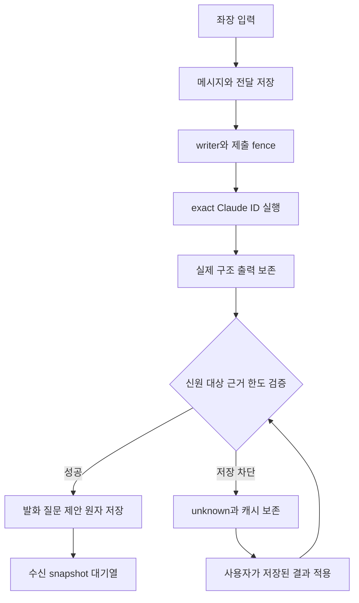
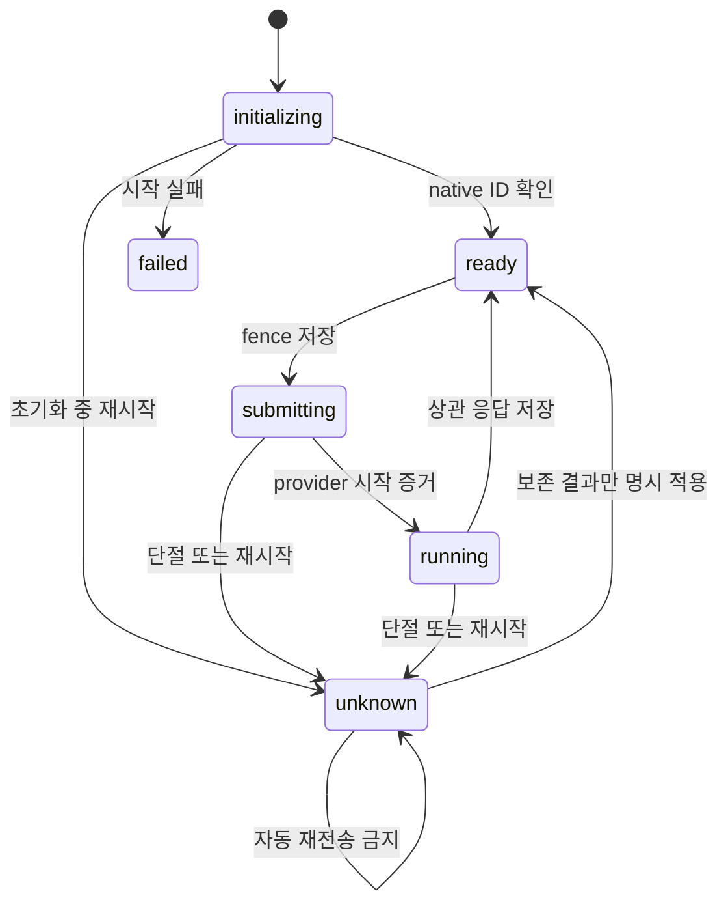
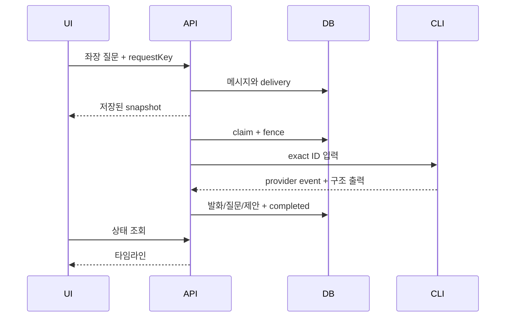
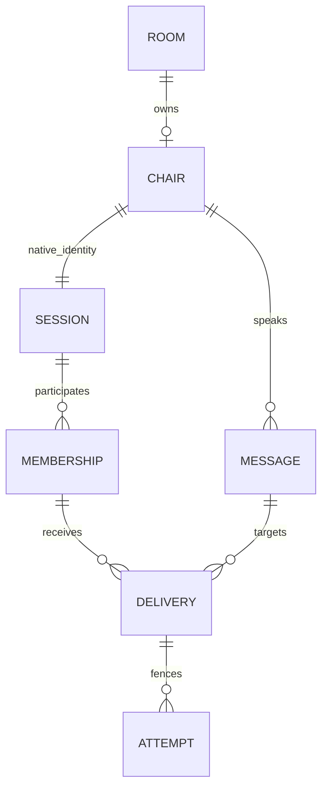
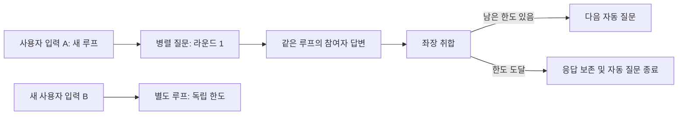

<!-- sr:plan
{"document_type":"decision","reader_questions":["좌장이 실제로 분리되는가","발언이 어디 남는가","재시작 오류를 어떻게 복구하는가"],"visual_plan":[{"kind":"comparison_table","content":"관측과 변경","required":true},{"kind":"flowchart","content":"좌장 실행과 실패","required":true},{"kind":"state_diagram","content":"실행 상태","required":true},{"kind":"sequence_diagram","content":"제출과 영속화","required":true},{"kind":"er_diagram","content":"좌장 소유권","required":true}],"visual_waiver":[]}
-->

# 별도 좌장과 연결 복구

> 참여 세션과 다른 전용 좌장을 만들고, 발언·인증·화면의 사용자 경로를 닫는다.

## 한눈에 보기

- 목적: 초대된 참여자를 좌장으로 승격하던 구현을 별도 LLM 좌장으로 바로잡는다.
- 현재 상태: 이 후속 수정의 AC-1~AC-5 완료. 실제 전용 좌장·두 참여자 응답·취합, 테스트 38개, 인증 복구와 두 폭 렌더링을 확인했다. 프로젝트 전체는 building이다.
- 핵심 결론: room별 앱 소유 Claude 대화, 구조화된 질문/요약, 영속 타임라인을 사용한다.
- 원인 또는 판단 근거: 역할만 변경하는 Store.role, 결정만 저장하는 Store.result, 재시작마다 바뀌는 인증과 일회 bootstrap을 코드에서 확인했다. 직접 확인, 2026-10-22.
- 결정: 설치된 Claude CLI를 도구 없는 전용 좌장으로 실행하고 정확한 ID만 resume한다. 기존 참여자 자동 wake는 별도 어댑터 범위다.
- 다음 행동: 기존 외부 세션의 자동 wake·busy/draft 보호·원래 host 응답 대조를 이어 구현한다.
- 최종 갱신: 2026-10-22, Asia/Seoul.

## 1. 의도 (Intent)

사용자는 처음부터 참여자를 취합·중재할 별도 좌장 세션을 요구했다. 기존 참여자 역할 지정 UI가 그 요구를 충족하지 못했음을 바로잡는다. 현재 요청은 별도 좌장, 좌장 입력 표시, 인증/연결 오류 복구, 메신저 정렬이다. 기존 메시지·원래 native ID·권한·미확정 결정을 보존한다. 기존 세션을 임의 종료하거나 불확실한 제출을 재실행하지 않는다.

전용 좌장은 Claude CLI의 새 session ID와 독립 작업 위치를 사용하며 도구/MCP/프로젝트 훅을 끈 조율 전용 실행이다. 새 요청만 처리하고 과거 대기열을 새 좌장으로 옮기지 않는다. Claude 선택은 이번 실행 가능한 좌장 구현이며, 참여자의 provider 제한을 바꾸지 않는다.

## 2. 수용 기준 (Acceptance)

| ID | 사용자에게 보이는 결과 | 검증 방법 |
|---|---|---|
| AC-1 | 별도 좌장 생성/상태가 있으며 초대된 두 세션과 다른 native ID가 영속된다. 이전 참여자는 유지된다. | 실제 CLI 초기화·ID 비교·다음 입력의 exact resume·재시작 후 ID 유지 |
| AC-2 | 좌장 발화·참여자 질문·결정 제안이 공용 타임라인에 남고 실제 sender/원문/근거가 연결된다. | 실제 좌장 질문→수신 snapshot→상관 응답→취합, DB 순서와 UI 대조 |
| AC-3 | 서버 재시작 뒤 화면이 자동 재인증하며 초안은 유지된다. 네트워크 실패는 연결 안내로 표시하고 동일 메시지 재접수는 멱등이다. | 실제 브라우저 열린 채 서버 재시작/일시 정지·복구·보존 확인, HTTP Host/Origin/CSRF 회귀 |
| AC-4 | 앱은 전체 창 폭을 사용하며 메시지 버블만 최대 720px로 제한한다. 사용자/좌장은 오른쪽, 참여자는 왼쪽이다. 상단 첫 행은 좌장+토론 정리, 둘째 행은 참여 세션이며 프로필에는 provider 아이콘을 표시한다. | 실제 1280×720 브라우저 및 1600×1000 iframe CSS viewport의 경계 측정과 스크린샷. 넓은 검증은 동일 앱/API의 읽기 전용 프록시이며 창 override 성공으로 보고하지 않음 |
| AC-5 | pause/archive/한도·writer fence·unknown 재전송 금지가 좌장 실행에도 적용된다. | 격리 storage/runner/HTTP 실패·재시작 테스트, 기존 데이터 보존 대조 |

## 3. 확정 사실 (Facts)

| 관측 | 근거 |
|---|---|
| role API는 초대 membership 중 한 명만 chair로 지정했다. | services/coordinator/store.js, d79a63b |
| result는 decisions와 sources만 기록했다. 질문은 room_request로 별도 남겨야 했다. | Store.result/post, d79a63b |
| secret/CSRF는 매 시작 새 random, 화면 req는 인증 갱신이 없었다. | server.js/app.js, d79a63b |
| Claude CLI는 print/stream-json/json-schema/tools/session-id/resume/safe-mode/strict-mcp-config 옵션을 제공한다. | 설치 CLI --help 직접 확인, 2026-10-22 |
| 최신 사용자의 실제 질문과 두 queued 전달이 존재한다. 과거 6개 메시지로 DB를 복원하면 안 된다. | 현재 브라우저 7개 메시지, 직접 확인 |
| 포트가 달라도 같은 host/path 쿠키는 덮어쓸 수 있었다. 현재 포트별 이름과 재인증으로 분리했다. | 4318/4320 동시 브라우저 접속, 오류 없음 |
| 별도 좌장 유리아는 cc814236-53b6-4612-a4cf-79b111feb2f3이며 초대된 두 native ID와 다르다. | 실제 Claude session_id, SQLite chairs/sessions, 직접 확인 |
| 좌장 실행 3건과 전달 10건이 completed다. 작업 성공 여부와 사용자 결정 확정은 별개다. | docs/validation/dedicated-chair.json, 직접 측정 |
| 기존 세션 2개·원문 7개·결정 1개·근거 4개의 기존 필드는 그대로다. | 변경 전 snapshot과 ID/필드 대조. 역할과 queued→completed는 의도한 변경 |

### 선택지

기존 참여자에게 역할만 붙이는 방식과 앱 소유의 별도 좌장을 비교했다.

### 평가기준

독립 native ID, 초대 세션의 역할 보존, 상관 응답과 원문 추적, 재시작 시 중복 실행 방지가 기준이다.

### 비교

| 방식 | 독립 신원 | 기존 참여자 보존 | 실행 추적 |
|---|---|---|---|
| 참여자 역할 승격 | 없음 | 좌장과 참여자 역할 혼합 | 같은 대화에 혼합 |
| 별도 앱 소유 좌장 | 별도 ID | 참여자는 참여자로 유지 | 전용 writer와 attempt |

### 결정

별도 Claude 좌장을 선택했다. 사용자 입력과 참여자 응답은 현재 room의 근거와 함께 같은 좌장 ID로 전달한다.

## 4. 유스케이스 (Use Cases)

참여자 질문은 공용 대화에 먼저 영속된다. 기존 외부 세션은 협력 inbox 방식이며 자동 wake 증거가 없으면 대기로 표시한다.

## 5. 구조와 처리 흐름 (Flow)

제출 전 attempt를 기록한다. CLI PID만으로 running을 만들지 않으며 provider stream 이벤트가 필요하다. 구조화 출력의 대상은 현재 room membership만 허용한다.

## 6. 액션·상태 전이 (State)

| 상태 | 저장·UI |
|---|---|
| initializing | 전용 ID 및 생성 중 표시 |
| ready | 입력 가능 |
| submitting/running | 제출과 실제 모델 시작 구분 |
| unknown/failed | 사유 표시, 기존 입력 자동 반복 금지 |

## 7. 타이밍 (Timing)

CLI 실행은 150초와 2 MB로 제한한다. 실행 중 제출·시작은 delivery/run에, 좌장 신원 초기화는 chairs에 별도로 저장한다. timeout은 unknown이며 새 session 생성으로 대체하지 않는다. 브라우저 인증 갱신은 한 번만 공유하고 인증 거절이 확인된 요청만 재호출한다. 네트워크 중단 후 mutation은 자동 반복하지 않는다.

## 8. 데이터 모델 (ER)

좌장/실행 테이블은 추가 migration으로 만들고 기존 행은 보존한다. 메시지 sender_role snapshot으로 과거 발화의 정렬을 고정한다. 기존 좌장 제안은 출처 결정 링크가 붙은 타임라인에 투영하되 과거 원문을 수정하지 않는다.

## 9. 변경 지점 (Touchpoints)

| 경로 | 변경 |
|---|---|
| `services/coordinator/store.js` | 좌장·실행·결정 타임라인 및 migration |
| `services/coordinator/server.js` | 생성/복구 API, scheduler, 포트 쿠키 |
| `services/coordinator/chair.js` | 신규 조율기·직렬화·원자 결과 적용 |
| `adapters/claude/chair.js` | 신규 도구 없는 CLI adapter |
| `apps/desktop/app.js` | 좌장 생성·복구, 발화 정렬 |
| `apps/desktop/api-client.js` | 신규 인증·연결 클라이언트 |
| `apps/desktop/style.css` | 최대 폭·메신저 배치 |
| `tests/chair.test.js` | 신규 실행/한도/원본 보존 테스트 |
| `tests/chair-runner.test.js` | 신규 CLI 신원·timeout 테스트 |
| `tests/api-client.test.js` | 신규 인증·네트워크 불명 테스트 |

## 10. 잠재 문제 (Risks)

| 위험 | 처리 |
|---|---|
| CLI 인증/할당량 오류 | 실제 실패 사유, 새 세션 자동 대체 금지 |
| 프로세스 종료 시 응답 저장 불명 | unknown, 외부 실행 exactly-once 주장 금지 |
| 구조 출력의 다른 room 대상 | 원자 검증 후 반영 |
| 과거 역할 변경으로 좌우가 바뀜 | 새 발화 snapshot, 과거는 저장 당시 근거에 한해 투영 |
| 넓은 코드/긴 단어 | 버블 wrap, grid min-width 0. 앱 전체 폭, 메시지 최대 720px |
| 좌장 초기화 실패/중단 | 기존 신원을 보존한다. 초기화 자체의 재시도 UI는 후속이며 새 ID로 조용히 대체하지 않는다. |
| 모델은 완료했으나 한도로 저장 불가 | output_json 보존. 한도 조정 후 저장된 결과 적용은 모델을 재실행하지 않는다. |

### 재검토 조건

CLI 프로토콜·인증 정책이 바뀌거나 초기화 복구가 필요해지면 전용 adapter를 재검토한다. 기존 세션 자동 입력을 추가할 때에는 busy·초안·현재 turn·권한 정책 계약을 먼저 검증한다.

## 11. 착수 순서 (Steps)

- [x] 전용 좌장 저장·실제 세션 초기화 및 정확한 재개 (AC-1, AC-5)
- [x] 좌장 발화·질문·취합을 타임라인에 연결 (AC-2, AC-5)
- [x] 인증·연결 복구와 초안/멱등 보호 (AC-3)
- [x] 최대 폭·좌우 정렬 및 두 크기 UI 확인 (AC-4)
- [x] 실제 모델/실패 테스트, 기존 데이터 비교, Wiki/HTML 동기화 (AC-1, AC-2, AC-3, AC-4, AC-5)

## 12. 추적성 (Traceability)

| AC | 코드·실제 검증 | 결과 |
|---|---|---|
| AC-1 | 전용 세션 생성, 같은 ID의 질문/취합/재시작 후 답변 3건 | PASS |
| AC-2 | 질문 289f7d60, 응답 d912048e/74eea4d5, 취합 2f350e22, 결정 885a762f와 근거 6건 | PASS |
| AC-3 | 열린 화면에서 서버 중단→offline·초안 유지→새 secret으로 재시작→새로고침 없이 복구. 4320 동시 접속 | PASS |
| AC-4 | native1280×720에서 app1280·timeline232·composer bottom720. 실제 iframe1600×1000에서 app1600·버블720·timeline512·composer bottom1000. 두 폭 모두 가로 넘침 없음 | PASS |
| AC-5 | 38/38 테스트, 한도 실패 원자 rollback·캐시 적용·서버 재시작 unknown·writer fence, 원본 필드 보존 | PASS |

### 결과

첫 실제 좌장 질문은 기존 검증방의 요청 한도 6개에 걸려 저장이 차단됐다. 외부 모델의 생성은 이미 끝난 상태여서 unknown을 재실행하지 않았다. 정확한 native ID의 CLI transcript에서 해당 request ID가 담긴 입력과 StructuredOutput을 대조해 결과를 한 번 복구했고, UI에서 검증방 한도를 20으로 조정한 뒤 저장된 결과 적용을 실행했다. 이후 코드는 모든 성공 출력의 output_json을 적용 전에 영속하고 같은 복구를 API/UI에서 수행한다. 질문 원문·수신자 두 명·응답·취합 모두 SQLite와 화면에서 확인했다.

참여자 두 세션은 사용자가 승인한 검증용 세션이다. 두 세션의 inbox 소비는 검증자가 Orca로 한 번씩 요청했고, 그 뒤 별도 좌장의 취합은 앱이 자동 실행했다. 따라서 기존 임의 세션의 무인 wake가 구현됐다는 뜻은 아니다.

### 화면·인증 근거

- [1280×720 실제 브라우저](screenshots/chair-panel-1280.jpg): 입력창 유지, 가로 오버플로 없음.
- [1600×1000 실제 iframe](screenshots/chair-panel-1600.jpg): 같은 production 앱/API를 GET 전용 프록시로 렌더링. app은 창 전체 1600px, 버블 최대720px, 사용자·좌장 오른쪽/참여자 왼쪽. 상단은 좌장·정리/참여 세션 2단이다. 1920px 창 테스트로 보고하지 않는다.
- [실행·보존 근거](validation/dedicated-chair.json): 3개 completed 좌장 실행, 10개 completed 전달, 원래 자료 필드 비교.
- 독립 읽기 전용 검토: AC-1~AC-5 PASS. 초기화 실패 재시도 UI는 후속 한계로 남긴다.

### 상단 패널과 너비 해석 정정

사용자는 앱 전체가 아니라 각 agent 응답의 읽기 폭을 제한하라는 뜻이라고 명확히 했다. 따라서 이전 전체1440px 제한을 제거하고, 버블720px 제한만 유지한다. 좌장은 상단 첫 행 맨 왼쪽에 독립 카드로, 그 오른쪽은 최신 토론 정리로 구성한다. 둘째 행에는 참여 세션만 표시한다. 이전 정리·근거 링크·사용자 확정은 상단에서 계속 제공하고, 세션 상세는 카드 또는 상세 버튼으로 열고 닫는다.

| 항목 | 현재 동작·검증 |
|---|---|
| Provider | 사용자 C:/Users/jhjang/Documents/icons의 투명 PNG를 로컬 정적 에셋으로 복사. Codex는 white256, Claude·Antigravity는 기본 icon256. 후속 [[resizable-panels]]에서 배경·테두리 제거. Claude·Codex·Antigravity 허용 목록. 외부 이미지 요청 없음 |
| 프로필 배지 | 참석자/좌장 카드, 발언, 멘션 후보와 수신자 칩에 provider 아이콘. 실제 참석자 3개 모두 로딩 확인 |
| 정리 | 최신 제안 먼저, 이전 정리와 근거 접기/펼치기. polling 후 열린 상태 유지 |
| 동작 보존 | 세션 native ID 상세 열기/닫기, @마야 키보드 선택, 기존 확정 버튼과 원문 링크 확인. 새 모델 호출 없음 |
| 검증 | docs/validation/chair-panel.json. 기존 38개 테스트 통과, PNG Content-Type/시그니처와 미허용 에셋404 검증 포함 |

후속 [[resizable-panels]]에서 정리 본문의 38px cap을 제거하고 패널 조절·저장·확대와 채널/토론장 이름 변경을 추가했다. 테스트는 42개이며 docs/validation/resizable-panels.json에 현재 근거가 있다. 위의 chair-panel 증거는 이전 e548276 시점 기록이다.

## 사용자 요청별 자동 대화 한도 (2026-10-23)

토론장 전체의 질문·전달 누적값을 사용해 정상 입력이 차단되던 버그를 수정했다. 기존 검증 결과의 ‘한도 초과 → unknown → 한도 증액 후 적용’은 역사 기록이며 현재 정책은 아래가 우선한다.

| 항목 | 수정된 동작 |
|---|---|
| 집계 범위 | 사용자 입력마다 새 루트. 사용자가 이전 메시지에 답장해도 새 루트이며, 자동 질문·참여자 답변·자동 취합은 reply_to 계보로 같은 루트를 유지 |
| 자동 라운드 | 자동 질문의 인과 깊이를 센다. 같은 좌장 응답에서 여러 참여자에게 병렬 질문하면 한 라운드 |
| 전달 수 | 해당 루프의 직접 전달·자동 질문·자동 취합 전달만 계산. 다른 사용자 입력과 토론장의 과거 기록은 제외 |
| 한도 도달 | 유효한 좌장 응답과 제안은 보존하고 추가 질문 묶음만 중단한다. 시스템 안내를 남기고 실행을 completed로 종료해 writer를 해제 |
| 취합 | 동일 루프의 답변과 대기 상태만 확인한다. 다른 루프의 대기 때문에 막거나 재취합하지 않으며, 전달 예산이 소진되면 추가 모델 호출 없이 안내로 종료 |
| 기존 오류 복구 | 저장된 output_json이 있고 오류가 과거 질문/요청 한도 초과인 unknown만 재검증·적용. 원래 모델 결과와 메시지·hash 보존, 재호출·자동 재전송 없음 |
| 실제 불명 실행 | 통신 중단·신원/출력 검증 실패 등 기존 unknown은 자동 해제하지 않는다. 실제 실행과 writer fence 보호 유지 |

기존 reply_to·provenance·sender_session_id를 사용해 계보를 계산한다. DB 스키마나 과거 본문·payload_hash를 변경하지 않는다. 제시된 수신자와 원문을 검증한 뒤 질문 묶음을 원자 적용하며, 제한되는 질문을 일부만 배포하지 않는다.

검증: 전체 75/75 통과. 병렬 질문·교차 사용자 루프·최종 취합·전달 예산 소진·새 입력·MCP offered 입력 계보·DB 재열기·원래 hash·멱등 복구·진짜 unknown 보호를 확인했다. 실제 DB 복사본과 4318 원본 각각에서 기존 한도 오류 1건을 completed로 복구했고 기존 메시지 24개·저장된 모델 출력은 보존했다. 필요한 응답/질문 3개만 새로 기록했고 모델 호출 0회·배포 후 추가 좌장 실행 0건·좌장 unknown 0건이었다. 원래 한도 설정은 그대로 유지했다. 실제 브라우저에서 사용자 초안을 보존하며 입력 미리보기 차단 해제와 요청별 한도 안내를 확인했다.

- [실행·복구 근거](validation/dialogue-loop-budget.json)
- [요청별 한도 화면](screenshots/dialogue-loop-budget.jpg)

관련: [[inter-session-index]], [[session-room-foundation]], [[session-personas]], [[resizable-panels]].

