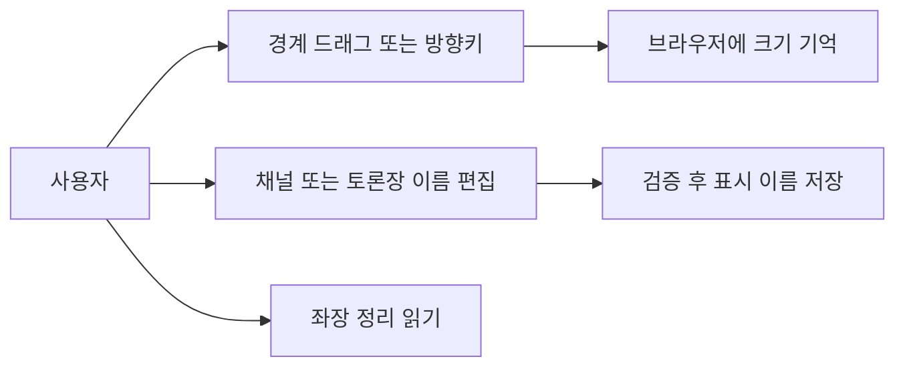
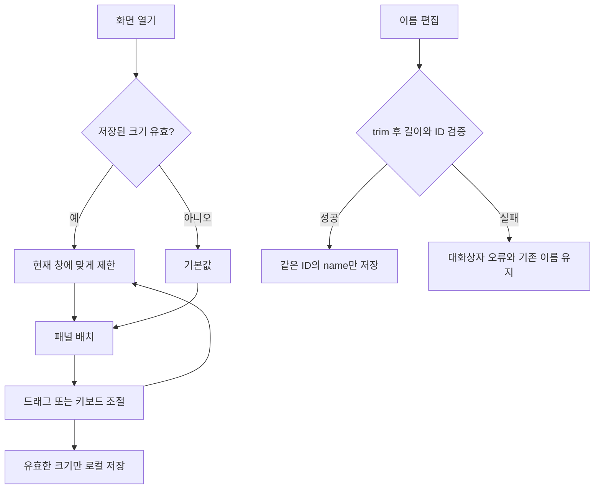
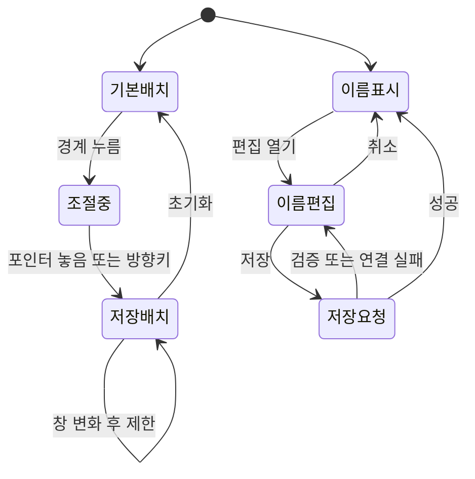

<!-- sr:plan
{"document_type":"decision","reader_questions":["무엇을 조절하는가","이름을 바꿔도 기록이 유지되는가","어떻게 검증했는가"],"visual_plan":[{"kind":"comparison_table","content":"수용 기준과 검증","required":true},{"kind":"flowchart","content":"크기 저장과 이름 변경","required":true},{"kind":"state_diagram","content":"조절과 편집 상태","required":true}],"visual_waiver":[]}
-->

# 조절 가능한 패널과 이름 변경

> 좌장 정리를 읽을 공간을 확보하고, 화면 구획과 채널·토론장 표시 이름을 사용자가 조절한다.

## 한눈에 보기

- 목적: 작은 좌장 정리 영역과 고정 분할 때문에 생기는 읽기 불편을 해결한다.
- 현재 상태: 구현 중. 사용자 요청으로 범위를 확정했으며 실행 검증 뒤 완료 상태로 전환한다.
- 핵심 결론: 화면 배치는 브라우저 설정으로, 이름은 기존 ID의 영속 메타데이터로 관리한다.
- 결정: 투명 원본 아이콘, 브라우저별 패널 크기 저장, ID를 유지하는 이름 변경을 사용한다.
- 판단 근거: 기존 CSS의 정리 본문 최대 높이 38px와 제공된 PNG의 투명 alpha를 직접 확인했다. (직접 확인, 2026-10-22)
- 다음 행동: 드래그·키보드·새로고침·이름 변경을 실제 브라우저에서 확인한다.
- 최종 갱신: 2026-10-22, Asia/Seoul.

## 1. 의도 (Intent)

좌장 프로필 옆 정리를 편하게 읽고, 화면과 작업 단위의 표시 이름을 사용자가 관리한다. 사용자가 요청한 아이콘 개선·크기 조절·이름 변경을 이번 범위로 확정했다.

불변식: 앱은 창 전체 폭을 사용한다. 개별 메시지 버블만 최대 720px다. 좌장과 사용자 발화는 오른쪽, 참여자는 왼쪽이다. 기존 native ID·room/channel ID·메시지·결정·수신자·권한을 유지한다. 조절이나 이름 변경은 모델 입력을 보내지 않는다.

비목표: 채널 삭제·권한 관리·참여자 별칭 변경·다른 PC와 레이아웃 동기화는 포함하지 않는다.

## 2. 수용 기준 (Acceptance)

| ID | 사용자에게 보이는 결과 | 검증 방법 |
|---|---|---|
| AC-1 | provider 표시는 검은 배경 타일 없이 투명 또는 흰색 원본을 사용한다. | 원본 alpha/해시, HTTP 이미지, 프로필·메시지·멘션·수신자 화면 확인 |
| AC-2 | 구획 경계에서 폭·높이를 드래그 또는 방향키로 조절하고 새로고침 후 유지하며 초기화할 수 있다. | 실제 포인터·키보드·재접속, 잘못된 저장값·창 크기 제한 단위 테스트 |
| AC-3 | 좌장 프로필 옆 정리가 여러 줄로 읽히고 참여자는 다음 행에 유지된다. 채팅과 입력창도 남는다. | 1280×720과 좁은/넓은 CSS viewport의 경계·넘침·스크린샷 확인 |
| AC-4 | 채널과 토론장 이름을 바꾸고 재접속해도 유지한다. 취소·유효하지 않은 이름은 기존 이름을 보존한다. | 실제 별도 fixture UI, Unicode/공백/초과/없는 ID·재오픈과 참조 보존 테스트 |
| AC-5 | 인증 복구·전달·기존 대화 기록 동작을 보존한다. | 기존 전체 테스트와 열린 브라우저에서 서버 재시작 확인 |

## 3. 확정 사실 (Facts)

| 관측 | 근거 |
|---|---|
| 좌장 정리 본문에 max-height 38px가 적용됐다. | apps/desktop/style.css의 마지막 규칙, 직접 확인 |
| 제공된 세 provider PNG에 투명 alpha 0~255가 있다. | 원본 codex-icon-white-256, claude-icon-256, antigravity-icon-256의 RGBA·모서리 alpha=0, 직접 확인 |
| 기존 아이콘 CSS도 어두운 배경과 테두리를 추가했다. | .provider-icon background/border, 직접 확인 |
| 이름 생성의 한도는 channel 80, room 120자다. | Store.createChannel/createRoom, 직접 확인 |
| 인증과 CSRF는 서버 재시작 때 갱신된다. | server.js/API client와 기존 인증 복구 검증, [[dedicated-chair]] |

### 선택지와 평가기준

좌장 정리를 다시 우측 inspector로 옮길지, 현재 좌장 옆 배치를 조절 가능하게 할지 비교했다. 읽기 공간, 사용자가 정한 상단 구성 유지, 창 폭 활용이 기준이다.

| 방식 | 읽기 공간 | 상단 구성 | 창 폭 활용 |
|---|---|---|---|
| 고정 작은 상단 | 두 줄로 제한 | 유지 | 고정 |
| 별도 우측 inspector | 넓어짐 | 정리 위치 변경 | 대화 폭 차감 |
| 조절 가능한 상단 | 사용자가 확보 | 유지 | 전체 창 사용 |

### 비교

고정 배치보다 사용자 조절이 읽기 공간과 창 비율에 대응한다. 우측 inspector 이전보다 요청된 좌장 옆 위치를 유지한다.

### 결정

조절 가능한 상단을 사용하고 긴 정리는 펼쳐 읽을 수 있게 한다.

### 결과

패널 크기는 이 브라우저에서 기억하며, 이름 변경은 SQLite의 기존 ID를 유지하는 표시 메타데이터만 갱신한다. 검증 결과는 구현 후 기록한다.

### 재검토 조건

짧은 창에서 최소 채팅 공간을 확보하지 못하거나 참여자 수 증가로 조절 영역이 겹치면 기본 높이와 접기 동작을 재검토한다. 여러 기기 동기화가 필요해지면 로컬 저장 정책을 다시 정한다.

## 4. 유스케이스 (Use Cases)

## 5. 파이프라인 (Flowchart)

## 6. 액션과 상태 전이 (State)

| 상태 | 저장과 UI 반응 |
|---|---|
| 조절 | 유효 범위와 separator 현재 값을 갱신하고 최소 채팅 공간을 유지한다. |
| 저장 실패 | localStorage 사용 불가여도 현재 화면 조절은 동작한다. |
| 이름 저장 중 | 중복 제출을 막고 취소 전의 기존 이름을 표시한다. |
| 이름 오류 | 오류를 보여주며 입력과 기존 영속 이름을 유지한다. |

## 9. 변경 지점 (Change Points)

| 경로 | 변경 |
|---|---|
| `apps/desktop/index.html` | 조절 경계와 접근 가능한 편집 컨트롤 |
| `apps/desktop/app.js` | 이름 편집·화면 갱신 |
| `apps/desktop/style.css` | 기본 공간·말줄임 제거·조절 배치 |
| `apps/desktop/layout.js` (신규) | 제한·저장·키보드와 포인터 조절 |
| `apps/desktop/assets/providers` | 제공된 투명 원본 |
| `services/coordinator/store.js` | ID 유지 이름 변경과 이벤트 |
| `services/coordinator/server.js` | 인증된 rename 경로·정적 module allowlist |
| `tests` | 이름·레이아웃·HTTP 회귀 |

## 10. 잠재 문제 (Risks)

| 위험 | 처리 |
|---|---|
| 짧은 창에서 상단이 채팅을 가림 | 창 크기별 최대 높이, 최소 채팅·입력 공간 |
| 저장된 크기가 다른 창에서 과도함 | 불러오기와 resize 시 제한 |
| polling이 편집/스크롤 초기화 | 경계와 대화상자를 영속 DOM에 두고 정리 재생성을 signature로 제한 |
| 같은 표시 이름 | 생성과 동일하게 허용한다. 식별과 연결은 ID로 한다. |
| 서버 응답이 끊김 | 기존 인증 복구·오류 표시 사용, 모델 실행 없음 |

## 11. 착수 순서 (Implementation)

- [ ] AC-1: 투명 원본을 복사하고 배지의 배경 제거 후 화면 확인.
- [ ] AC-2 AC-3: 제한·저장 모델과 실제 경계, 넓어진 정리 UI를 구현·검증.
- [ ] AC-4: 같은 ID를 유지하는 저장 경로와 편집 UI, 취소·실패·재접속 확인.
- [ ] AC-5: 회귀 테스트·실제 서버 재시작·기록 보존 확인.

## 관련

[[dedicated-chair]] · [[session-room-foundation]] · [[inter-session-index]]

