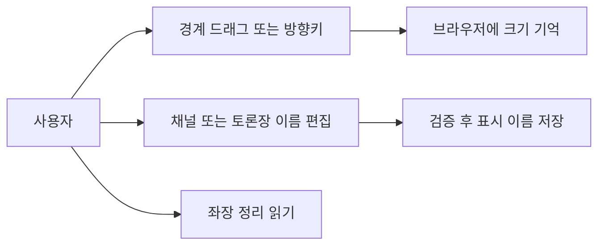
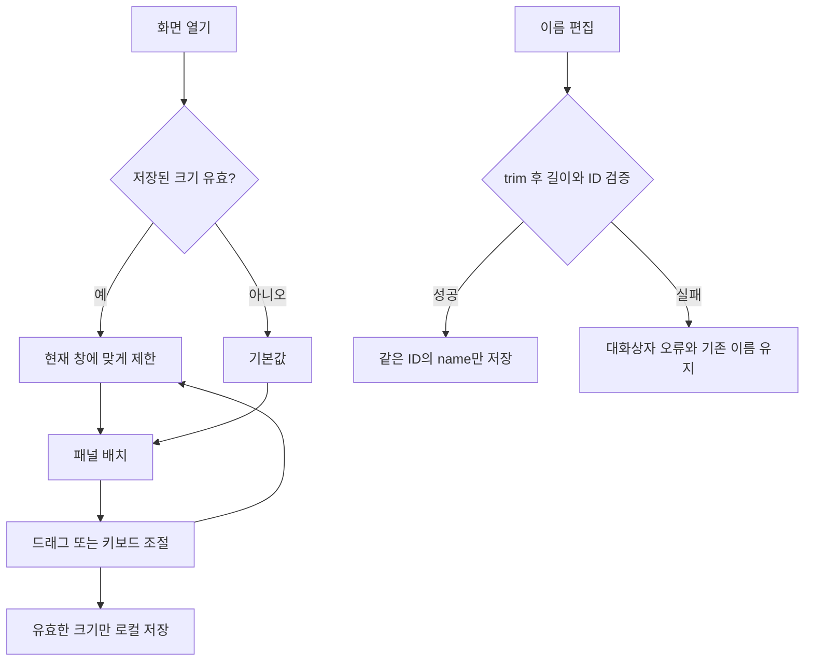
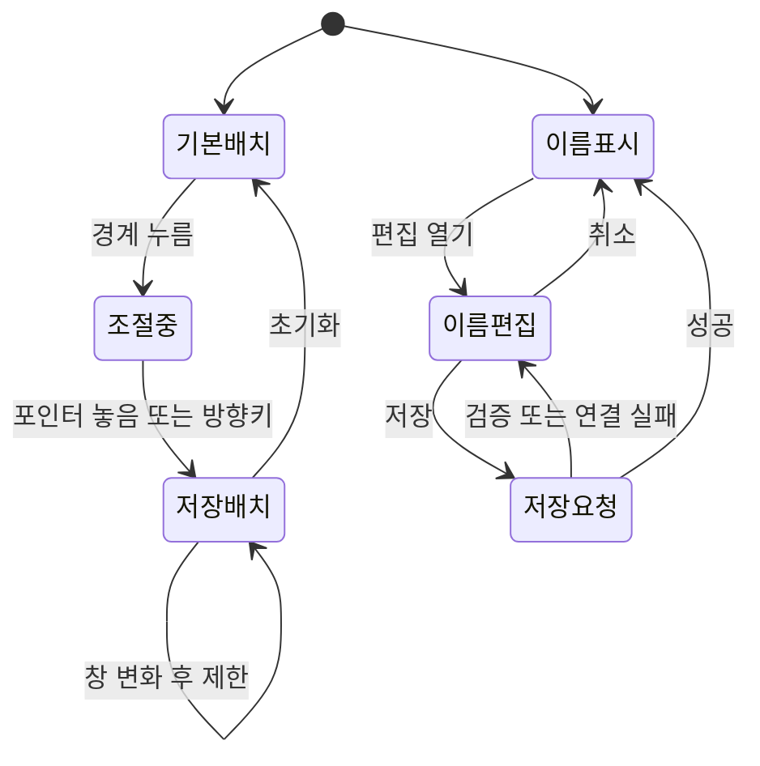

# 조절 가능한 패널과 이름 변경

<!-- sr:plan
{"document_type":"decision","reader_questions":["무엇을 조절하는가","이름을 바꿔도 기록이 유지되는가","어떻게 검증했는가"],"visual_plan":[{"kind":"comparison_table","content":"수용 기준과 검증","required":true},{"kind":"flowchart","content":"크기 저장과 이름 변경","required":true},{"kind":"state_diagram","content":"조절과 편집 상태","required":true}],"visual_waiver":[]}
-->

> 좌장 정리를 읽을 공간을 확보하고, 화면 구획과 채널·토론장 표시 이름을 사용자가 조절한다.

## 한눈에 보기

- 목적: 작은 좌장 정리 영역과 고정 분할 때문에 생기는 읽기 불편을 해결한다.
- 현재 상태: 최초 AC-1~AC-5 및 멘션 잘림·조절선 정리 후속 PL-1~PL-3의 구현·실행 검증을 완료했다. 전체 테스트 61개 통과. 아래 최초 검증 기록과 §12의 현재 변경을 구분한다. 프로젝트 전체는 building이다.
- 핵심 결론: 화면 배치는 브라우저 설정으로, 이름은 기존 ID의 영속 메타데이터로 관리한다.
- 결정: 흰 배경 provider 배지, 사이드바·작성창·세션 상세 크기 저장, 상단 자동 배치, ID를 유지하는 이름 변경을 사용한다. 멘션 목록은 패널 overflow 밖에 배치한다.
- 판단 근거: 기존 CSS의 정리 본문 최대 높이 38px와 제공된 PNG의 투명 alpha를 직접 확인했다. (직접 확인, 2026-10-22)
- 다음 행동: 기존 세션 자동 wake 어댑터와 원래 host 입력/응답 대조를 이어 검증한다.
- 최종 갱신: 2026-10-22, Asia/Seoul.

## 1. 의도 (Intent)

좌장 프로필 옆 정리를 편하게 읽고, 화면과 작업 단위의 표시 이름을 사용자가 관리한다. 사용자가 요청한 아이콘 개선·크기 조절·이름 변경을 이번 범위로 확정했다.

불변식: 앱은 창 전체 폭을 사용한다. 개별 메시지 버블만 최대 720px다. 좌장과 사용자 발화는 오른쪽, 참여자는 왼쪽이다. 기존 native ID·room/channel ID·메시지·결정·수신자·권한을 유지한다. 조절이나 이름 변경은 모델 입력을 보내지 않는다.

비목표: 채널 삭제·권한 관리·참여자 별칭 변경·다른 PC와 레이아웃 동기화는 포함하지 않는다.

## 2. 수용 기준 (Acceptance)

| ID | 사용자에게 보이는 결과 | 검증 방법 |
|---|---|---|
| AC-1 | provider 표시는 검은 배경 타일 없이 투명 또는 흰색 원본을 사용한다. | 원본 alpha/해시, HTTP 이미지, 프로필·메시지·멘션·수신자 화면 확인 |
| AC-2 | 구획 경계에서 폭·높이를 드래그 또는 방향키로 조절하고 새로고침 후 유지하며 초기화할 수 있다. | 실제 포인터·키보드·재접속, 잘못된 저장값·창 크기 제한 단위 테스트 |
| AC-3 | 좌장 프로필 옆 정리가 여러 줄로 읽히고 참여자는 다음 행에 유지된다. 채팅과 입력창도 남는다. | 1280×720과 좁은/넓은 CSS viewport의 경계·넘침·스크린샷 확인 |
| AC-4 | 채널과 토론장 이름을 바꾸고 재접속해도 유지한다. 취소·유효하지 않은 이름은 기존 이름을 보존한다. | 실제 별도 fixture UI, Unicode/공백/초과/없는 ID·재오픈과 참조 보존 테스트 |
| AC-5 | 인증 복구·전달·기존 대화 기록 동작을 보존한다. | 기존 전체 테스트와 열린 브라우저에서 서버 재시작 확인 |

## 3. 확정 사실 (Facts)

| 관측 | 근거 |
|---|---|
| 좌장 정리 본문에 max-height 38px가 적용됐다. | apps/desktop/style.css의 마지막 규칙, 직접 확인 |
| 제공된 세 provider PNG에 투명 alpha 0~255가 있다. | 원본 codex-icon-white-256, claude-icon-256, antigravity-icon-256의 RGBA·모서리 alpha=0, 직접 확인 |
| 기존 아이콘 CSS도 어두운 배경과 테두리를 추가했다. | .provider-icon background/border, 직접 확인 |
| 이름 생성의 한도는 channel 80, room 120자다. | Store.createChannel/createRoom, 직접 확인 |
| 인증과 CSRF는 서버 재시작 때 갱신된다. | server.js/API client와 기존 인증 복구 검증, [[dedicated-chair]] |

### 선택지와 평가기준

좌장 정리를 다시 우측 inspector로 옮길지, 현재 좌장 옆 배치를 조절 가능하게 할지 비교했다. 읽기 공간, 사용자가 정한 상단 구성 유지, 창 폭 활용이 기준이다.

| 방식 | 읽기 공간 | 상단 구성 | 창 폭 활용 |
|---|---|---|---|
| 고정 작은 상단 | 두 줄로 제한 | 유지 | 고정 |
| 별도 우측 inspector | 넓어짐 | 정리 위치 변경 | 대화 폭 차감 |
| 조절 가능한 상단 | 사용자가 확보 | 유지 | 전체 창 사용 |

### 비교

고정 배치보다 사용자 조절이 읽기 공간과 창 비율에 대응한다. 우측 inspector 이전보다 요청된 좌장 옆 위치를 유지한다.

### 결정

최초 구현은 상단도 조절 가능하게 했다. §12의 후속 피드백으로 상단은 자동 배치하고 사이드바·작성창·세션 상세만 조절 가능하게 정정한다. 긴 정리는 계속 펼쳐 읽을 수 있다.

### 결과

패널 크기는 이 브라우저에서 기억하며, 이름 변경은 SQLite의 기존 ID를 유지하는 표시 메타데이터만 갱신한다. 실제 드래그·새로고침·서버 재시작을 확인했고 원래 토론장의 11개 테이블 데이터가 일치했다.

### 재검토 조건

짧은 창에서 최소 채팅 공간을 확보하지 못하거나 참여자 수 증가로 조절 영역이 겹치면 기본 높이와 접기 동작을 재검토한다. 여러 기기 동기화가 필요해지면 로컬 저장 정책을 다시 정한다.

## 4. 유스케이스 (Use Cases)

## 5. 파이프라인 (Flowchart)

## 6. 액션과 상태 전이 (State)

| 상태 | 저장과 UI 반응 |
|---|---|
| 조절 | 유효 범위와 separator 현재 값을 갱신하고 최소 채팅 공간을 유지한다. |
| 저장 실패 | localStorage 사용 불가여도 현재 화면 조절은 동작한다. |
| 이름 저장 중 | 중복 제출을 막고 취소 전의 기존 이름을 표시한다. |
| 이름 오류 | 오류를 보여주며 입력과 기존 영속 이름을 유지한다. |

## 9. 변경 지점 (Change Points)

| 경로 | 변경 |
|---|---|
| `apps/desktop/index.html` | 조절 경계와 접근 가능한 편집 컨트롤 |
| `apps/desktop/app.js` | 이름 편집·화면 갱신 |
| `apps/desktop/style.css` | 기본 공간·말줄임 제거·조절 배치 |
| `apps/desktop/layout.js` (신규) | 제한·저장·키보드와 포인터 조절 |
| `apps/desktop/assets/providers` | 제공된 투명 원본 |
| `services/coordinator/store.js` | ID 유지 이름 변경과 이벤트 |
| `services/coordinator/server.js` | 인증된 rename 경로·정적 module allowlist |
| `tests` | 이름·레이아웃·HTTP 회귀 |

## 10. 잠재 문제 (Risks)

| 위험 | 처리 |
|---|---|
| 짧은 창에서 상단이 채팅을 가림 | 창 크기별 최대 높이, 최소 채팅·입력 공간 |
| 저장된 크기가 다른 창에서 과도함 | 불러오기와 resize 시 제한 |
| polling이 편집/스크롤 초기화 | 경계와 대화상자를 영속 DOM에 두고 정리 재생성을 signature로 제한 |
| 같은 표시 이름 | 생성과 동일하게 허용한다. 식별과 연결은 ID로 한다. |
| 서버 응답이 끊김 | 기존 인증 복구·오류 표시 사용, 모델 실행 없음 |

## 11. 착수 순서 (Implementation)

- [x] AC-1: 투명 원본을 복사하고 배지의 배경 제거 후 화면 확인.
- [x] AC-2 AC-3: 제한·저장 모델과 실제 경계, 넓어진 정리 UI를 구현·검증.
- [x] AC-4: 같은 ID를 유지하는 저장 경로와 편집 UI, 취소·실패·재접속 확인.
- [x] AC-5: 회귀 테스트·실제 서버 재시작·기록 보존 확인.

## 최초 구현 검증 결과

직접 측정, 2026-10-22 최초 구현 당시의 기록이다. 여섯 조절선과 투명 배지는 이후 §12 및 [[rich-attachments]] 정책으로 대체됐다. 모든 화면 변경은 로컬 브라우저에서 확인했다. 이 검증으로 모델 요청은 보내지 않았다.

| 경로 | 결과와 근거 |
|---|---|
| 포인터 조절 | sidebar 218→288, chair 180→230, upper 190→280, participants 90→110, composer 200→260, inspector 340→400px. 여섯 값 모두 재접속 후 일치 |
| 키보드·초기화 | 방향키·Home·End, 좁은 화면 방향키, 초기화 기본값 복원 확인 |
| 최대 높이 | 1280×720에서 upper/composer/participants End 후에도 timeline 약102px, 보내기 버튼과 입력창 유지 |
| 정리 | 본문 38px cap 제거, 14px/1.65, 한 영역 스크롤. 크게 보기에서 1300자 fixture 정리 확인 |
| 이름 | 별도 fixture 채널·토론장 Unicode 이름 변경, 공백 거부·취소·재접속·서버 재시작 확인 |
| 기록 보존 | 현재 토론장의 rooms/channels/sessions/memberships/bindings/messages/deliveries/decisions/sources/chairs/chair_runs 동일. fixture는 rooms/channels의 name만 변경 |
| 인증 | 새 UI를 연 상태에서 4318 서버 재시작 뒤 자동 복구, 미전송 초안 보존, 오류 없음 |
| 회귀 | npm test 42/42. Store 재오픈·참조 보존, HTTP rename의 인증/CSRF/Origin 거부 포함 |

| 화면 | 정리 높이(px) | 대화 높이(px) | 입력창 높이(px) | 가로 넘침 |
|---|---:|---:|---:|---|
| 실제 앱 약1518×1399, 상단280으로 조절 | 255 | 735 | 200 | 없음 |
| 1280×720 iframe | 165 | 146 | 200 | 없음 |
| 760×900 iframe | 169 | 214 | 200 | 없음 |
| 1600×1000 iframe | 165 | 426 | 200 | 없음 |

iframe 검증은 같은 production 앱/API를 GET 전용 localhost 프록시로 렌더링한 CSS viewport다. 실제 창 크기를 바꿨다고 보고하지 않는다. 높이620px 미만에서는 앱 최소 높이620px와 페이지 세로 스크롤을 사용한다. 해당 초소형 높이는 이번 화면 증거 범위에 포함하지 않았다.

아이콘은 제공된 codex-icon-white-256.png, claude-icon-256.png, antigravity-icon-256.png와 바이트가 일치하며 alpha 범위는 모두0~255다. CSS 배경과 테두리도 제거했다.

- [검증 JSON](validation/resizable-panels.json)
- [현재 앱 화면](screenshots/resizable-panels-main.jpg)
- [1280 화면](screenshots/resizable-panels-normal.jpg) · [760 화면](screenshots/resizable-panels-narrow.jpg) · [1600 화면](screenshots/resizable-panels-wide.jpg)

독립 읽기 전용 수용 검토: AC-1~AC-5 PASS. 투명 alpha·CSS·실행 근거·기록 보존을 대조했다.

## 관련

[[dedicated-chair]] · [[session-room-foundation]] · [[inter-session-index]]

## 12. 멘션 목록과 구획 후속 수정

2026-10-22 사용자 피드백으로 다음 변경을 적용했다. 기존 여섯 경계 조절 기록은 최초 구현의 검증이며, 아래 정책이 현재 배치를 대체한다. 아이콘은 후속 rich-attachments 결정에 따라 흰 배경 배지를 유지한다.

| 기준 | 현재 동작과 검증 |
|---|---|
| PL-1 | 목록을 body의 fixed portal로 옮기고 최대230px·viewport 경계를 적용한다. 실제 앱의 세 후보 모두 hit-test 통과, 클릭은 @마야, 방향키+Enter는 @유리아를 선택했다. Escape·대화상자는 목록을 닫고, 화면 크기 변화에도 다시 배치한다. |
| PL-2 | 사이드바·작성창·세션 상세 세 조절바만 남긴다. 좌장 프로필–정리, 좌장–참여자–대화 사이 조절바와 고정 크기 트랙을 제거했다. 예전 세 값은 무시하고 남긴 설정238/233/340px는 보존했다. 12px 조작 영역 안에 얇은 선과 작은 그립을 표시하고 hover/focus로 강조한다. |
| PL-3 | 상단은 화면에 맞는 높이와 요약 내부 스크롤을 사용한다. 크게 보기·흰 배지·720px 메시지 폭·오른쪽 사용자/좌장·왼쪽 프로필을 유지했다. 작성창 최대 크기는 상단 실측 높이와 대화100px를 예약한다. 61개 회귀 테스트 및 DB11개 테이블 보존을 확인했다. |

직접 관측: 수정 전 목록 상단1071.7px, 작성창 상단1165.9px로 약94px가 잘려 세 후보 중 마지막 한 명만 보였다. 원인은 작성창 overflow 경계였으며, 수정 후에는 목록 상단1068.2px의 첫 후보까지 실제 클릭 대상으로 잡혔다.

| 검증 화면 | 요약 보이는 높이 / 내용 높이(px) | 대화 높이(px) | 작성창 높이(px) | 멘션 후보 |
|---|---:|---:|---:|---|
| 실제4318 약1517×1398 | 234.90 / 287 | 735.50 | 232.99 | 3/3 보임·hit-test 통과 |
| 1280×720 CSS viewport | 176.59 / 286 | 148.44 | 200 | 3/3 보임·hit-test 통과 |
| 760×900 CSS viewport | 219 / 354 | 179.83 | 200 | 3/3 보임·hit-test 통과 |
| 1600×1000 CSS viewport | 235 / 264 | 370.03 | 200 | 3/3 보임·hit-test 통과 |
| 1280×720 작성창 End | 내부 스크롤 유지 | 100.44 | 248 | 작성창을 늘려도 대화 유지 |

후속 검증 범위: 별도 GET 전용 프록시4320과 iframe으로 같은 production 앱을 렌더링했다. 프록시는 별도 origin의 레이아웃 설정을 써 원래4318 설정을 건드리지 않는다. 세 조절바 방향키·작성창 Home/End·초기화, 요약 크게 보기를 실제 브라우저에서 확인했다. iframe은 자동화 도구의 키보드 focus 제약으로 화면·hit-test·크기 변화만 확인했고, 멘션 키보드 선택은 실제4318에서 확인했다. 물리 조절바 드래그는 이번 후속에서 재실행하지 않았으며 기존 pointer handler를 유지했다.

미전송 초안은 검증 직전 값으로 복원했다. 모델 요청0건, DB11개 테이블의 전후 JSON SHA-256은 `9a5d07bb14c6aeed2bd3fa732f542a3ddf6582a9690e27ecaf15fe0a37f0bb5f`로 일치했다.

독립 수용 검토: PL-1~PL-3 PASS. 실제 화면 검증은 root가 수행하고, 별도 검토자는 코드·시험·측정 근거의 일관성을 확인했다. 위에 명시한 iframe 키보드·물리 드래그 범위는 추가 검증 완료로 해석하지 않는다.

- [후속 검증 JSON](validation/panel-menu-layout.json)
- [수정 전](screenshots/panel-menu-before.jpg) · [실제 앱](screenshots/panel-menu-main.jpg)
- [1280 화면](screenshots/panel-menu-normal.jpg) · [760 화면](screenshots/panel-menu-narrow.jpg) · [1600 화면](screenshots/panel-menu-wide.jpg)

