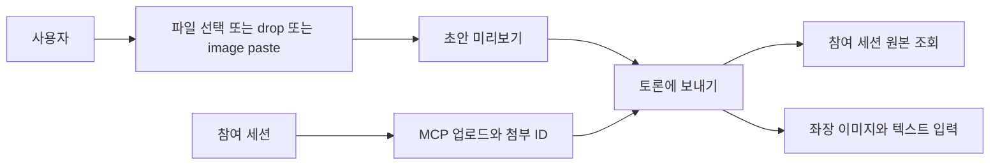
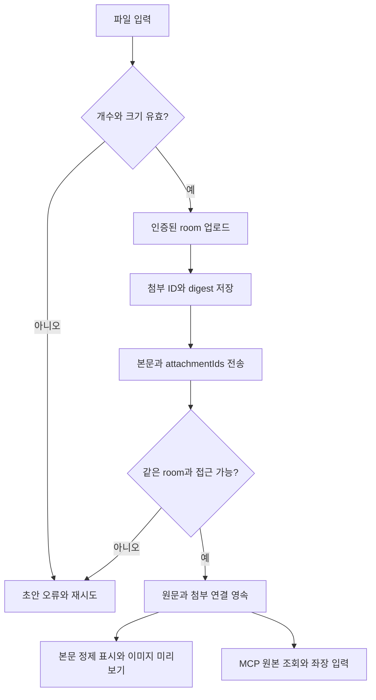
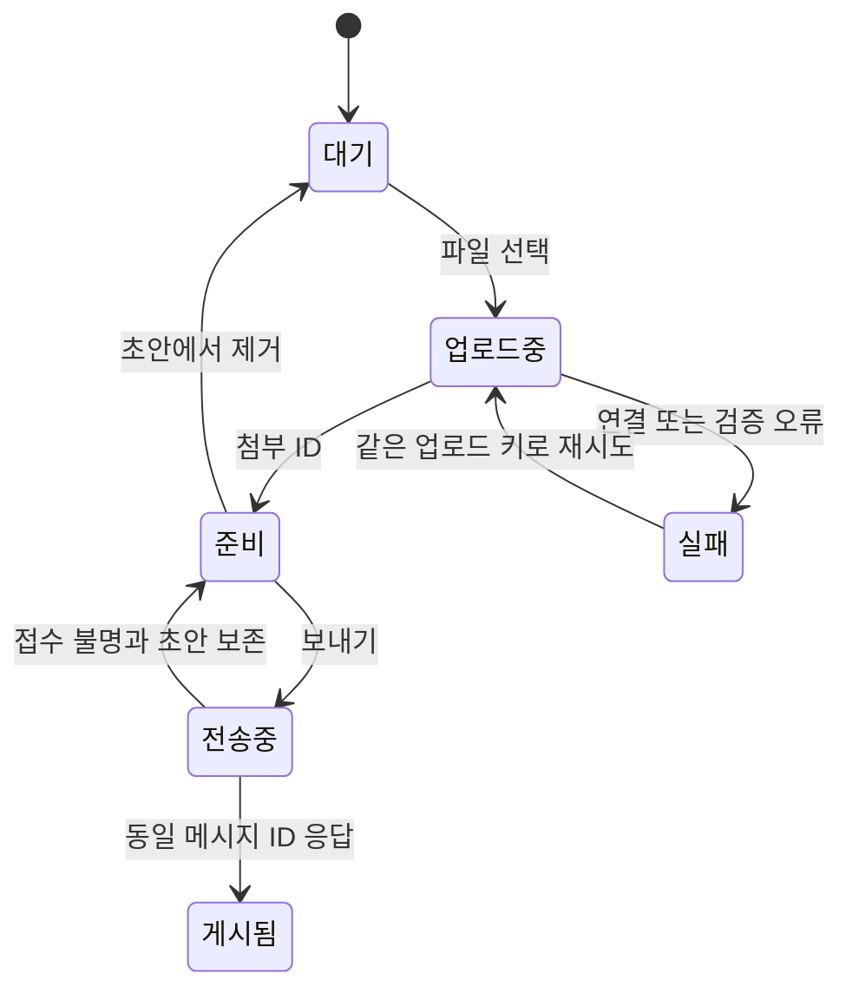
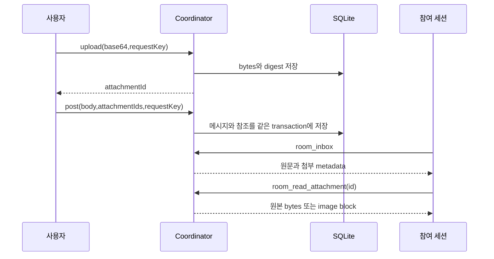
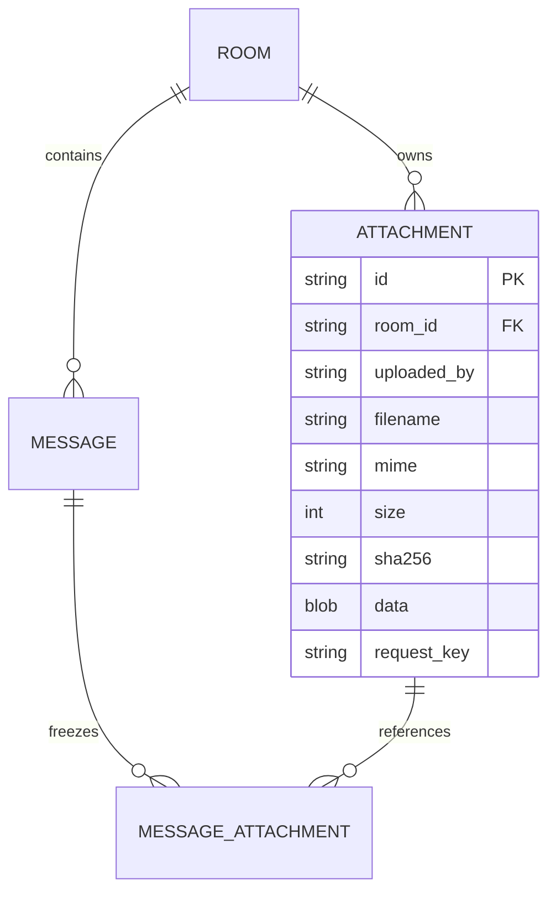

# 서식 있는 대화와 공유 첨부

<!-- sr:plan
{"document_type":"decision","reader_questions":["무엇을 표시하고 공유하는가","누가 첨부 원본을 읽는가","기록과 재시도는 안전한가"],"visual_plan":[{"kind":"comparison_table","content":"표시와 원본 경로","required":true},{"kind":"flowchart","content":"첨부 전송","required":true},{"kind":"state_diagram","content":"업로드와 전송","required":true},{"kind":"sequence_diagram","content":"세션 공유","required":true},{"kind":"er_diagram","content":"첨부 연결","required":true}],"visual_waiver":[]}
-->

> 흰 배경 provider 배지와 말풍선 내부 왼쪽 프로필, Markdown·HTML 본문, 사용자와 참여 세션이 공유하는 파일·이미지를 추가한다.

## 한눈에 보기

- 목적: 문서·코드·이미지를 세션마다 복사하지 않고 토론의 원문과 함께 전달한다.
- 현재 상태: 이 기능 AC-1~AC-6 구현·검증 완료. 전체 테스트 53/53과 독립 수용 검토를 통과했다. 전체 프로젝트는 building이다.
- 핵심 결론: 원문은 보존하고 표시만 정제하며, 첨부는 SQLite BLOB과 room/message ID에 연결한다.
- 판단 근거: 실제 브라우저 입력·동일 원본 바이트·좌장 판독, 기존 11개 테이블 보존과 53개 회귀 테스트를 확인했다. (직접 검증, 2026-10-22)
- 결정: marked18.1.1·DOMPurify3.4.17을 로컬 제공하고, room 권한으로 첨부를 업로드·조회한다.
- 검증 경계: drop은 실제 브라우저 DataTransfer 이벤트로 제품 핸들러를 실행했다. OS 마우스 드래그는 자동화 입력 실패로 미검증이다.
- 다음 행동: 기존 세션 자동 wake와 host 제출·응답 대조를 후속 검증한다.
- 최종 갱신: 2026-10-22, Asia/Seoul.

## 1. 의도 (Intent)

사용자가 바꾼 취향에 맞춰 provider 아이콘에 흰 배경을 적용한다. 좌장·사용자 말풍선은 오른쪽에 유지하고 그 안의 프로필은 왼쪽에 둔다. 본문은 Markdown과 정적인 HTML 서식을 표시하며, 파일 선택·드래그·클립보드 이미지를 메시지와 함께 공유한다. 참여 세션도 같은 room 안에서 첨부를 업로드하고 post/reply/request/result에 연결하며 다른 참여자가 원본을 조회한다.

불변식: 원문·기존 ID·메시지 순서·전달 증거는 보존한다. 파일의 원래 PC 경로를 API로 읽지 않는다. 첨부만 올리거나 표시할 때 모델을 깨우지 않는다. 실행 결과 unknown은 자동 재전송하지 않는다. HTML 표시가 앱의 스크립트·폼·권한으로 바뀌지 않게 한다.

비목표: 모든 바이너리 형식을 자동 해석하는 파서·OCR·다른 PC 동기화·기존 세션 자동 wake는 이번 변경에 포함하지 않는다. 문서 원본은 공유하고 좌장은 지원되는 이미지·UTF-8 텍스트를 직접 입력으로 받는다.

## 2. 수용 기준 (Acceptance)

| ID | 사용자에게 보이는 결과 | 검증 방법 |
|---|---|---|
| AC-1 | 흰 배경 provider 배지, 오른쪽 말풍선 내부 왼쪽 프로필 | 실제 화면·좌표·좁은 폭 확인 |
| AC-2 | Markdown 제목·강조·목록·표·코드와 정적 HTML 서식이 표시되고 능동 콘텐츠는 제거된다. | DOM hostile matrix·기존 원문 재접속·실제 화면 |
| AC-3 | 파일 선택·drop·이미지 paste, 제거·실패/재시도와 room별 초안, 최대5개/파일10MiB | 실제 picker/drop/paste·초안/오류·메시지 미리보기 |
| AC-4 | 첨부가 post/reply/request/result·HTTP/stdio/helper로 공유되고 재시작 뒤 같은 바이트다. | digest/바이트 대조·멱등 replay·Store 재오픈·통합 테스트 |
| AC-5 | 초대한 room의 연결된 첨부만 읽고 좌장은 이미지/텍스트 내용을 받는다. | 다른 room·미연결·revoked 거부, runner 입력 캡처와 실제 검증용 좌장 응답 |
| AC-6 | 인증·원래 기록·수신자 snapshot·unknown 재전송 금지·협력 pull 의미를 유지한다. | 기존 회귀·서버 재시작·이전 데이터 대조 |

## 3. 확정 사실 (Facts)

| 사실 | 근거 |
|---|---|
| 변경 전 본문은 plain text였다. 현재 marked→DOMPurify로 정제 표시한다. | apps/desktop/app.js, rich-text.js |
| 첨부 원본 BLOB과 메시지 참조를 영속 저장한다. 업로드 JSON만15MiB이며 일반 JSON은262144byte다. | Store schema와 server.body |
| MCP는 기존6개와 upload/read_attachment의 총8개다. | packages/mcp/server.js |
| Claude CLI는 --input-format stream-json을 제공한다. | 설치 --help와 공식 CLI reference, 2026-10-22 |
| marked는 정제 기능을 제공하지 않아 후단 sanitizer가 필요하다. | [공식 문서](https://marked.js.org/), 2026-10-22 |
| DOMPurify는 태그·속성 허용 목록을 제공한다. | [공식 README](https://github.com/cure53/DOMPurify), 2026-10-22 |

### 선택지

파일 경로만 공유할지, room 소유 원본을 저장할지 비교한다.

### 평가기준

재접속 뒤 재현, 다른 room 접근 제한, CLI와 UI의 같은 원본 접근이 기준이다.

### 비교

| 방식 | 재현 | room 경계 | 공통 원본 |
|---|---|---|---|
| PC 경로 문자열 | 이동하면 깨짐 | 경로 접근 확대 위험 | 세션 환경에 의존 |
| SQLite BLOB+ID | DB와 함께 영속 | room ID로 검증 | 같은 바이트·digest |

### 결정

첨부 ID와 원본 바이트를 DB에 저장한다. 글은 raw body를 보존하고 browser renderer 한 곳에서 marked→DOMPurify로 표시한다. 스크립트·이벤트·style·프레임·외부 이미지 자동 요청을 허용하지 않는다.

### 결과

일반 파일은 다운로드할 수 있고 PNG/JPEG/GIF/WebP는 미리보기를 제공한다. 좌장은 지원 이미지와 제한된 UTF-8 텍스트를 읽으며 다른 바이너리는 파일명·유형·크기와 원본 조회 경로를 받는다.

### 재검토 조건

DB 크기·이미지 입력 비용·파일10MiB 또는5개 한도가 실제 사용을 방해하면 외부 blob 저장·청크 전송·해석 어댑터를 재검토한다.

## 4. 유스케이스 (Use Cases)

## 5. 파이프라인 (Flowchart)

## 6. 액션과 상태 전이 (State)

| 상태 | 저장·UI 반응 |
|---|---|
| 업로드중 | 전송 금지, 파일명과 진행 표시 |
| 실패 | 초안 파일 보존, 재시도·제거 제공 |
| 준비 | room별 첨부 ID 유지, 다른 room으로 섞이지 않음 |
| 전송중 | 본문·첨부 ID와 requestKey 고정, 실패 뒤 같은 payload 재시도 |
| 게시됨 | 메시지 참조를 고정하고 선택했던 초안만 정리 |

## 7. 타이밍 (Timing)

파일10MiB·최대5개, JSON 업로드 최대 약15MiB, 일반 본문8000자는 별도 제한이다. 업로드와 조회는 제한된 대기시간을 사용하고 불명 전송은 자동 반복하지 않는다.

## 8. 데이터 (ER)

첨부 업로드는 room+uploader+request_key로 멱등하며, 다른 내용 재사용은 conflict다. 참여자는 자신이 올린 미연결 첨부 또는 room 메시지에 연결된 첨부만 읽거나 재첨부한다. 브라우저는 로컬 사용자 인증으로 초안을 포함한 room 원본을 조회한다.

## 9. 변경 지점 (Change Points)

| 경로 | 책임 |
|---|---|
| `apps/desktop/app.js` | 프로필 위치·본문/정리 표시·첨부 전송 연결 |
| `apps/desktop/style.css` | 흰 배지·서식·첨부·반응형 |
| `apps/desktop/rich-text.js` (신규) | 공통 정제 렌더러 |
| `apps/desktop/attachments.js` (신규) | 입력·room별 초안·미리보기·재시도 |
| `services/coordinator/store.js` | BLOB·메시지 연결·권한·멱등 |
| `services/coordinator/server.js` | 인증 업로드/조회·MCP·정적 vendor module |
| `packages/contracts/attachments.js` (신규) | 제한·MIME·텍스트 판정 |
| `packages/mcp/server.js` | stdio 첨부 도구·이미지 block |
| `packages/mcp/participant.js` | 로컬 파일 업로드·원본 저장 helper |
| `services/coordinator/chair.js` | 첨부가 들어간 context·질문 전달 |
| `adapters/claude/chair.js` | stream-json 이미지 입력 |
| `tests` | Store·HTTP/stdio·renderer·업로드 UI·runner 회귀 |

## 10. 잠재 문제 (Risks)

| 위험 | 처리 |
|---|---|
| HTML이 앱 기능 실행 | 허용 서식만 정제, 원문 별도 보존 |
| 파일명 MIME 위장 | 바이너리 signature로 inline image 판정, 나머지 attachment 다운로드 |
| 미연결 첨부 유출 | uploader 또는 room 메시지 연결 검사 |
| 재시도 중복 | 업로드·메시지 키와 attachmentIds 비교 |
| room 전환 중 업로드 완료 | room별 초안에 귀속 |
| 모든 파일을 읽었다고 오인 | 지원 text/image만 실제 입력, 미지원 binary는 명시 |
| 읽기 전용 세션·초기화 실패 | 기존 권한과 unknown 정책 유지 |

## 11. 착수 순서 (Implementation)

- [x] AC-1 AC-2: 흰 배지·프로필과 정제 렌더러.
- [x] AC-4 AC-5: Store·HTTP/MCP·helper의 원본 공유와 ACL.
- [x] AC-3: 세 입력 경로·room별 초안·미리보기·재시도.
- [x] AC-5: 좌장 이미지·텍스트 입력과 실제 응답 검증.
- [x] AC-6: 회귀·재시작·기존 데이터 보존·브라우저 검증.

## 12. 추적성 (Traceability)

| AC | 구현 | 검증 | 위험 |
|---|---|---|---|
| AC-1 AC-2 | desktop와 renderer | DOM·브라우저 | 서식·표시 오해 |
| AC-3 | attachment composer | picker/drop/paste | 초안 유실 |
| AC-4 AC-5 | Store/API/MCP/chair | 바이트·권한·runner | room 경계·내용 누락 |
| AC-6 | 기존 실행 경로 | 회귀·재시작 | 기존 기록·unknown |

## 13. 검증 결과

| 구분 | 직접 확인한 결과 |
|---|---|
| 표시 | 실제 provider 배경 rgb(255,255,255), filter none. 말풍선 우측 끝1459px, 프로필 왼쪽 여백16px, 최대720px. |
| 서식 | 실제 Markdown·HTML 대화/정리 표시, marked+DOMPurify hostile matrix 통과. |
| 입력 | 실제 chooser 이미지+텍스트, Control+V 이미지, room 전환 초안 복원, 제거, 서버 단절 실패→재시작→재시도 준비됨. |
| drop | 검증용 loopback 프록시에서 브라우저 DataTransfer/File/DragEvent를 실제 composer에 전달해 두 파일 업로드·게시. OS 물리 드래그는 별도 미검증. |
| 한도 | 실제10MiB+1 chooser 오류, 최대5개와 여섯째 재시도 우회 차단 테스트. |
| 원본 | HTTP 업로드→stdio MCP image block→helper 저장 바이트 일치, Store 재오픈 뒤 일치. post/request/reply/result 참조·ACL·멱등 확인. |
| 좌장 | 새 검증 전용 Claude 대화가 BIRD-47 및 MEDIA_TEXT_7Q29을 정확히 응답. 질문·파일명에는 두 답이 없었다. 응답에도 같은 첨부 연결. |
| 회귀 | 53/53. 실제4318 서버 재시작 후 기존 기록 표시, 기존11개 테이블 원본 값 일치. unknown 자동 재전송·writer·frozen 수신자·인증 복구·협력 pull 회귀 통과. |

원본 근거: [검증 JSON](../validation/rich-attachments.json), [화면](../screenshots/rich-attachments.jpg). 백엔드315ec52·통합fe65964, 좌장b950bb5, UI605e99e와 후속 통합 수정에 대응한다.

### 해석과 입력 한계

파일 업로드는10MiB/개·메시지5개다. 직접 좌장 입력은 현재 메시지 우선 최근5개, PNG/JPEG/GIF/WebP 각5MiB·총8MiB, UTF-8 텍스트 각16000자·총48000자다. 잘린 텍스트·제외 이미지·미지원 바이너리는 metadata와 제한 사유를 알려준다. PDF·Office 등은 원본 공유/다운로드이며 자동 문서 파서는 아직 없다. stdio read 도구는 이미지 block, helper read는 원본 파일 저장을 제공한다.

초안은 열린 브라우저의 room별 메모리에 유지된다. 서버 재시작·room 전환에는 남지만 브라우저 자체 새로고침 뒤에는 복원하지 않는다. 제거된 미게시 첨부는 폐기하고 이미 메시지에 연결된 원본은 보존한다. 업로드는 room당 미연결50개로 제한한다.

## 참고

[Marked](https://marked.js.org/) · [DOMPurify](https://github.com/cure53/DOMPurify) · [Claude CLI reference](https://code.claude.com/docs/en/cli-reference), 2026-10-22 조회.
[[resizable-panels]] · [[dedicated-chair]] · [[inter-session-index]]

