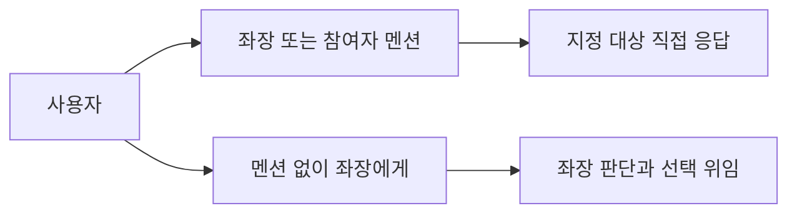
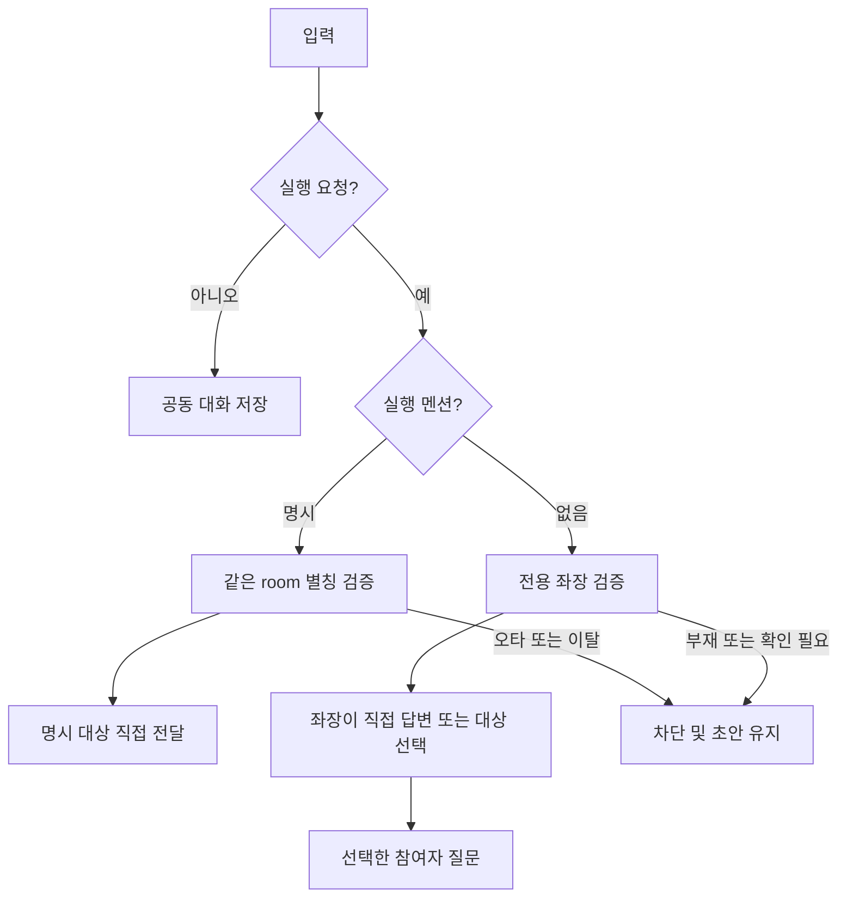
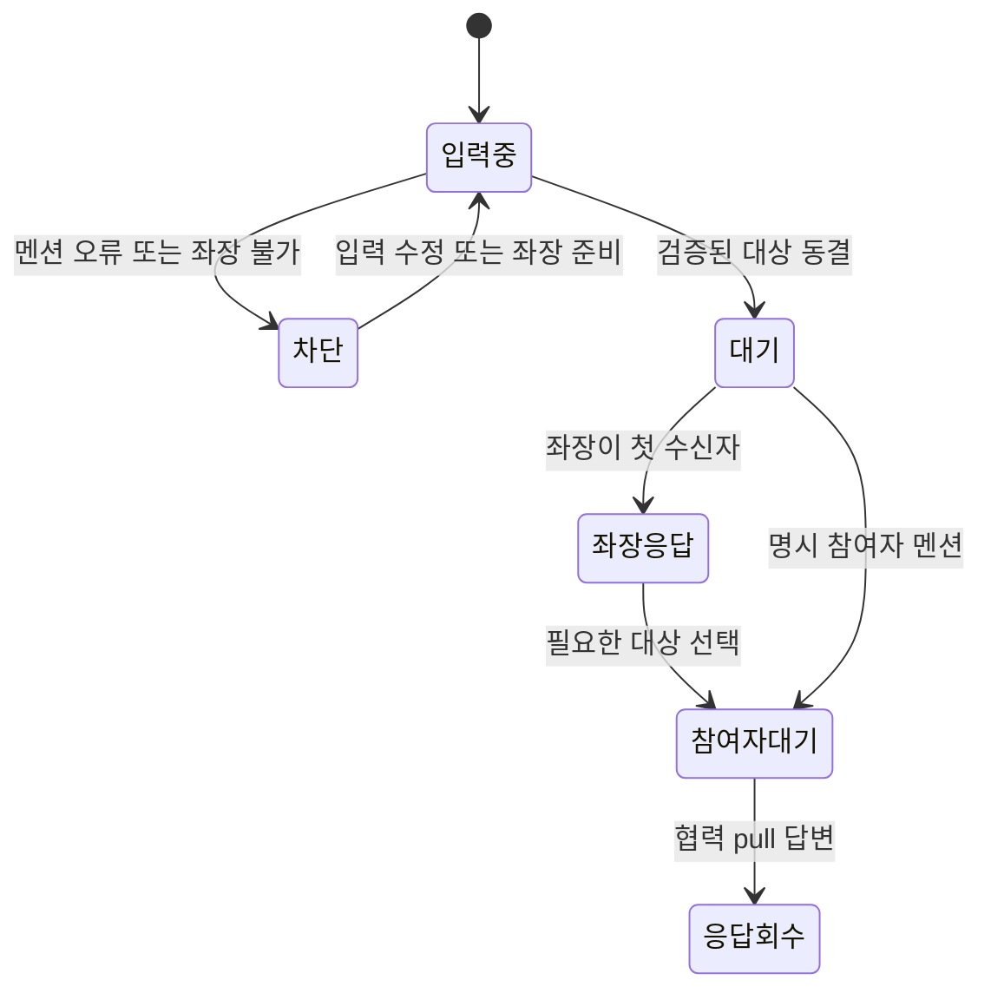

# 통합 멘션과 좌장 기본 라우팅

<!-- sr:plan
{"document_type":"decision","reader_questions":["누가 입력을 받는가","좌장은 어떻게 위임하는가","기존 전달 기록은 유지되는가"],"visual_plan":[{"kind":"comparison_table","content":"입력별 수신자","required":true},{"kind":"flowchart","content":"직접 멘션과 좌장 경유","required":true},{"kind":"state_diagram","content":"입력과 전달 상태","required":true}],"visual_waiver":[]}
-->

> 수신 모드 버튼을 없애고 좌장을 같은 멘션 대상으로 두며, 멘션 없는 실행 요청은 좌장이 먼저 판단한다.

## 한눈에 보기

- 목적: 사용자가 수신 모드를 고르지 않고 이름과 내용으로 토론을 진행한다.
- 현재 상태: 사용자 요청으로 정책 확정, 구현 중. 프로젝트 전체는 building이다.
- 핵심 결론: 명시 멘션은 직접 전달하고, 무멘션은 좌장 한 명에게 먼저 전달한다.
- 판단 근거: 멘션 후보에는 이미 좌장이 있으나 현재 무멘션은 참여자 전체이고 별도 수신 버튼이 있다. 기존 좌장은 질문별 membership ID로 위임할 수 있다. (직접 코드 확인, 2026-10-22)
- 결정: 새 auto 모드를 사용하고 기존 routingMode와 명시 ID 요청은 호환한다.
- 다음 행동: 격리 브라우저와 검증용 좌장으로 실제 입력·대상 선택을 확인한다.
- 최종 갱신: 2026-10-22, Asia/Seoul.

## 1. 의도 (Intent)

‘참여자에게 / 좌장에게’ 선택을 제거한다. 좌장도 일반 참여자처럼 @별칭으로 직접 지정한다. 별칭을 쓰지 않은 실행 요청은 좌장이 내용·참여자 설명·대화 맥락을 읽고 필요한 참여자에게 질문/작업을 보내거나 직접 답한다. 명시 멘션은 다른 세션으로 자동 확대하지 않는다.

불변식: 원래 세션·메시지·첨부·전달 snapshot을 보존한다. 멘션 오타나 좌장 부재가 전체 전달로 바뀌면 안 된다. 이미 전달 여부가 unknown인 작업을 자동 재전송하지 않는다. 기존 외부 세션 자동 wake는 이번 변경과 구분한다.

## 2. 수용 기준 (Acceptance)

| ID | 사용자에게 보이는 결과 | 검증 방법 |
|---|---|---|
| AC-1 | 수신 모드 버튼이 없고 좌장도 역할 표시와 함께 멘션 후보에 나온다. 좌장·참여자·혼합 멘션은 그 대상만 받는다. | 브라우저 후보/키보드·미리보기·실제 저장 수신자, Store/HTTP |
| AC-2 | 멘션 없는 실행 입력은 활성 전용 좌장 한 명에게 먼저 전달된다. 부재·준비 안 됨·unknown·불명확/읽기 전용 멘션은 전송 차단하며 초안 유지, 전체로 대체하지 않는다. 게시·알림은 실행하지 않는다. | 격리 UI와 Store 경계 테스트 |
| AC-3 | 좌장이 입력·역할 설명·대화 맥락에 맞는 참여자에게 구체적으로 위임하고 이유를 발화한다. 이미 직접 지정된 대상에게 동일 입력을 중복 위임하지 않는다. | coordinator 테스트와 새 검증용 좌장의 실제 질문·공유 발화/수신자 확인 |
| AC-4 | 원래 기록·첨부·멱등 snapshot·예산·unknown 정책과 협력 pull을 유지한다. 과거 chair/mentions 모드 및 MCP 명시 ID는 호환한다. | 전체 회귀·기존 DB 읽기 전용 대조·재시작·이전 키 replay |

## 3. 확정 사실 (Facts)

| 사실 | 근거 |
|---|---|
| UI는 recipientMode를 body와 함께 보내고 Store가 멘션을 재검증한다. | app.js, store.js |
| mentions 모드의 무멘션은 전용 좌장을 제외한 전체다. | Store.post |
| 별도 좌장은 speech/questions/proposal과 첨부 ID를 반환한다. | ChairCoordinator, Claude runner |
| 모델 입력에 alias/provider만 있어 담당 설명을 추가할 수 있다. | ChairCoordinator.context |
| 참여자는 협력 MCP pull 방식이다. | 기존 실행 명세·HTTP 경로 |

### 선택지

UI 수신 버튼 유지, 모든 무멘션을 전체로 전달, 좌장을 기본 수신자로 사용하는 방식을 비교했다.

### 평가기준

입력 단계 수, 명시 대상 보장, 불필요한 호출과 대화 확산이 기준이다.

### 비교

| 방식 | 입력 단계 | 명시 대상 보장 | 무멘션 확산 |
|---|---|---|---|
| 수신 버튼 | 매번 선택 | 모드에 따라 의미가 다름 | 전체 |
| 전체 기본 | 단순 | 멘션은 보장 | 전원 호출 |
| 좌장 기본 | 단순 | 직접 멘션 우선 | 좌장이 필요한 대상만 선택 |

### 결정

브라우저는 auto 모드를 전송한다. 기존 mode를 재해석해 과거 키를 깨지 않고, 새 모드에서만 무멘션 좌장 경유 정책을 적용한다. 명시 멘션 대상은 membership ID로 동결한다. 좌장에는 참가자 설명과 현재 직접 수신자도 전달해 불필요한 재위임을 막는다.

## 4. 유스케이스 (Use Cases)

| 입력 | 최초 수신자 | 후속 처리 |
|---|---|---|
| @민수 검토해줘 | 민수 | 직접 답변 |
| @좌장별칭 정리해줘 | 좌장 | 정리 또는 필요한 질문 |
| @좌장별칭 @민수 확인해줘 | 좌장과 민수 | 원래 두 대상, 동일 질문 재발행 방지 |
| 설계 검토해줘 | 좌장 | 맥락에 맞는 참여자 선택 또는 직접 답 |
| 게시·알림 | 실행 없음 | 공동 대화 기록 |

## 5. 파이프라인 (Flowchart)

## 6. 액션과 상태 전이 (State)

| 상태 | UI와 저장 |
|---|---|
| 입력중 | 직접 대상 또는 좌장이 판단할 예정임을 표시 |
| 차단 | 원문과 첨부 초안 유지, 전체 대체 금지 |
| 대기 | membership snapshot·첨부·원문을 원자 저장 |
| 좌장응답 | 공용 발화와 위임 대상/질문 기록 |
| 참여자대기 | 실제 queued 상태 표시, 자동 wake로 오인 금지 |

## 9. 변경 지점 (Change Points)

| 경로 | 책임 |
|---|---|
| `apps/desktop/app.js` | 수신 버튼 제거·미리보기·좌장 역할 후보 |
| `services/coordinator/store.js` | auto 모드의 직접/암묵 좌장 수신 검증 |
| `services/coordinator/chair.js` | 담당 설명·현재 수신자와 위임 지침 |
| `tests/` | 새 라우팅·오류·호환·중복 질문 회귀 |

## 10. 잠재 문제 (Risks)

| 위험 | 대응 |
|---|---|
| 좌장 부재가 전체 호출로 변함 | 새 모드 fail closed |
| 중간의 @ 오타가 무시됨 | 공유 parser와 서버 전체 검증 |
| 혼합 멘션을 좌장이 재발행 | 직접 수신자 context와 서버 중복 방지 |
| 과거 요청 hash 변경 | 기존 모드 의미 유지, 새 auto 모드 |
| 실행되지 않은 외부 세션을 실행 중으로 표시 | 기존 cooperative pull/증거 상태 유지 |

## 11. 착수 순서 (Implementation)

- [ ] AC-1 AC-2: 통합 멘션과 좌장 기본 수신.
- [ ] AC-3: 좌장 담당 설명·선택 지침과 중복 위임 방지.
- [ ] AC-4: 호환·회귀·기록 보존, 실제 UI와 좌장 검증.

## 참고

[[session-personas]] · [[dedicated-chair]] · [[rich-attachments]] · [[inter-session-index]]

