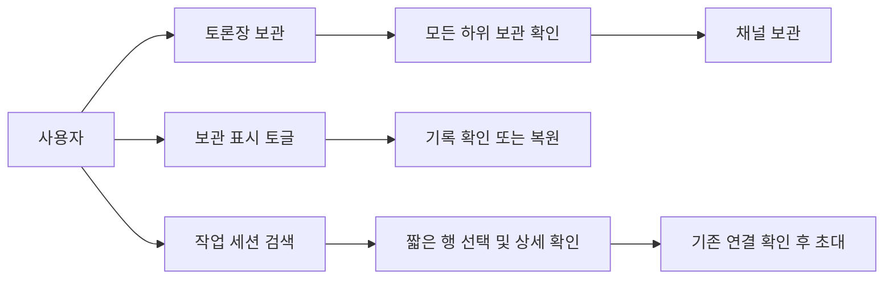
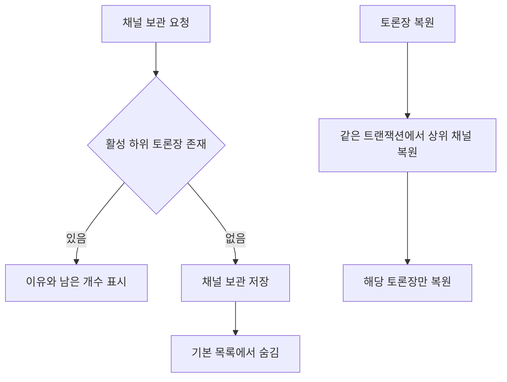
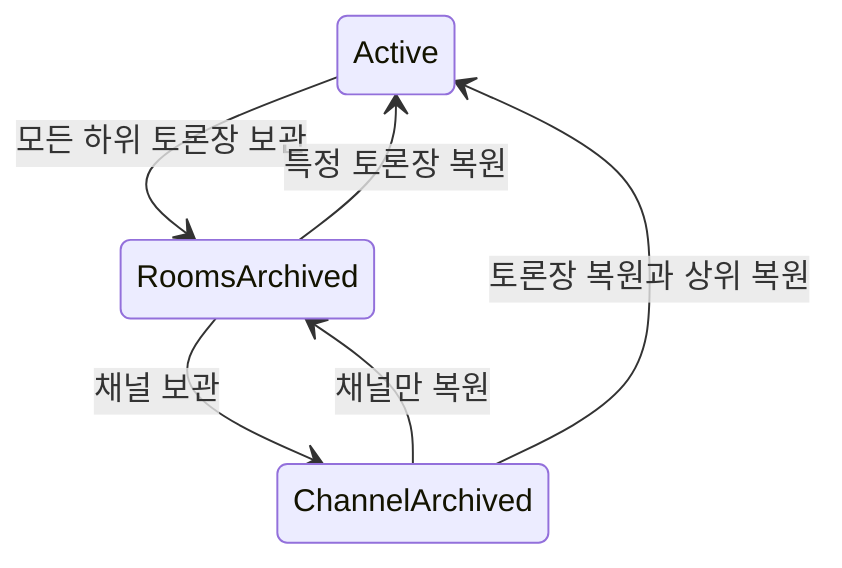
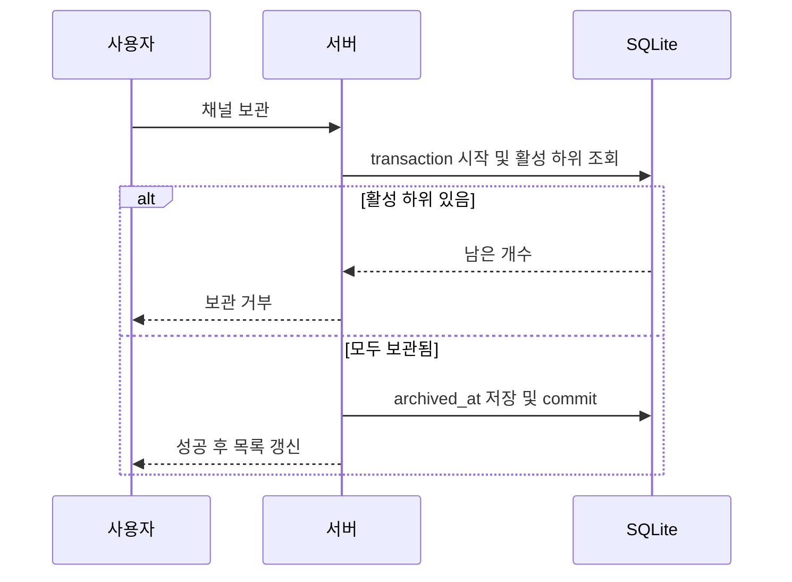
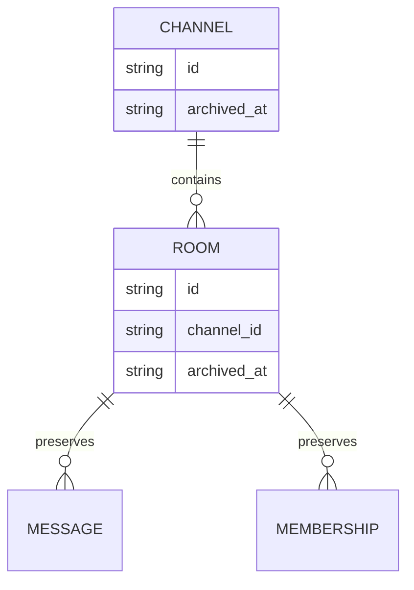

<!-- sr:plan
{"document_type":"decision","reader_questions":["무엇이 바뀌는가","왜 목록을 바꾸는가","보관과 복원은 어떤 범위인가","검증 결과는 무엇인가"],"visual_plan":[{"kind":"decision_matrix","content":"제품별 목록 패턴과 채택 결정","required":true},{"kind":"flowchart","content":"보관 전제와 복원 흐름","required":true},{"kind":"state_diagram","content":"채널과 토론장의 보관 상태","required":true},{"kind":"sequence_diagram","content":"보관 API의 원자적 검증","required":true},{"kind":"er_diagram","content":"채널과 토론장 관계","required":true}],"visual_waiver":[]}
-->

# 채널 보관과 세션 선택 UX

> 보관 항목을 기본 화면에서 숨기고, 초대할 실제 작업 세션을 짧은 목록과 선택 상세로 찾는다.

## 한눈에 보기

- 목적: 채널 보관의 전제를 지키면서 목록의 잡음과 공간 낭비를 줄인다.
- 현재 상태: 구현·브라우저 검증을 마치고 4318 실행판에 적용했다. 전체 테스트 104/104, 기존 발언 37건 원문 보존을 확인했다(근거는 추적성 절).
- 핵심 결론: 보관은 삭제와 분리하고, 기본 목록은 활성 항목·주 작업 세션 중심으로 표시한다.
- 원인 또는 판단 근거: 변경 전 카탈로그는 모든 정보와 버튼을 항목마다 반복했다. 현재는 높이 약66px의 행과 선택 상세를 분리하고 채널 보관 필드를 추가했다.
- 결정: 검색 가능한 짧은 행과 선택 상세, 명시적인 보관 표시 토글, 주요 작업과 보조 작업이 구분된 상단바를 적용한다.
- 다음 행동: 4318에서 보관 표시 토글과 세션 선택창을 사용한다. 전체 host 검증 V01~13과 일반 참여자 lifecycle은 별도 후속 범위다.
- 최종 갱신: 2026-10-23, Asia/Seoul.

## 1. 의도 (Intent)

사용자는 채널을 하위 토론장 전체 보관 후에만 보관하며, 보관된 채널과 토론장은 토글로 확인한다. provider subagent와 SAO 하위 실행 세션을 일반 초대 목록에서 제외한다. 기존 native ID·별칭·메시지·자료·프로세스와 권한 정책을 보존한다. 전체 provider lifecycle 재설계는 이번 범위 밖이다.

## 2. 수용 기준 (Acceptance)

| ID | 사용자 결과 | 검증 방법 |
|---|---|---|
| AC-1 | 활성 하위 토론장이 남으면 채널 보관을 거부하고 모두 보관됐으면 허용한다. | storage/API 혼합·전체·빈 채널 및 실제 브라우저 전후 |
| AC-2 | 보관 채널·토론장은 기본 숨김이며 보관 표시 토글로 함께 확인한다. | 브라우저 기본/켜짐/꺼짐, 재열기 |
| AC-3 | 복원은 기록을 보존한다. 토론장 복원은 상위 채널도 복원하고, 채널만 복원하면 하위 토론장은 보관 상태를 유지한다. | 트랜잭션·재열기·원문 비교, 실제 복원 |
| AC-4 | 보관된 채널에 활성 토론장이 생기지 않는다. 새 토론장은 거부하고 복원은 상위 채널과 원자 처리한다. | API 우회·실패 rollback 테스트 |
| AC-5 | 일반 세션은 유지하고 provider child·SAO worker는 기본 제외한다. 정확한 ID 조회·명시적 포함은 가능하다. | 실제 native metadata 관측과 positive/negative fixture, 카탈로그 UI |
| AC-6 | 선택 목록은 짧은 행/상세 분리와 키보드 탐색을 지원하고, 상단바는 주요/보조 작업을 구분한다. 숨긴 보관 항목이 선택 상태로 남지 않는다. | 1440×900·1280×800 시각 QA, 검색·선택·전환·숨김 경로 |

## 3. 확정 사실 (Facts)

| 구분 | 관측과 근거 | 적용 |
|---|---|---|
| 로컬 구현 | channels.archived_at additive migration, 보관 전제와 복원 트랜잭션을 구현했다. 104개 테스트와 실제 UI/API 경로를 확인했다(2026-10-23). | 서버에서 활성 하위 방이 있으면409 및 개수 반환 |
| 로컬 UI | 짧은 행·단일 선택 상세와 provider 필터를 구현했다. CSS viewport1440×900·1280×800에서 행 약66px, 전체 대화상자와 ID 노출을 확인했다. | [1440 화면](../screenshots/session-picker-1440.png), [1280 화면](../screenshots/session-picker-1280.png) |
| 내부 세션 | Codex native subagent/guardian_review와 구조화 source, Claude sidechain/subagent 표식을 분류한다. 설치된 SAO의 정확한 첫 입력 wrapper와 앱 전용 좌장 초기화 문구도 제외한다. | 제목의 SAO 단어만으로 제외하지 않는다. 정확한 UUID 검색·작업용 포함 옵션 및 등록된 borrowed 세션은 명시적으로 접근 가능하다. |
| VS Code | Quick Pick은 검색, 구별에 필요한 아이콘/description, 짧은 detail, 분류 separator와 관련 항목 다중 선택을 안내한다. [공식 지침](https://code.visualstudio.com/api/ux-guidelines/quick-picks), 확인 2026-10-23. | 검색을 상단 고정하고 provider 아이콘·제목·프로젝트 행을 사용한다. 상세는 선택 후 펼친다. |
| Linear | 빠른 검색과 최근 항목, 검색 필터를 제공한다. [공식 검색 문서](https://linear.app/docs/search), 확인 2026-10-23. | 기본 최근 갱신 순서와 provider 필터, 키보드 탐색을 적용한다. |
| Slack | 보관과 삭제를 분리하며 보관 채널 필터에서 찾고 복원한다. [공식 보관 문서](https://slack.com/help/articles/213185307-Archive-or-delete-a-channel), 확인 2026-10-23. | 별도 삭제 대신 보관 토글과 복원 작업을 둔다. 하위 전체 보관 전제는 이 앱 사용자 요구다. |

제품의 문서 패턴을 조사한 것으로 로그인한 실제 계정의 전체 동작 실험은 아니다. 우리 앱에서의 밀도·가독성은 로컬 브라우저로 별도 검증한다.

세션 요약은 native 제목·요약 또는 첫 입력 미리보기이며 새 LLM 요약을 생성하지 않는다. 이력은 실제 실행 터미널과 별개다. 알려진 native 표식과 정확한 wrapper를 분류하므로 다른 도구의 미등록 worker 형식은 남을 수 있다. 현재 프로젝트 검색에서 기본4개·작업용 포함80개(상한)를 관측했다.

### 선택지

기존 전체 카드, 짧은 목록만 표시, 검색 목록과 선택 상세의 세 방식을 비교했다.

### 비교

| 대안 | 목록 밀도 | 식별 정보 | 키보드 | 결정 |
|---|---|---|---|---|
| 기존 모든 정보 카드 | 낮음 | 전부 반복 | 버튼 순회 | 교체 |
| 짧은 목록만 | 높음 | 긴 원래 ID와 요약을 보기 어려움 | 가능 | 단독 사용 안 함 |
| 검색 목록과 선택 상세 | 높음 | 선택한 정보 전체 확인 | 방향키·Enter | 채택 |

### 평가기준

한 화면에 보이는 목록 밀도, provider·ID·cwd의 식별 가능성, 키보드 조작, 보관 전제와 기록 보존으로 판단한다. native 이력과 현재 실행 연결은 구분해서 표시한다.

### 결정

검색·provider 필터·짧은 행과 선택 상세를 채택한다. 보관 항목은 기본 숨기고 토글로 표시한다. 빈번한 상단 작업은 남기고 한도·중지·보관·배치 초기화는 더 보기로 묶는다.

## 4. 유스케이스 (Use Cases)

## 5. 구조와 처리 흐름 (Flow)

목록 API는 전체 항목을 유지하고 UI가 보관 표시를 적용한다. 서버는 UI 필터와 무관하게 보관 전제를 검증한다. 카탈로그의 작업용 세션 분류는 native 메타데이터를 우선하고, 추론 규칙은 좁은 실행 wrapper로 제한한다.

## 6. 상태 전이 (State)

| 상태 | 저장 | UI |
|---|---|---|
| 활성 | archived_at 없음 | 기본 표시·새 입력 가능 |
| 토론장 보관 | room.archived_at | 기본 숨김·보관 토글에서 읽기 |
| 채널 보관 | channel.archived_at 및 모든 room.archived_at | 기본 숨김·보관 토글에서 복원 |

## 7. 타이밍 (Timing)

## 8. 데이터 (ER)

## 9. 변경 지점 (Change Surface)

| 경로 | 변경 |
|---|---|
| `services/coordinator/store.js`, `services/coordinator/server.js` | 채널 migration·보관/복원 조건과 API |
| `adapters/catalog/index.js` | native child/worker 분류와 명시적 포함 |
| `apps/desktop/app.js`, `apps/desktop/index.html`, `apps/desktop/style.css` | 보관 토글·컨텍스트 메뉴·선택 UI·상단바 |
| `tests/` | 저장/HTTP/catalog 경계 검증 |

## 10. 잠재 문제 (Risks)

| 위험 | 대응 |
|---|---|
| 제목에 SAO를 언급한 일반 사용자 세션 누락 | 제목 단어만으로 제외하지 않고 native source 및 좁은 wrapper 표식 사용 |
| 숨긴 보관 항목이 계속 선택됨 | 표시 전환과 보관 직후 보이는 방을 재선택하거나 빈 상태로 이동 |
| 채널 보관 뒤 토론장 생성 우회 | 서버 transaction 안에서 전제 검사 |
| 선택 창이 긴 원문 때문에 커짐 | 행은 말줄임, 상세만 스크롤, 창은 viewport 안으로 제한 |

## 11. 착수 순서 (Slices)

- [x] 채널 보관과 원자적 복원·API — AC-1, AC-3, AC-4.
- [x] 보관 표시와 선택 상태·복원 UI — AC-2, AC-6.
- [x] native child/SAO worker 분류 — AC-5.
- [x] 검색 목록·선택 상세·상단바와 실제 브라우저 검증 — AC-6.

## 12. 추적성 (Traceability)

### 결과

| 기준 | 결과 | 근거 |
|---|---|---|
| AC-1 | PASS | 활성 하위 방의 UI 비활성·API409, 전체 보관 후 채널 보관 성공 |
| AC-2 | PASS | 기본 숨김·토글 표시·보관 배지·선택 항목 숨김 시 대체/빈 상태 |
| AC-3 | PASS | 채널만 복원하면 자식 보관 유지, 방 복원 시 상위도 복원. 배포 전 기존37건의 id/body/request_key/payload_hash/reply_to/created_at을 재대조해 동일함 |
| AC-4 | PASS | 보관 채널에 생성 거부, 복원 실패 rollback. 실제 DB의 보관 부모 아래 활성 방0개 |
| AC-5 | PASS | native positive/negative fixture, 정확한 ID 검색, 포함 옵션4→80, provider 필터2개 모두 Codex |
| AC-6 | PASS | 두 viewport에서 대화상자·ID 노출, 방향키/Enter로 원래 ID·cwd 유지한 초대 폼 진입. 상단 보조 작업은 더 보기로 이동 |

전체 `npm test` 104/104, `node --check apps/desktop/app.js` 통과. [검증 JSON](../validation/catalog-archive.json)과 [상단 더 보기 화면](../screenshots/archive-toolbar-1280.png)을 함께 보관한다. 별도 토론장/DB에서 UI 경로를 검증했고 테스트 질문이나 초대를 기존 작업 세션에 보내지 않았다. 신선한 독립 검토에서도 AC-1~6이 모두 PASS였다.

기준 revision은 f8bde4e다. 채널 backend066a2e4와 catalog577e42f·c0d074a를 현재 feat/archive-session-picker 브랜치에 통합했다. 실행판은 http://127.0.0.1:4318/ 이며 기존37발언을 보존했다. 이 결과는 이번6개 수용 기준의 완료이고 원래 전체 host V01~13 완료를 뜻하지 않는다.

### 재검토 조건

provider가 native 이력 형식을 바꾸거나 알려지지 않은 worker가 기본 목록에 보이면 fixture와 분류 규칙을 갱신한다. 긴 한국어 제목·작업 경로로 실사용 선택이 어려워지면 상세의 줄 수와 비율을 다시 조정한다.

## 참고

- [[session-room-foundation]], [[inter-session-index]]
- [VS Code Quick Picks](https://code.visualstudio.com/api/ux-guidelines/quick-picks)
- [Linear Search](https://linear.app/docs/search)
- [Slack Archive](https://slack.com/help/articles/213185307-Archive-or-delete-a-channel)

