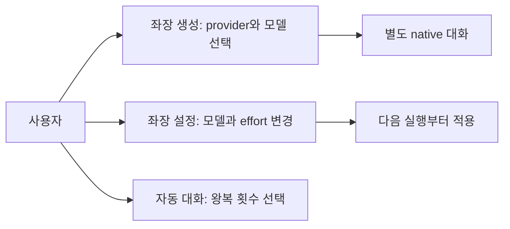
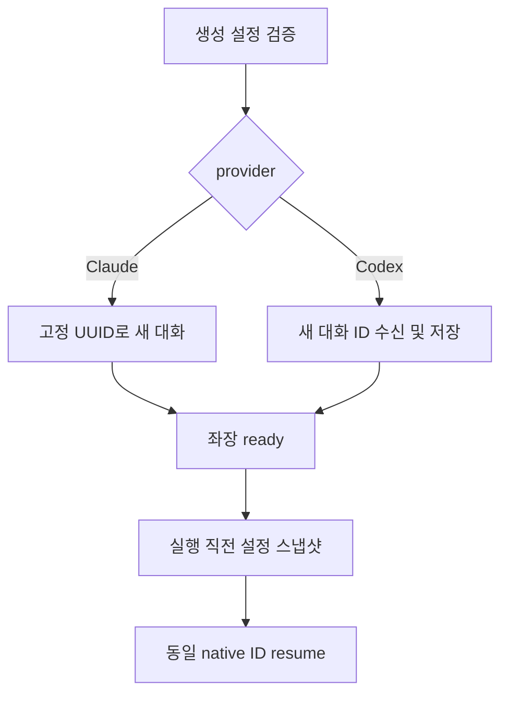
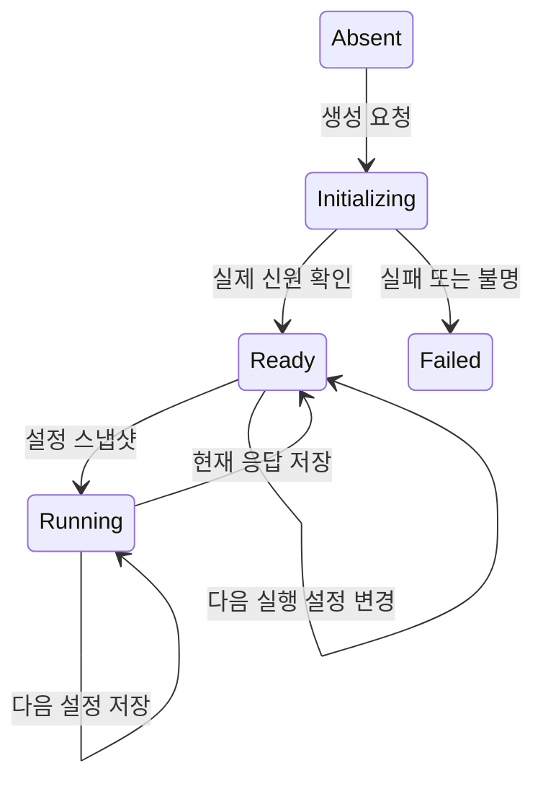
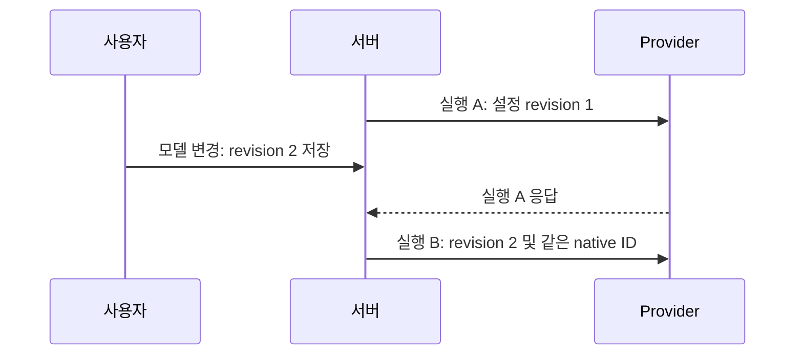
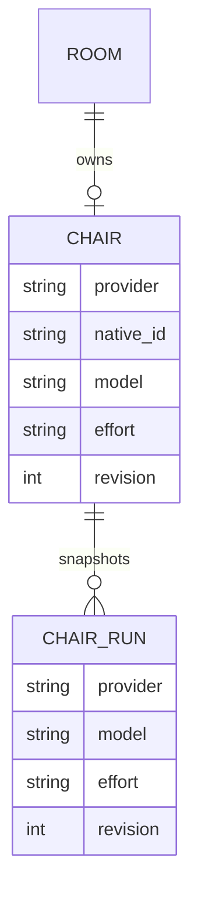
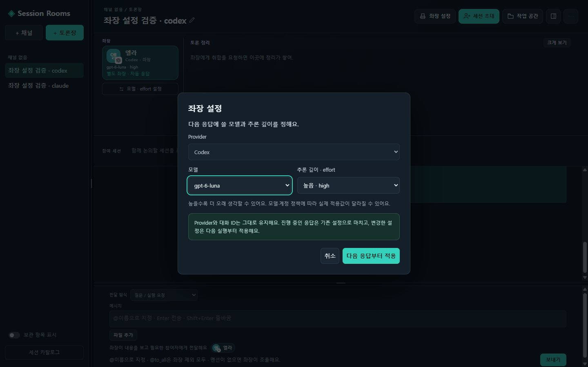
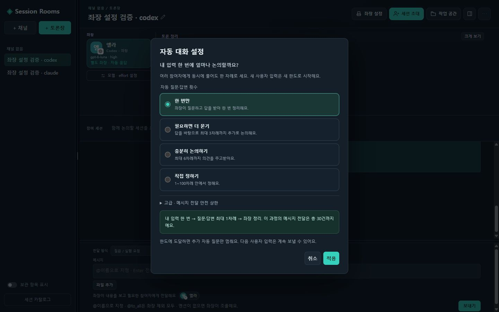

<!-- sr:plan
{"document_type":"decision","reader_questions":["생성 때 무엇을 선택하는가","토론 중 변경은 언제 적용되는가","한도는 무엇을 제한하는가","무엇을 실행 검증했는가"],"visual_plan":[{"kind":"comparison_table","content":"provider와 실행 설정 구분","required":true},{"kind":"flowchart","content":"선택부터 다음 실행까지","required":true},{"kind":"state_diagram","content":"생성 및 설정 변경 상태","required":true},{"kind":"sequence_diagram","content":"실행 설정 스냅샷","required":true},{"kind":"er_diagram","content":"좌장 설정과 실행 기록","required":true}],"visual_waiver":[]}
-->

# 좌장 provider·모델 설정과 자동 대화 한도

## 한눈에 보기

- 목적: 좌장의 provider를 선택하고 토론 중 모델·effort를 조절하며, 자동 대화가 어디서 멈추는지 이해한다.
- 현재 상태: 로컬 4318 반영 완료. 전체 120개 회귀 테스트와 두 provider 실제 생성·재개를 검증했다.
- 핵심 결론: provider와 native 대화 신원은 생성 후 고정하고, 모델·effort는 다음 실행부터 적용한다.
- 원인 또는 판단 근거: 변경 전 runner·저장은 Claude 고정이었으며 생성 UI에는 설정이 없었다. 한도는 숫자 두 개만 노출했다.
- 결정: 생성/변경 설정 UI, provider별 실행기, 실행별 설정 기록, 대화 왕복 기준의 프리셋과 고급 안전 한도를 추가한다.
- 다음 행동: 기존 borrowed Claude 참여자의 초안/추천문구 감지 문제를 별도로 복구한다. 새 전용 좌장 두 provider는 검증 완료다.
- 최종 갱신: 2026-10-23, Asia/Seoul.

## 1. 의도 (Intent)

생성 시 Claude/Codex를 선택한다. 생성 뒤 provider는 바꾸지 않고 모델과effort를 바꾼다. 변경 중 실행은 기존 설정으로 끝내며 다음 실행이 새 설정을 사용한다. 기존 좌장·native ID·대화·제안·자료·미확인 실행의 보호를 유지한다. 초대한 외부 참여자의 CLI 설정을 임의로 바꾸거나 provider를 교체하지 않는다.

## 2. 수용 기준 (Acceptance)

| ID | 결과 | 검증 |
|---|---|---|
| AC-1 | 생성 UI에서 provider·모델·effort를 고르고 실제 별도 좌장을 만든다. | 두 provider의 생성·native ID·최초 응답 대조 |
| AC-2 | 같은 provider·native ID를 유지한 모델·effort 변경은 다음 실행부터 적용되며 현재 실행은 보존한다. | 실행 스냅샷·경계 fixture 및 실제 동일 ID 재개 |
| AC-3 | 기존 Claude 좌장은 migration 후 같은 대화를 유지하고 잘못된 provider/effort 입력은 거부한다. | 기존 DB fixture·HTTP 검증·재시작 |
| AC-4 | 자동 대화 한도는 사용자 입력 한 번에 적용되며, 왕복 횟수 프리셋과 고급 전달 상한을 구분한다. | UI 저장/재열기·병렬 질문·새 입력 한도 회귀 |
| AC-5 | UI에서 현재 설정과 다음 적용 시점을 확인하며 실패·미확인을 성공으로 표시하지 않는다. | 실제 브라우저와 provider 오류/기존 unknown 회귀 |

## 3. 확정 사실 (Facts)

| 항목 | 직접 확인 | 영향 |
|---|---|---|
| 기존 좌장 | chairs.native_id NOT NULL, readyChair의 provider='claude', initialize/resume CLI는 도구/MCP 없는 Claude 실행 | additive 설정 migration 및 provider별 runner 분리 |
| Claude | 설치 CLI는 --model·--effort·--resume를 지원한다. 기존 --tools 빈 값·safe-mode·strict MCP를 유지한다. | 실행별 인자만 바꾸고 전역 설정을 쓰지 않는다. |
| Codex | 설치 exec/resume는 --model·model_reasoning_effort·--output-schema·--json·--ignore-user-config를 지원한다. 새 thread ID는 provider가 발급한다. | 초기화에서 실제 ID를 확인하고 ready 전 한 번만 바인딩한다. |
| 한도 | reply_to 계보별 자동 질문 깊이와 전달 수를 별도로 계산한다. 병렬 질문은 한 라운드다. | 기존 저장 의미를 바꾸지 않고 설명·선택 방식을 개선한다. |

### 선택지

고정 Claude를 유지하는 방법과 provider별 실행기를 추가하는 방법을 비교했다.

### 비교

| 설정 | 생성 후 변경 | 저장·적용 |
|---|---|---|
| Provider | 불가 | 좌장 신원과 고정 |
| 모델·effort | 가능 | 좌장 기본값 + 실제 실행별 스냅샷 |
| 자동 대화 왕복 | 가능 | 사용자 요청별 라운드 상한 |
| 전달 수 안전 상한 | 가능 | 병렬 대상 수와 취합을 포함하는 고급 설정 |

### 평가기준

동일 대화의 연속성, 실제 runner 인자, 진행 중 실행 보존, 사용자에게 보이는 적용 시점과 한도 의미로 판단한다.

### 결정

모델 목록은 가능한 로컬 provider 메타데이터를 사용하고 기본값/직접 모델 입력을 구분한다. 설정하지 않은 기존 모델은 provider 기본값으로 보존한다. 모델이 지원하지 않는 effort를 UI에서 정상 적용처럼 표시하지 않는다.

## 4. 유스케이스 (Use Cases)

## 5. 구조와 처리 흐름 (Flow)

## 6. 상태 전이 (State)

| 상태 | 저장/UI |
|---|---|
| Initializing | provider 고정, 초기화 결과 확인 전 대화 발신 안 함 |
| Ready | 현재 provider·모델·effort와 변경 동작 제공 |
| Running | 실행 당시 설정 유지, 변경값은 다음 실행용으로 저장 |
| Unknown | 미확인 실행 보호, 설정 변경이 재전송/신원 교체를 만들지 않음 |

## 7. 타이밍 (Timing)

## 8. 데이터 (ER)

## 9. 변경 지점 (Change Surface)

| 경로 | 변경 |
|---|---|
| `services/coordinator/store.js`, `chair.js`, `server.js` | 설정·migration·실행 스냅샷·API |
| `adapters/claude/chair.js` | 모델·effort 인자 전달 |
| `adapters/codex/chair.js` (신규) | 별도 Codex 좌장 생성·정확한 ID 재개 |
| `adapters/chair/index.js` (신규) | provider 실행기 선택 |
| `packages/contracts/chair-settings.js` (신규) | 설정·카탈로그 계약 |
| `apps/desktop/app.js`, `style.css` | 생성/변경 UI·자동 대화 프리셋 |
| `tests/` | 두 provider·기존 설정·진행 중 변경·한도 검증 |

## 10. 잠재 문제 (Risks)

| 위험 | 대응 |
|---|---|
| provider가 바뀌어 대화가 새로 생성됨 | 서버에서 변경 거부, native ID resume 검증 |
| 실행 중 설정을 바꿔 현재 요청과 기록이 불일치 | 실행 직전 스냅샷을 고정하고 실제 인자와 기록 대조 |
| Codex 임시 UUID를 실제 native ID로 오인 | ready 전 실제 발급 ID 확인, 초기화 불명은 자동 재생성 금지 |
| 모델 목록·지원 effort 변화 | 로컬 메타데이터와 명시적 기본값/오류 처리 |
| 한도 UI 단순화가 집계 의미를 변경 | 기존 request별 깊이/전달 집계를 유지 |

### 재검토 조건

provider의 도구 제한·구조화 출력·resume 형식이 바뀌면 해당 runner를 검증 전 사용 가능으로 표시하지 않는다.

## 11. 착수 순서 (Slices)

- [x] provider별 runner와 모델·effort 계약 — AC-1, AC-3.
- [x] 저장·API·실행 스냅샷 및 migration — AC-1, AC-2, AC-3.
- [x] 생성/설정과 자동 대화 한도 UI — AC-1, AC-4, AC-5.
- [x] 실제 두 provider·동일 ID·브라우저 검증 — AC-1, AC-2, AC-3, AC-4, AC-5.

## 12. 추적성 (Traceability)

### 결과

실행판: http://127.0.0.1:4318/. 기준 커밋 d8f026a에서 provider별 runner·저장 migration·설정 API·UI를 통합했다. 독립 acceptance audit는 AC-1~5 모두 PASS다. 원자료는 [검증 JSON](../validation/chair-provider-settings.json)에 있다.

| 검증 | 실제 관찰 | 판정 |
|---|---|---|
| Claude 생성·재개 | 격리 API에서 Sonnet/low 생성 → 실행 중 Opus/medium 저장 → 같은 native ID 다음 응답. native transcript 모델은 claude-sonnet-5-5 → claude-opus-5-5. | PASS |
| Codex 생성·재개 | 브라우저에서 gpt-6.1-sol/low 생성 → 실행 중 gpt-6-luna/medium 저장 → 같은 native ID 다음 응답. native transcript model·effort도 일치. | PASS |
| 설정 경계 | Claude 설정 변경 06:47:19.832 UTC는 첫 실행 06:47:19.203~06:47:23.917 안에 발생. Codex도 첫 실행 claim 뒤 06:46:57.652 UTC에 변경. 실행1은 revision1, 실행2는 revision2 유지. | PASS |
| 응답 연속성 | 두 provider 모두 모델 변경 후 앞서 전달한 검증 코드를 재현했다. 코드만으로 영구 기억을 보장한다는 의미는 아니다. | PASS |
| 실제 migration | 기존 2좌장·38메시지·2결정·10원문 근거와 5방·1채널·5세션의 모든 기존 컬럼이 일치. 새 provider=claude, model/effort=null, revision1. | PASS |
| 신원 변경 방지 | 실제 4318의 기존 Claude 좌장에 provider 변경 요청 → HTTP409, 기존 설정 그대로. 인증·CSRF·잘못된 effort도 HTTP 테스트로 확인. | PASS |
| 한도 UI | 사용자 지정 4차례/30전달 저장·재열기, 1차례 프리셋 저장·재열기. 병렬/독립 사용자 입력 한도 기존 회귀 유지. | PASS |
| UI·회귀 | 1280×800·1440×900 화면에서 설정 대화상자 가로 넘침 없음. npm test 120/120. | PASS |

### 사용 방법

1. **좌장 만들기**에서 Claude/Codex와 모델·effort를 선택한다.
2. 생성 후 **좌장 설정** 또는 좌장 카드 아래 **모델 · effort 설정**에서 변경한다. Provider는 비활성화되고 같은 대화 ID를 유지한다.
3. **더 보기 → 자동 대화 설정**에서 1회·3회·6회 또는 직접 횟수를 정한다. 전달 수 안전 상한은 고급 설정에 있다.

CLI 기본 모델은 기본 effort를 함께 사용한다. 직접 모델 ID 입력은 provider가 허용할 때 제공하며, 지원 effort가 확인된 목록 모델에서만 추론 깊이를 선택한다. Codex는 로컬 모델 메타데이터의 숨김 모델을 일반 선택 목록에서 제외한다. Claude effort는 요청 인자·실행 스냅샷을 검증했으며, native transcript에서 최종 적용 effort를 별도로 관측했다고 주장하지 않는다.

### 실패 처리와 남은 범위

Codex의 구조화 응답은 선택 항목을 null로 반환할 수 있다. 기존 조율기 검증이 이를 거부해 첫 결과 적용이 unknown이 됐고, nullable 선택 필드를 정상 처리하도록 수정했다. 보관된 output_json을 **재실행 없이** 적용한 뒤 동일 native ID로 다음 응답을 검증했다. 잘못된 대상·반응·첨부는 기존대로 거부한다.

이전에 초대한 Claude ‘수아’ 참여자는 초안/추천문구 감지로 기존 요청이 차단된 상태다. 사용자 승인으로 취소 신호를 한 번 전달했지만 감지 문구가 남아 있어 복구 완료로 처리하지 않았다. 이번 새 전용 Claude 좌장 검증과 구분한다. 기존 사용자 토론장에 테스트 질문은 보내지 않았다.

### 화면

## 참고

- [[dedicated-chair]], [[session-room-foundation]], [[inter-session-index]]
- [Codex non-interactive mode](https://learn.chatgpt.com/docs/non-interactive-mode)
- [Claude model configuration](https://code.claude.com/docs/en/model-config)

