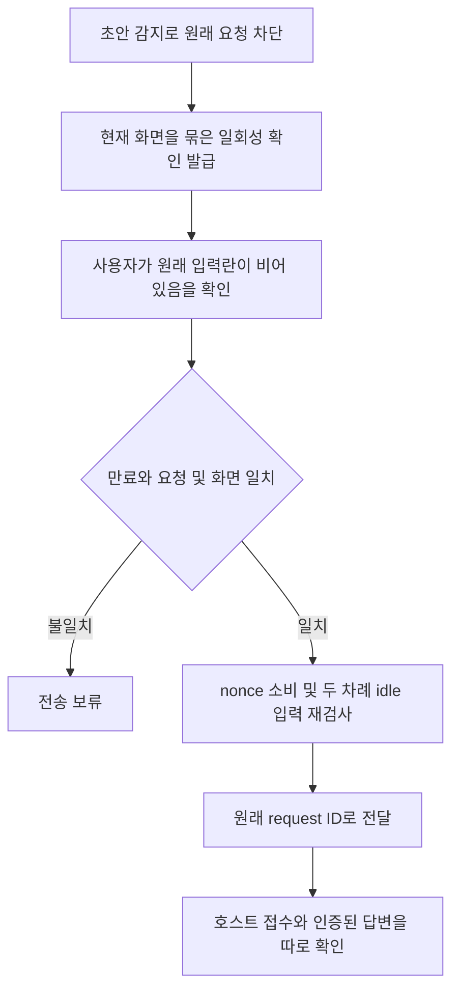

<!-- sr:plan
{"document_type":"incident","reader_questions":["왜 빈 입력이 차단되는가","기존 요청을 어떻게 복구하는가","무엇을 검증했는가"],"visual_plan":[{"kind":"flowchart","content":"오탐 확인과 요청 단위 복구","required":true}],"visual_waiver":[]}
-->

# 빈 입력 확인 후 초안 오탐 요청 복구

## 한눈에 보기

- 목적: 실제 입력란이 비어 있다는 사용자 확인을 바탕으로 차단된 원래 요청 한 건을 복구한다.
- 현재 상태: 4318 반영 완료. 원래 요청 3/3건의 인증된 답변을 회수했고 전체 124개 회귀 테스트가 통과했다.
- 핵심 결론: 감지 문자열을 실제 사용자 초안으로 단정할 수 없다. 확인 효력은 해당 요청과 현재 화면 한 번에 한정한다.
- 원인 또는 판단 근거: Orca read API가 draft 문자열을 반환하면 기존 adapter가 즉시 차단한다. API에는 원래 셀 스타일이 없다.
- 다음 행동: 이후 같은 오탐이 나면 해당 요청의 상태 다시 확인에서 빈 입력 확인 후 한 번 전달한다. 자동 판별 개선은 Orca의 richer composer metadata가 필요하다.
- 최종 갱신: 2026-10-23, Asia/Seoul.

## 현상

사용자는 Claude 입력란에 미전송 글이 없다고 확인했지만 Orca read API는 예전 문장을 draft로 반환했다. 앱은 이 보고를 실제 초안으로 취급해 원래 요청의 전송을 막았다.

## 영향

수아의 원래 요청 세 건이 전송 대기 상태로 남았다. 실제 사용자 초안이 있었다는 증거는 확보되지 않았다. 복구 후 기존 메시지·세션·좌장·결정·근거 데이터의 모든 기존 컬럼을 대조해 변경이 없음을 확인했다.

## 타임라인

| 순서 | 관찰 또는 조치 |
|---|---|
| 1 | 사용자가 입력란에 미전송 글이 없다고 정정했다. |
| 2 | 읽기 전용 API와 설치 코드를 확인해 감지 보고와 실제 입력을 구분했다. |
| 3 | 원래 요청 한 건과 현재 화면에만 묶인 일회성 복구를 구현했다. |
| 4 | 실제 UI 검증에서 자동 tick과 수동 복구의 경쟁을 발견하고 회귀 테스트와 함께 수정했다. |
| 5 | 원래 요청 3/3건의 인증된 답변과 데이터 보존을 확인했다. |

## 근본원인

앱은 Orca의 draft 보고를 실제 사용자 입력과 구별하지 않고 전송 차단 근거로 사용했다. 설치 코드에는 dim 문자를 제외한 afterCursor가 비면 rawAfterCursor로 돌아가는 경로가 있다. 추천 문구 오탐이 가능한 경로지만 현재 문자의 스타일은 API에 없어 그 세부 원인은 확정하지 않았다.

별도로 확인된 복구 경쟁은 자동 tick이 검사 중인 요청에 수동 확인을 소비하던 동작이었다. tick 완료를 기다리고 원래 행을 다시 읽은 뒤 확인을 소비하도록 수정했다.

## 검증

전체 테스트 124/124, dispatcher 집중 테스트 15/15와 독립 수용 기준 AC-1~4를 통과했다. 실제 4318 환경에서 같은 native 세션·원래 request ID 세 건의 인증된 답변을 확인했다. 접수와 답변 회수는 [검증 JSON](../validation/composer-recovery.json)에 구분해 기록했다.

## 1. 의도 (Intent)

| 항목 | 내용 |
|---|---|
| 문제 | 사용자가 입력란이 비어 있다고 확인한 Claude 참여 세션의 요청이 초안 감지 때문에 전송되지 않는다. |
| 주 사용자 | 기존 Codex/Claude 세션을 토론장에 연결한 사용자 |
| 불변식 | 실제 초안·busy·신원 변경은 보호한다. 원래 request_id·대화·자료를 유지하며 중복 실행하지 않는다. |
| 범위 | 원래 queued 요청 중 host dispatch 기록이 없는 한 건에 대한 일회성 복구 |
| 비목표 | Orca 설치 번들 수정, 모든 draft 무시, 특정 추천 문자열 화이트리스트, 다른 세션 입력 삭제 |

## 2. 수용 기준 (Acceptance)

| ID | 결과 | 검증 |
|---|---|---|
| AC-1 | 감지 결과와 실제 입력을 구분해 설명하고 차단 시 확인 동작을 제공한다. | 실제 API·브라우저 대화상자 |
| AC-2 | 사용자 확인은 원래 요청·handle·incarnation·draft와 화면에 묶이며 60초 이내 한 번만 사용한다. | 만료·재사용·다른 요청·화면 변경·동시 요청 테스트 |
| AC-3 | 자동 전달과 실제 초안·busy·알 수 없는 화면 보호를 유지한다. | adapter·dispatcher 회귀, 두 preflight 변경 fixture |
| AC-4 | 수아의 원래 요청을 같은 request_id로 전달하고 인증된 답변을 회수하며, 실패를 성공으로 표시하지 않는다. | 원래 delivery·receipt·room_reply·메시지 보존 실제 대조 |

## 3. 확정 사실 (Findings)

| 확인 | 관찰 | 의미 |
|---|---|---|
| 사용자 | 원래 Claude 입력란에 미전송 글이 없다고 확인했다. | 사용자 초안을 지우라는 안내를 철회한다. |
| 현재 Orca API | 정확한 handle에서 예전 문장을 draft에 계속 반환한다. tail에서는 그 문장을 제거한다. | tail의 빈 프롬프트는 독립적인 빈 입력 증거가 아니다. |
| 설치 코드 | dim 문자를 제외한 afterCursor가 비면 rawAfterCursor를 사용한다. | 추천 문구가 오탐되는 경로는 존재하지만 현재 문자의 스타일은 API로 확정할 수 없다. |
| 원래 요청 | 세 요청은 queued이며 participant_dispatches 기록이 없다. | 접수된 요청을 새 요청으로 만들지 않고 원래 delivery를 전달할 수 있다. |

## 5. 복구 흐름

## 9. 변경 지점

| 파일 | 변경 |
|---|---|
| `adapters/orca/index.js` | 한 번 확인한 화면에만 제한된 입력 검사 |
| `services/coordinator/participant-dispatcher.js` | 만료되는 일회성 확인 및 기존 요청 복구 |
| `services/coordinator/server.js` | retry API 확인 값 전달 |
| `apps/desktop/app.js` | 오탐 확인 대화상자 |
| `tests/participant-dispatcher.test.js` | 기본 차단·확인 범위·경쟁·만료·재사용 검증 |

## 10. 잠재 문제와 대응

| 문제 | 대응 |
|---|---|
| 확인 뒤 실제 입력이나 연결이 바뀜 | draft·화면·handle·incarnation을 다시 검사하고 다르면 보류한다. |
| 같은 확인을 다른 요청에 재사용 | 서버 메모리 nonce를 원래 delivery에 묶고 소비한다. 재시작하면 사라진다. |
| Orca 접수 여부가 불명확함 | unknown을 유지하고 기존 receipt 재조회만 허용한다. 새 요청을 만들지 않는다. |

## 11. 착수 순서

- [x] 확인 UI와 API·원래 요청 복구 — AC-1, AC-2.
- [x] 정상 보호·경쟁·재사용 회귀 — AC-2, AC-3.
- [x] 실제 원래 요청 전달과 답변 검증 — AC-4.

## 12. 결과

전체 npm test **124/124**, 독립 acceptance audit **AC-1~4 PASS**. [실제 검증 JSON](../validation/composer-recovery.json)에 원래 delivery/request ID, host 접수와 인증된 room_reply를 함께 기록했다.

| 원래 request ID 앞부분 | 전달 상태 | 인증된 답변 | 답변 ID 앞부분 |
|---|---|---|---|
| 9e0789a6 | completed | 확인 | 771b2d42 |
| 1a94c335 | completed | 확인 | 4a6fa7e6 |
| 08b72dc8 | completed | 확인 | 869f30f4 |

현재 native ID는 4703f258-92f2-4ffd-9ccd-37d61b2f4144이며 새 대화를 만들지 않았다. 첫 답변에는 SCN_CLAUDE_OK가 있다. 원래38메시지·5세션·2좌장·2결정·10근거의 모든 기존 컬럼은 그대로였다. nonce·쿠키·등록 토큰은 보고서에 저장하지 않았다.

실제 UI 첫 시도에서는 자동 tick이 해당 delivery를 검사 중일 때 수동 복구가 in-flight 결과로 끝나며 nonce만 소비되는 경쟁을 발견했다. 확인된 재호출은 진행 중 tick을 기다린 뒤 row를 다시 읽고 소비·dispatch하도록 고쳤으며 경쟁 회귀를 추가했다. 두 번째 실제 시도에서 원래 요청의 turn_started와 인증된 답변을 확인했다.

### 재발 방지와 한계

감지 알고리즘을 자동으로 고쳤다고 주장하지 않는다. 첫 응답 뒤 다른 문구도 draft로 반환됐고, 현재 API만으로 실제 dim 추천문구인지 확인할 수는 없다. 이번 경로는 사용자가 원래 입력란이 비어 있음을 확인한 경우에만 해당 요청을 한 번 전달한다. 다른 요청이나 이후 화면에 그 확인을 자동으로 재사용하지 않는다.

호스트의 마지막 dispatch 상태가 running이어도 인증된 reply가 저장돼 delivery가 completed이면 답변 회수가 완료된 상태다. 접수·모델 시작·인증된 답변을 구분해서 기록한다. CLI를 통해 전달됐는지는 receipt로 확인하며 모델이 본문에서 전송 주체를 추정한 표현은 실행 근거로 쓰지 않는다.

앱의 실제 확인 대화상자와 답변 회수 화면을 브라우저로 검증했다. 보고서 HTML은 로컬 파일 URL 정책 때문에 브라우저 화면 검증을 생략하고 원문·위키·본문 해시·Mermaid 문법·참조를 정적으로 검사한다.

## 참고

- [[catalog-archive-ux]], [[inter-session-index]]

