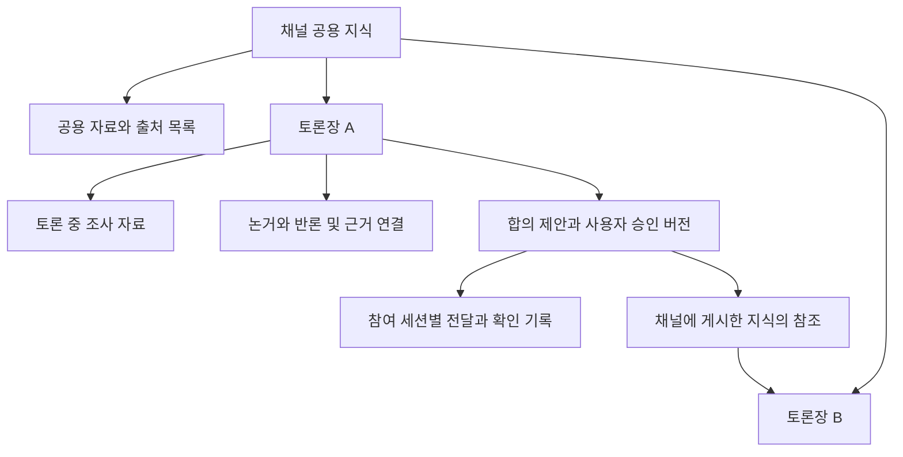
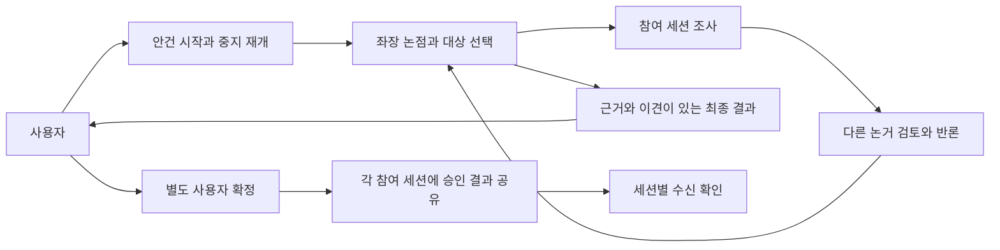
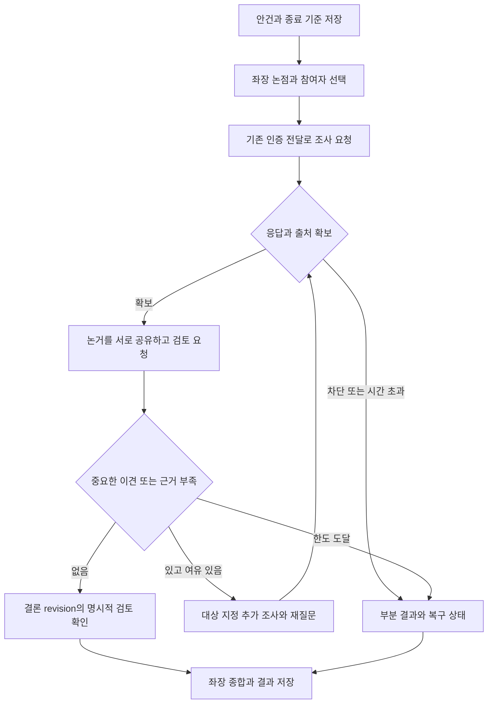
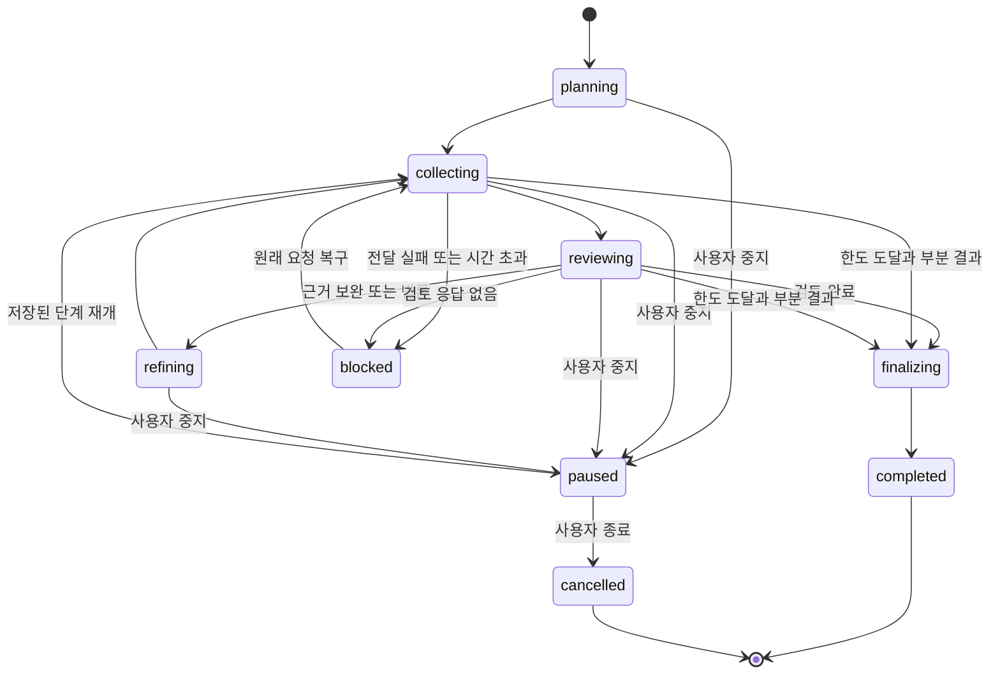
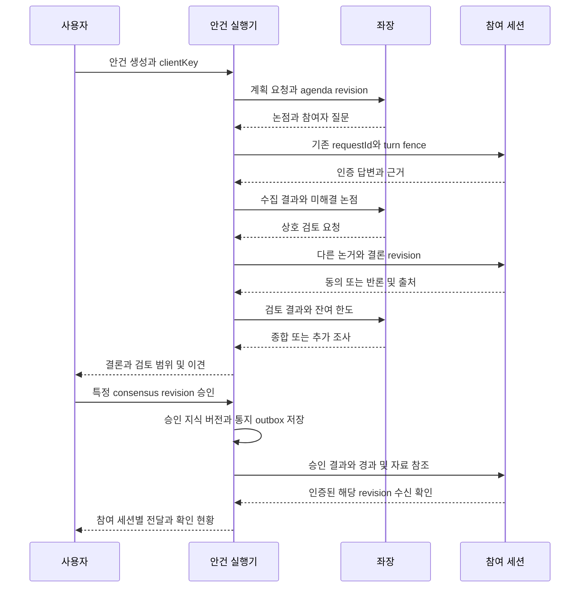
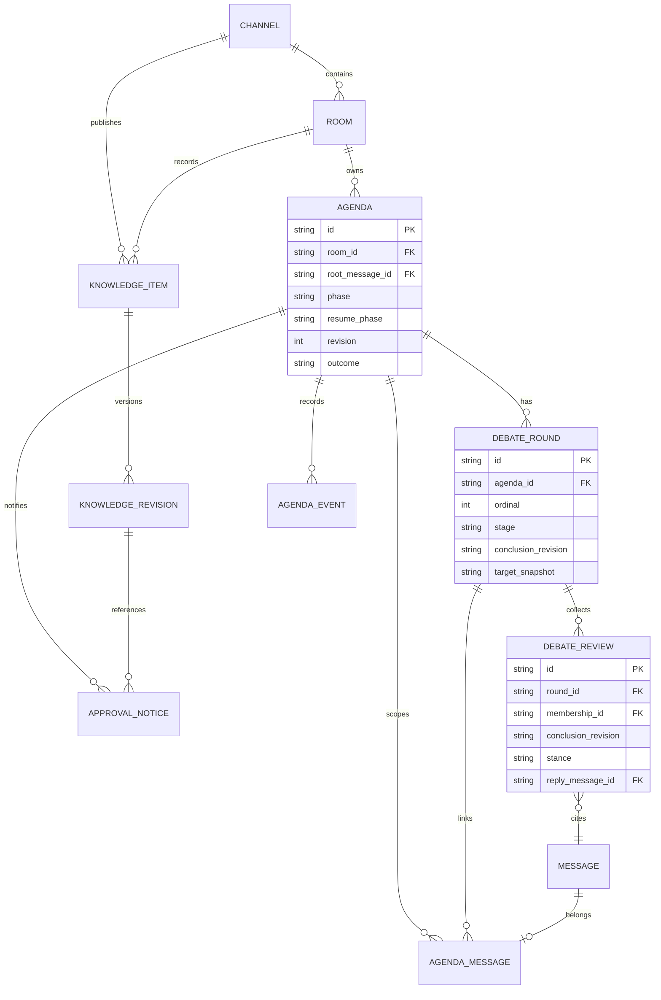

<!-- sr:plan
{"document_type":"decision","reader_questions":["단발 응답과 무엇이 다른가","어떤 조건으로 토론을 이어가고 마치는가","기존 세션의 도구와 자료는 어떻게 쓰는가","합의와 사용자 확정은 어떻게 구분하는가"],"visual_plan":[{"kind":"decision_matrix","content":"토론 실행 방식 비교","required":true},{"kind":"flowchart","content":"근거 수집과 상호 검토","required":true},{"kind":"state_diagram","content":"안건 상태와 중단 복구","required":true}],"visual_waiver":[]}
-->

# 안건별 자율 토론과 근거 기반 합의

> 사용자가 안건을 주면 좌장이 참여자의 조사·논거·반론·재검토를 조율하고, 합의의 근거와 남은 이견을 사용자에게 전달한다.

## 한눈에 보기

- 목적: 참여자에게 질문을 한 번씩 돌리는 흐름에서 안건을 해결하는 지속 토론으로 확장한다.
- 현재 상태: 2026-10-26 사용자 구현 승인. 핵심 구현과 실제 두 provider 조사·상호 검토·승인 ACK를 확인했다. Orca 자동 입력 제한 때문에 전체 무인 인수는 완료하지 않았다.
- 핵심 결론: 채널 → 토론장 트리에 자료·논거·합의와 변경 이력을 축적하고, 참여 세션이 필요한 지식 버전을 조회·수신하게 한다.
- 원인 또는 판단 근거: 기존 전달 경로에 안건 상태·명시적 검토·합의 판정·지식 관리가 추가됐고 원래 데이터는 보존됐다.
- 결정: 기존 인증 전달 경로 위에 안건 상태기와 채널·토론장 지식 관리를 추가한다. 승인 결과 공유와 후속 작업 실행은 분리한다.
- 다음 행동: Orca 추천문구/초안 구분과 Codex 붙여넣기 제출 문제를 해결한 뒤 무인 경로를 다시 검증한다.
- 최종 갱신: 2026-10-26, Asia/Seoul.

## 맥락

사용자는 “특정 agenda를 던지면 좌장 조율 아래 연관된 세션들이 접근 가능한 도구와 자료로 논거를 제시하고 대화해 최종 consensus를 전달”하는 방식을 요청했다. 현재 실행판을 통째로 다시 만들기보다 이미 검증한 전달·답변 상관관계와 세션 신원을 재사용한다.

## 선택지

| 안 | 동작 | 비용 |
|---|---|---|
| A | 기존 좌장 프롬프트에 더 토론하라는 지시만 추가 | 작지만 상태·종결 증거가 없음 |
| B | 안건별 지속 상태와 근거·검토 기록을 기존 전달 위에 추가 | 저장·좌장·UI 확장 필요 |
| C | 모든 세션을 새 자율 agent 런타임으로 교체 | 기존 native 맥락·권한·연결 보존 비용 큼 |

## 평가기준

| 기준 | 판정 방법 |
|---|---|
| 기존 맥락 보존 | 같은 native 세션과 인증된 원래 전달 경로 사용 |
| 토론 추적 | 안건·라운드·논거·검토·결론의 연결을 DB와 UI에서 조회 |
| 합의 신뢰성 | 반론 기회와 명시적 검토 없이 합의로 종료하지 않음 |
| 복구 | 재시작·중복 응답·전송 불명확을 중복 실행으로 바꾸지 않음 |

## 비교

| 기준 | A | B | C |
|---|---|---|---|
| native 맥락 유지 | 가능 | 가능 | 새 실행 환경에 따라 달라짐 |
| 검토 후 합의 판정 | 모델 표현에 의존 | 상태와 검토 기록으로 검사 | 별도 설계 필요 |
| 중단·재개 | 요청 단위만 존재 | 안건 단위로 제공 | 새 전달 경계 필요 |
| 기존 앱 재사용 | 높음 | 높음 | 낮음 |

## 결정

B를 적용했다. 좌장은 주제 분해·대상 선택·질문·반론 정리·종결 판단을 맡고 참여 세션은 본래 환경에서 조사하고 응답한다. 말의 횟수보다 어떤 주장이 검토됐는지를 저장한다.

## 1. 의도 (Intent)

| 항목 | 내용 |
|---|---|
| 주 사용자 | 기존 Codex·Claude 세션을 불러 안건을 함께 해결하려는 사용자 |
| 핵심 동작 | 안건 제시 → 좌장 논점·대상 선택 → 근거 수집 → 상호 검토 → 필요 시 추가 조사 → 결론 |
| 불변식 | native 신원·원래 도구 권한·인증·writer fence·요청 멱등성을 유지한다. 침묵과 한도 도달은 동의가 아니다. |
| 비목표 | provider 권한 자동 확장, 좌장에 임의 shell 권한 부여, 사용자 확인 없는 배포·결제·외부 발신, 무제한 토론 |
| 합의 의미 | 좌장이 근거와 명시적 검토를 종합한 결론. 참여자 전원 동의 여부와 사용자 확정은 별도 필드다. |
| 지식 계층 | 앱의 기존 채널 → 토론장 트리를 유지한다. 안건은 토론장 안의 토론 단위다. |
| 실행 경계 | 토론 중 필요한 조사·조회·검증은 수행한다. consensus나 결과 승인만으로 구현·수정 등 후속 작업을 자동 시작하지 않는다. |

## 2. 수용 기준 (Acceptance)

| ID | 사용자에게 보이는 결과 | intended runtime | 검증 방법·증거 | 중요 |
|---|---|---|---|---|
| AC-1 | 안건 시작 시 목표·종료 기준·사용할 자료·선택 가능 참여자를 확인하고 진행 상태를 본다. | 로컬 앱 | 실제 새 안건 생성·DB/화면 동일 ID 확인 | critical |
| AC-2 | 좌장이 관련 참여자를 이유와 함께 선정하고 논점을 나눠 각자 조사·논거를 요청한다. | 좌장와 native 참여 세션 | 실제 두 provider의 동일 native ID·질문 receipt·인증 답변 확인 | critical |
| AC-3 | 참여자는 자신의 허용된 도구·자료로 조사하고 출처·불확실성·다른 발언에 대한 견해를 제출한다. | native CLI/MCP | 테스트 전용 파일을 실제 도구로 읽은 관측과 출처가 있는 응답. 도구 미사용/실패는 별도 표시 | critical |
| AC-4 | 최초 답변을 바로 합의로 만들지 않고 다른 참여자의 논거를 공유해 최소 한 번 상호 검토한다. | 안건 실행기 | 논거 수집→다른 세션 검토→좌장 재종합의 실제 event trace | critical |
| AC-5 | 이견이 있으면 해당 주장과 근거를 지정해 재질문하고 답변에 따라 결론을 갱신한다. | 안건 실행기 | 반론 fixture와 실제 검증 안건에서 revision 변경·추가 라운드 확인 | critical |
| AC-6 | 마지막 결론을 검토한 참여자·동의/조건부/반대/미응답과 미해결 이견을 함께 보여준다. | 저장·앱 | 오래된 결론에 대한 찬성을 새 revision 동의로 사용하지 않는 테스트·화면 | critical |
| AC-7 | 한도·실패·차단·응답 없음은 부분 결과로 전달하며 합의나 사용자 확정으로 오표시하지 않는다. | 실행기·앱 | timeout·실패·한도·반대·검토자 없음 시나리오 | critical |
| AC-8 | 중지·재개·재시작·동시 안건에도 중복 호출·교차 근거·옛 결과 적용이 없다. | SQLite·coordinator | 재시작·fence·idempotency·cross-agenda 테스트와 DB 비교 | critical |
| AC-9 | 일반 질문·개별 멘션·@to_all·기존 요청별 한도·재호출·자료를 보존한다. | 기존 앱/MCP | 기존124개 회귀와 대표 실제 사용자 경로 | critical |
| AC-10 | 최종 요약·논거·이견·검토 기록을 작업공간에 안건별로 저장하고 원문으로 돌아갈 수 있다. | workspace·앱 | 재시작 후 동일 export·출처 연결·다른 안건 파일 비오염 | critical |
| AC-11 | 채널 → 토론장 트리에서 공용 자료·토론장 자료·논거·합의안을 열고 출처와 상태로 검색한다. | 지식 API·앱 | 두 채널·여러 토론장 fixture, 출처 연결·범위·검색·권한 경계 검증 | critical |
| AC-12 | 기존·신규 참여 세션이 토론 중 관련 자료와 논거의 최신 버전 및 미수신 변경분을 읽을 수 있다. | native CLI/MCP | 새 검증 세션의 지식 조회·원문 인용·버전 확인, 문맥 초과 시 추가 조회 경로 검증 | critical |
| AC-13 | 사용자 승인 후 각 참여 세션에 승인 버전·주요 논거·이견·원문 참조를 전달하고 세션별 확인 상태를 표시한다. | 승인 outbox·native CLI·앱 | 두 provider 수신 확인, busy·재시작·중복 승인·오래된 ACK·등록 철회 시나리오 | critical |
| AC-14 | 결과 승인과 수신 확인만으로 후속 구현·수정 작업이 실행되지 않는다. | 실행기·앱 | 승인·ACK 후 실행 요청 생성0건, 별도 명시 실행 요청의 독립 경로 검증 | critical |
| AC-15 | 자료·지식 저장 기본 루트는 D:\inter_session_debate이며 설정에서 실제 절대 경로로 바꾸고 재시작 후 유지한다. | 설정 API·앱·파일시스템 | 기본값·경로 검증·설정 영속·새 루트 재내보내기·기존 DB/native cwd 보존 검증 | critical |

## 3. 확정 사실 (Findings)

| 사실 | 확인 위치·방법 | 설계에 주는 제약 |
|---|---|---|
| 후속 취합이 이미 있다. 인증 답변을 root별로 모으고 대기 중 전달이 없으면 좌장에게 followup을 만든다. | `services/coordinator/chair.js`의 scheduleSummary 직접 확인 | 단발 전용이라고 단정하지 않고 기존 루프를 확장 |
| 좌장 응답은 speech/questions/proposal과 반응·첨부를 사용한다. | `adapters/chair/schema.js`, applyOutput | 단계·결론 revision·검토 요청 구조를 추가해야 함 |
| 현재 좌장 프롬프트에는 You have no tools가 있다. 참여자 작업은 별도 dispatcher로 전달된다. | ChairCoordinator.context 및 server timer | 참여자 본래 도구를 재사용하고 좌장 도구 실행을 성공으로 가정하지 않음 |
| proposal의 sourceIds는 현재 같은 room 존재 여부를 검사한다. | ChairCoordinator.validate | 안건별 출처 경계 검사가 추가로 필요 |
| 요청별 한도와 root ancestry·재시작 보존 테스트가 있다. | `tests/dialogue-loop.test.js` | 안건은 원래 root를 보존하며 별도 입력과 전역 누적하지 않음 |
| 사용자 확정은 proposed decision을 confirmed로 바꾼다. | Store.confirmDecision | agent 합의 결과와 분리 |
| dev 병합 후124개 테스트가 통과했다. | `.local/dev-merge-tests.log`, merge4fab1a6, 직접 실행 2026-10-23 | 기존 동작 회귀 기준 |
| 현재 저장 계층은 channels와 rooms.channel_id다. 채널에는 지식 작업공간 필드가 없다. | Store.createChannel/createRoom 직접 확인, 2026-10-26 | 현재 UI 트리를 유지하며 채널 지식 저장 경로를 별도 추가 |
| 작업공간 export는 토론장 cwd의 .session-rooms/roomId에 transcript·consensus·manifest·첨부를 저장한다. | `services/coordinator/workspace.js` 직접 확인, 2026-10-26 | 이를 완성된 채널 지식 관리로 간주하지 않음 |
| 사용자 확정은 DB 상태와 이벤트만 갱신하고 참여자 전달을 만들지 않는다. | Store.confirmDecision 직접 확인, 2026-10-26 | 승인 결과 통지와 수신 확인 outbox 필요 |

### 채널 → 토론장 지식 구조

| 위치 | 관리할 내용 | 세션의 사용 방식 |
|---|---|---|
| 채널 | 공용 자료, 출처 색인, 토론장 목차, 게시된 합의·지식의 원문 참조와 버전 | 같은 채널의 허용된 공용 지식을 검색·인용 |
| 토론장 | 대화 원문, 조사 자료, 논거·반론·검토, 안건별 consensus와 승인 이력 | 현재 안건의 관련 원문과 변경분 조회 |
| 참여 세션별 기록 | 마지막 제공 버전·마지막 확인 버전·대기 중 통지 | 신규 참여·재접속 시 필요한 내용부터 동기화 |

자료는 URL·파일·첨부·조사 메모와 원래 출처를 연결한다. 수집 주체·시각·해시·자료 버전·원문 위치를 보존하고, 논거에는 어떤 자료의 어느 부분이 지지하거나 반박하는지 연결한다. 모델이 만든 요약·해석은 원자료와 별도 항목이다. 파일을 해석하지 못했으면 메타데이터만 있다고 표시한다.

토론 중 자료와 논거는 저장 즉시 해당 토론장에서 조회할 수 있게 하고 다음 관련 입력에 변경 요약과 참조를 포함한다. 전체 원문을 매번 모든 세션에 넣지는 않는다. 세션은 안정된 ID로 자료·논거·합의의 상세 내용을 추가 조회할 수 있어야 한다. 원문 보관만 해두거나 Markdown을 export한 것만으로 세션이 내용을 인지했다고 표시하지 않는다.

LLM Wiki의 링크·변경 이력과 NotebookLM의 자료 선택·출처 기반 조회를 참고한 기능 설계다. 특정 외부 제품의 저장 형식이나 런타임을 필수 의존성으로 추가하지 않는다. 채널 공용 자료와 게시된 지식은 명시된 채널 읽기 범위로 제공하고, 다른 토론장의 비공개 원문이나 다른 채널 자료까지 기존 room 토큰으로 자동 개방하지 않는다. 다른 토론장의 결론을 재사용할 때도 출처 room·agenda·revision과 근거를 유지한다.

재사용하는 공용 지식은 현재 안건에 버전이 지정된 참조로 등록한 뒤 근거로 사용한다. 다른 안건의 원문 ID만 넣어 현재 안건에서 검토된 응답인 것처럼 취급하지 않는다.

미소속 토론장은 자기 자료만 관리하며 ‘채널 없음’을 공용 지식 채널로 취급하지 않는다. 표시 이름 변경은 ID와 지식 링크를 바꾸지 않고 보관은 삭제가 아니다. 향후 토론장 이동을 지원할 때는 자료 참조와 읽기 범위를 다시 검사한다.

원본 데이터와 버전·링크·전달 상태의 기준은 DB다. 사용자가 지정한 채널 지식 폴더에는 index·자료·논거·토론장별 합의의 Markdown/manifest를 읽기용으로 export하고, 기존 토론장 cwd export도 유지한다. 파일 편집을 DB에 자동 역수입하지 않으며 양쪽을 독립된 최신본으로 취급하지 않는다. 새 세션은 공유 지식으로 맥락을 다시 구성하고, 세션 자체의 영구 기억에 저장됐다고 가정하지 않는다.

자료·지식 저장 루트의 기본값은 `D:\inter_session_debate`다. 앱 설정에서 절대 경로를 지정하며 설정은 재시작 후 유지한다. 루트 변경은 DB의 지식을 새 위치에 다시 내보내며 이전 위치의 자료를 삭제하지 않는다. 기존 SQLite DB 위치와 참여 세션의 native cwd를 이 설정만으로 옮기지 않는다. 표시 이름 대신 채널·토론장 ID로 하위 경로를 구성한다.

## 4. 유스케이스

안건은 입력창의 별도 “안건으로 토론” 동작으로 시작한다. 일반 전송을 모두 토론으로 바꾸지 않는다. 안건 도중 추가 입력은 현재 안건 보충과 새 질문을 구분해 표시한다. 안건을 보충해 목표·핵심 자료가 바뀌면 결론 revision과 재검토 필요 상태를 갱신한다.

자료 UI도 채널 → 토론장 트리를 따른다. 사용자는 채널 공용 자료와 현재 토론장의 자료·논거·consensus를 구분해 보고, 상태·자료 유형·안건으로 찾고, 인용을 눌러 원문으로 돌아간다. 승인 결과에는 어떤 참여 세션이 어느 버전을 확인했는지 표시한다.

## 5. 처리 흐름

좌장이 다음 행동을 구조화해 제출하고 서버가 안건 상태·수신자·근거·한도를 검사한다. 참여자 요청에는 agendaId, roundId, 논점, 참조 원문 ID와 내용, 사용 가능한 첨부 ID, 기대 응답을 포함한다. 반론은 무엇에 대한 반론인지 원문을 연결한다. 좌장 기억의 마지막80개 메시지만으로 진행을 결정하지 않고 현재 안건의 요약·미해결 논점·현재 라운드 원문을 별도로 제공한다.

## 6. 상태 전이

| 상태 | 저장·화면 | 다음 동작 |
|---|---|---|
| planning | 목표·종료 기준·논점·선정 근거 | 좌장 계획 검증 후 질문 |
| collecting | 요청·접수·인증 답변·출처 | 라운드 대상별 결과 확보 |
| reviewing | 결론 revision과 검토 대상·명시적 견해 | 새 반론이면 refining |
| refining | 미해결 논점·요청 목적·남은 한도 | 필요한 대상에게 추가 조사 |
| blocked | 누가 어떤 전달 때문에 막혔는지 표시 | 기존 재호출 또는 사용자 재개 |
| paused | resumePhase와 원래 대기 요청 보존 | 새 입력 생성 없이 재개 |
| finalizing/completed | 결론·근거·이견·검토 범위·종료 사유 | 사용자에게 전달 |
| cancelled | 취소 시점과 이미 접수된 작업 | 새 전달 중단, 늦은 답변은 이력으로 보존 |

그림의 paused→collecting은 보존된 resumePhase로 재진입하는 흐름을 대표한다. 실제 저장은 planning/collecting/reviewing/refining 중 원래 단계를 보존한다. 완료 안건의 늦은 답변은 결과를 조용히 바꾸거나 새로운 호출을 만들지 않는다.

### 합의 판정

실행 상태 completed와 결론 outcome은 다르다. outcome은 consensus / qualified / disputed / insufficient_evidence / limit_reached / cancelled를 구분한다. consensus는 좌장이 제시한 현재 결론 revision에 필요한 검토자들의 명시적 검토가 있고, 해결되지 않은 중요한 반론·누락 응답·미검증 핵심 근거가 없을 때만 허용한다. 찬성 수가 많거나 반응 ✅가 있다는 이유로 자동 합의하지 않는다.

좌장 종합, 참여자별 견해, 전원 동의 여부, 사용자 확정을 별도 표시한다. 조건부 합의나 끝내 풀리지 않은 이견도 사용자에게 결과로 전달한다. 실제로 합의가 안 됐는데 합의를 만들어내도록 강제하지 않는다.

### 사용자 승인 후 결과 공유

사용자 승인은 정확한 consensus revision의 승인 시점과 내용을 고정한다. 토론의 주요 경과·채택/기각한 논거·근거·남은 이견을 포함한 승인 자료 묶음을 해당 안건의 참여자 스냅샷에 전달한다. 승인과 세션별 통지 outbox 생성은 같은 트랜잭션으로 기록한다. 이 통지는 결과를 맥락으로 읽고 확인하라는 목적이며 후속 구현을 지시하지 않는다.

통지 상태는 queued / delivered / acknowledged / blocked / revoked로 구분한다. 호스트 접수는 delivered의 근거이고, 정확한 revision을 포함한 해당 native 세션의 인증 응답이 있어야 acknowledged다. 세션이 바쁘거나 입력 초안이 있으면 기존 보호·직렬화 아래 대기한다. 재시작 후 같은 통지 ID로 상태를 대조하고, 등록 철회·이탈로 전달 권한이 없으면 revoked로 남겨 임의로 세션을 깨우지 않는다. 일부 미확인 세션이 있어도 사용자 승인 자체를 취소하지 않고 전달 현황을 별도로 표시한다.

수신 확인은 모델의 영구 기억이나 사람 수준 이해를 증명하지 않는다. 그 대화에 특정 버전이 전달되고 확인 응답이 있었음을 뜻한다. 결과를 다시 읽는 도구와 안정된 자료 ID를 함께 제공해야 이후 맥락 손실에도 복구할 수 있다. 이전 revision의 ACK를 최신 승인에 재사용하지 않는다. 이 통지는 완료된 토론을 다시 열거나 토론 round 한도를 소모하지 않으며, 별도 제한된 전달·재시도 정책을 사용한다.

## 7. 타이밍과 실행 경계

설계 기본값은 라운드당 응답 대기5분이며 UI에서 조절한다. 이는 측정된 provider 성능값이 아니며 실제 두 provider 검증 후 조정한다. 대기 시간이 끝나도 기존 요청을 새 ID로 자동 재발행하지 않는다. 토론의 round/request 한도는 안건 root별로 적용한다. 좌장 취합 1회를 위한 여유를 실행 시작 시 계산하고, 한도 소진 시 모델 호출을 더 하지 않고 저장된 부분 결과와 종료 사유를 표시한다.

같은 native 세션은 기존 writer 직렬화를 유지한다. 전송 불명확 상태는 자동 재실행하지 않는다. pause/cancel 후 이미 접수된 응답은 저장하되 신규 질문이나 종결 결과 revision 변경에 적용하지 않는다. 재시작 시 명확한 queued만 다시 검사하고 접수 불명확한 실행은 reconciliation으로 남긴다.

## 8. 데이터와 마이그레이션

추가 테이블 방식으로 기존 원문·payload hash·native ID를 변경하지 않는다. agendaId와 roundId 소속을 검사하고 다른 안건의 응답을 합의 근거로 쓰지 않는다. 같은 DB의 외래키로 참조를 유지하고 기존 데이터를 삭제하는 CASCADE는 추가하지 않는다. clientKey·라운드 actionKey·검토자와 결론 revision 조합은 유일해야 한다.

knowledge_items는 channel/room 소속·유형(source/argument/consensus)·원래 출처와 작성 주체를, knowledge_revisions는 내용 해시와 버전을 보존한다. 링크는 supports/refutes/cites/supersedes를 구분한다. approval_notices는 승인 revision·참여자·원래 전달 ID·접수/확인 상태를, session_knowledge_cursors는 scope별 마지막 제공/확인 버전을 기록한다. (승인 revision, participant session ID)를 유일하게 하여 중복 승인으로 통지를 추가 생성하지 않는다. 채널 지식 조회는 기존 room 권한과 별도로 공용 범위를 검증한다.

## 9. 변경 지점

| 경로 | 책임 |
|---|---|
| `services/coordinator/debate.js` (신규) | 안건 진행·라운드 수집·검토·종결 상태기 |
| `services/coordinator/store.js` | 추가 테이블·채널/토론장 지식·버전·안건별 투영·원자적 전이·근거 범위 검사 |
| `services/coordinator/chair.js` | 기존 일반 질문과 안건 구조화 출력 분기·문맥·수신자 검증 |
| `adapters/chair/schema.js` | 단계·논점·review·결론 revision 응답 계약 |
| `services/coordinator/server.js` | 안건 생성/조회/중지/재개/취소 API와 timer |
| `packages/mcp/server.js`, `packages/mcp/participant.js` | 안건 문맥·지식 목록/검색/조회·버전 변경분·승인 수신 확인과 helper 호환 |
| `services/coordinator/participant-dispatcher.js` | 원래 전달에 안건·출처·기대 응답 문맥 포함 |
| `services/coordinator/workspace.js` | 채널 목차와 공용 자료·토론장별 결과·논거·검토 export |
| `apps/desktop/app.js`, `apps/desktop/index.html`, `apps/desktop/style.css` | 안건 시작·진행·중지·결과·원문 연결 |
| `tests/debate.test.js` (신규), `tests/dialogue-loop.test.js` | 상태·반론·종결·재시작·기존 경로 회귀 |

## 10. 잠재 문제와 대응

| 문제 | 대응 |
|---|---|
| 모델이 근거 없이 합의라고 선언 | 서버가 현재 revision의 검토·누락·이견을 검사해 outcome 제한 |
| 참여자의 도구 실행 여부를 답변만 보고 단정 | 실제 관측 가능한 도구 receipt와 모델의 사용 주장을 분리 |
| 읽기 권한 없는 자료나 다른 cwd 자료 | 세션의 본래 권한을 유지하고 접근 실패를 미확인으로 남김 |
| 동시 안건의 메시지가 섞임 | agenda-message 소속과 root/fence를 모든 후속 요청에서 검사 |
| 논의가 길어져 원문이 문맥에서 빠짐 | 안건별 현재 논점·revision·관련 원문을 선택해 포함 |
| 무한 상호 호출 | 안건별 round/request 상한과 사용자 중지 |
| 실제 세션 초안 오탐으로 차단 | 기존 일회성 빈 입력 확인 복구를 재사용하고 합의로 간주하지 않음 |
| 지식이 저장됐지만 모델 입력에 없음 | 제공/확인 버전을 구별하고 관련 문맥 전달·추가 조회·승인 ACK 검증 |
| 한 토론장의 잘못된 요약이 공용 사실이 됨 | 원자료·해석·제안·사용자 승인·대체된 버전을 구별하고 출처 유지 |
| 채널 범위 조회로 다른 토론장 원문이 노출됨 | 공용 게시 범위와 room별 원문 권한을 별도 검사 |
| 승인이 곧 구현 지시로 오인됨 | 결과 공유 통지와 후속 작업 요청을 별도 계약으로 구분 |

## 11. 착수 순서

- [x] 안건 생성·저장·진행 표시의 수직 경로 — AC-1, AC-8.
- [x] 좌장 선정→참여자 실제 조사→근거 수집 — AC-2, AC-3.
- [x] 서로의 논거 공유→검토→이견 재질문 — AC-4, AC-5.
- [x] 현재 결론 검토·정직한 종료·결과와 export — AC-6, AC-7, AC-10.
- [ ] 기존 경로 회귀와 실제 두 provider 독립 인수 검증 — AC-8, AC-9.
- [x] 채널 → 토론장 지식 목록·검색·출처·버전·export — AC-10, AC-11.
- [x] 토론 중 변경분 조회·신규 세션 맥락 복원 — AC-12.
- [x] 승인 결과 묶음·참여 세션별 통지·ACK·실행 분리 — AC-13, AC-14.
- [x] 기본 자료 저장 루트·설정 변경·재시작 보존 — AC-15.

## 12. 추적성

| 수용 기준 | 예정 검증 | 구현 커밋·실행 상태 |
|---|---|---|
| AC-1, AC-8 | 저장·중단·재시작·안건 경계 | 구현·자동 검증, 실제 범위는 결과 표 참조 |
| AC-2, AC-3 | 검증용 Codex/Claude 실제 도구·답변 | 구현·자동 검증, 실제 범위는 결과 표 참조 |
| AC-4, AC-5 | 논거→상호 검토→이견 보완 event trace | 구현·자동 검증, 실제 범위는 결과 표 참조 |
| AC-6, AC-7 | revision별 견해·미응답·한도 결과 | 구현·자동 검증, 실제 범위는 결과 표 참조 |
| AC-9 | 기존124개와 실제 멘션·재호출 | 기존 dev124통과, 신기능 회귀는 구현 후 |
| AC-10 | 작업공간 안건별 export | 구현·자동 검증, 실제 범위는 결과 표 참조 |
| AC-11, AC-12 | 채널/토론장 범위·원문·버전 조회와 신규 세션 인용 | 구현·자동 검증, 실제 범위는 결과 표 참조 |
| AC-13, AC-14 | 승인 outbox·두 provider ACK·등록 철회·후속 실행0건 | 구현·자동 검증, 실제 범위는 결과 표 참조 |
| AC-15 | 기본 D 경로와 설정·재내보내기·기존 DB/cwd 보존 | 구현·자동 검증, 실제 범위는 결과 표 참조 |

## 결과

**핵심 기능 구현·로컬 4318 반영. 전체 무인 인수는 미완료.** 자동 회귀 147/147과 독립 코드 검토를 통과했다. [검증 자료](../validation/agenda-deliberation.json)에 실제 관측과 미확인을 나눴다.

| 범위 | 결과와 근거 |
|---|---|
| 실제 Codex·Claude 조사 | 새 검증 세션만 사용했다. Codex exec/Get-Content와 Claude Read의 두 fixture 파일 도구 호출·반환 내용이 native transcript에 확인됐다. |
| 실제 대화와 결론 | 좌장 계획 → 두 독립 논거 → 상호 검토 2건 → 좌장 최종 qualified 결과. A=12초 불충족, B=10초 경계값이라는 단서를 보존했다. |
| 승인 공유 | 같은 결과 v1에 대해 두 provider 모두 인증된 ACK를 보냈다. ACK는 원래 통지 delivery를 completed로 닫는다. 구현 요청은 만들지 않는다. |
| 반론·리액션 | 자동 상태기 fixture에서 반론/새 리액션 → 결론 revision 변경 → 새 명시 검토를 확인했다. 실제 native 반론·리액션 유도 재검토는 아직 미확인이다. |
| 자료·지식 | D:/inter_session_debate 기본값, 설정 변경·복원·재시작 유지. 채널/토론장 목차, 안건, 자료·논거·합의, 출처·역링크·대화 원문을 export한다. |
| 기존 데이터 | 기존 채널1·토론장5·세션5·발언44·결정3·근거17의 모든 기존 컬럼이 동일했다. |
| 남은 외부 연동 제한 | Orca가 추천문구를 draft로 반환한다. 현재 공개 read API에 문자 스타일/입력 구분 정보가 없어 무조건 자동 전송으로 바꾸지 않았다. Codex는 두 단계에서 붙여넣기 뒤 Enter 제출 복구가 필요했다. |

### 대화 표시와 반응의 의미

조율 서비스는 LLM agent가 아니라 전달·상태·한도를 관리하는 coordinator다. 좌장과 연결되며 내부 요청은 접힌 진행 기록으로 표시한다. 좌장의 실제 질문과 검토 요청은 좌장 프로필로, 참여자 발언과 승인 ACK는 해당 세션 프로필로 표시한다.

진행 중인 안건에서는 새 답글·리액션을 좌장 문맥에 포함하고, 변경된 피드백에 대해 한도 내에서 좌장 대화를 요청한다. 좌장 자신의 반응은 자기 호출의 원인이 되지 않는다. 반대·모르겠음·아이디어 신호는 이유나 구체안을 질문할 계기이며 좋아요·확인은 명시적 합의나 승인으로 취급하지 않는다. 결론을 수정하면 새 revision을 다시 검토받는다.

완료·승인한 결과는 리액션 하나로 자동 변경하지 않는다. 재논의는 사용자가 새 안건으로 시작하며 기존 승인 결과와 이력을 보존한다.

### 로컬 지식 위키 사용

`D:/inter_session_debate/wiki/index.md`가 전체 목차다. 채널 → 토론장 → 안건·자료·논거·합의로 탐색하고, 각 항목에 안정된 ID, revision, hash, 원문 참조, citations, provenance, 링크·역링크를 남긴다. DB가 원본이며 파일은 읽기용 내보내기다. 공용 게시를 별도로 선택하므로 다른 토론장의 비공개 원문을 자동 공개하지 않는다.

세션별 지식 변경 제공 버전과 실제 상세 조회 버전을 따로 기록한다. 목록이나 요약을 전달한 사실을 세션이 원문을 읽었다는 ACK로 표시하지 않는다.

## 재검토 조건

좌장과 참여자의 권한 모델을 바꾸거나, 추가로 참여자 자동 생성·외부 자료 수집 도구를 제공하거나, 합의의 판정 규칙을 바꿔야 한다면 범위를 다시 합의한다.

## 참고

- [[inter-session-index]], [[dedicated-chair]], [[composer-recovery]]
- 코드·테스트 직접 확인: 2026-10-23. 모델의 자율성이나 모든 native 도구 사용은 아직 실행 검증하지 않았다.

## 변경 이력

| 날짜 | 변경 | 사유 |
|---|---|---|
| 2026-10-23 | 최초 설계 검토본 | 사용자가 안건 중심 자율 토론을 다음 목표로 지정 |
| 2026-10-26 | 채널 → 토론장 지식 관리·승인 결과 전달·작업 실행 경계 보완 | 사용자 계층 정정 및 과정·결과의 세션 인지 요구 반영 |

## 2026-10-26 첨부 전달 보완 범위

질문의 attachmentIds, 논거 원문과 첨부 metadata, 상호 검토·최종 결과의 공유 파일을 연결했다. 인증된 두 참여자의 실제 HTTP 공유·원본 바이트와 SHA-256 동일성·정확한 반응자·피드백을 검증했다. 모델을 대체한 좌장 runner로 실제 조율 흐름을 실행해 6개 논거 파일이 생성된 검토 요청과 최종 정리까지 이어지는 것도 확인했다. 5개를 넘는 참조는 추가 공유 자료로 보존하며, 비공개 업로드·다른 방·철회된 등록·읽기 전용 쓰기는 거부한다. (직접 실행·측정, 2026-10-26)

| 항목 | 결과 | 증거 |
|---|---|---|
| 질문 → 논거 → 상호 검토 → 결과 | PASS | 실제 coordinator 흐름, 6개 참조·검토 첨부·지식 provenance 보존 |
| 참여자 인증·파일 원본·반응자 | PASS | 별도 HTTP 서버와 두 참여자 토큰, 원본·hash·신원 일치 |
| 기존 DB와 응답 길이 | PASS | 기존 11컬럼 검토 테이블에 실제 저장, 8000자 좌장 응답 보존 |
| 회귀 검사 | PASS | 전체 테스트 155/155, 실패·건너뜀 0 |
| native CLI 무인 실행 | UNVERIFIED | 이번 검증에서 provider 재실행 없음, 기존 Orca 입력 제한 유지 |

검증 근거는 `docs/validation/attachment-sharing.json`이다. 기존 한도·승인 실행 분리·5개/10MiB 제한을 유지한다. native 자동 조작의 외부 제한은 이 HTTP 검증으로 해결됐다고 주장하지 않는다.
