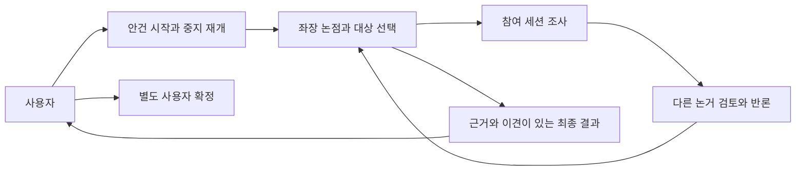
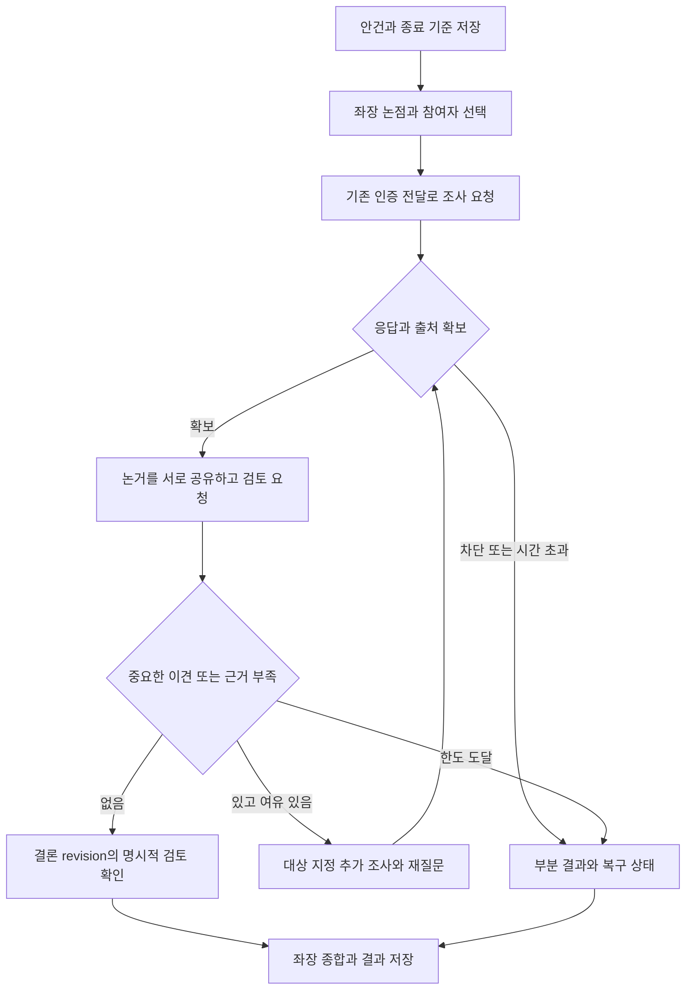
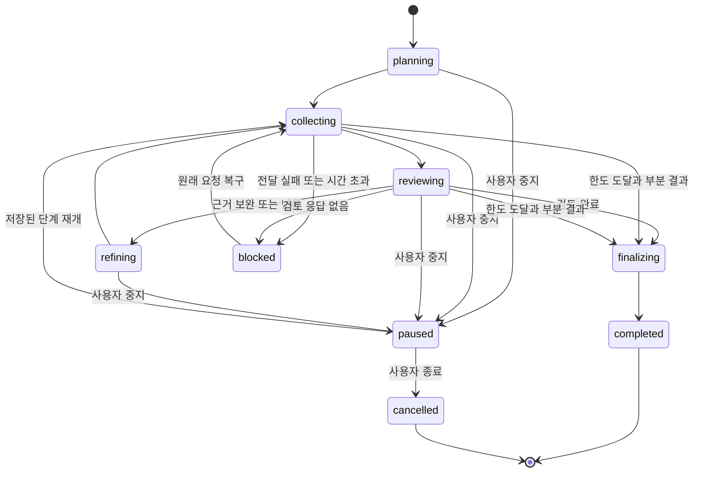
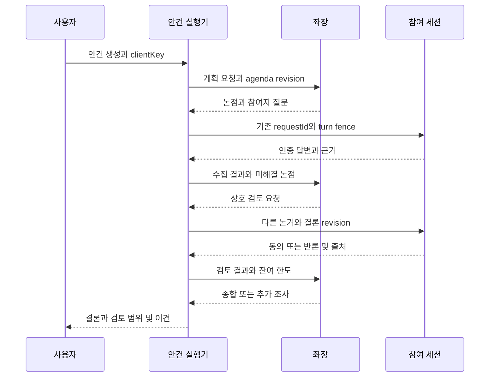
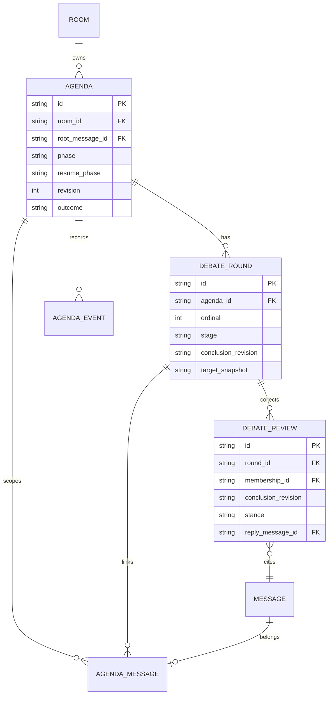

<!-- sr:plan
{"document_type":"decision","reader_questions":["단발 응답과 무엇이 다른가","어떤 조건으로 토론을 이어가고 마치는가","기존 세션의 도구와 자료는 어떻게 쓰는가","합의와 사용자 확정은 어떻게 구분하는가"],"visual_plan":[{"kind":"decision_matrix","content":"토론 실행 방식 비교","required":true},{"kind":"flowchart","content":"근거 수집과 상호 검토","required":true},{"kind":"state_diagram","content":"안건 상태와 중단 복구","required":true}],"visual_waiver":[]}
-->

# 안건별 자율 토론과 근거 기반 합의

> 사용자가 안건을 주면 좌장이 참여자의 조사·논거·반론·재검토를 조율하고, 합의의 근거와 남은 이견을 사용자에게 전달한다.

## 한눈에 보기

- 목적: 참여자에게 질문을 한 번씩 돌리는 흐름에서 안건을 해결하는 지속 토론으로 확장한다.
- 현재 상태: 설계 검토본. 기능 구현 전이며 기존 dev 실행판은 유지한다.
- 핵심 결론: 안건·라운드·검토 대상 결론을 저장하고, 상호 검토를 거친 결과만 합의로 분류한다.
- 원인 또는 판단 근거: 현재 코드에는 후속 취합과 요청별 한도가 있지만 안건 상태·명시적 검토·합의 판정 기록이 없다.
- 결정: 기존 인증 전달 경로 위에 안건 상태기를 추가한다. 일반 질문·멘션 흐름은 유지한다.
- 다음 행동: 수용 기준을 확인한 뒤 저장·실행·UI 순서의 수직 슬라이스를 구현하고 새 검증용 두 provider로 확인한다.
- 최종 갱신: 2026-10-23, Asia/Seoul.

## 맥락

사용자는 “특정 agenda를 던지면 좌장 조율 아래 연관된 세션들이 접근 가능한 도구와 자료로 논거를 제시하고 대화해 최종 consensus를 전달”하는 방식을 요청했다. 현재 실행판을 통째로 다시 만들기보다 이미 검증한 전달·답변 상관관계와 세션 신원을 재사용한다.

## 선택지

| 안 | 동작 | 비용 |
|---|---|---|
| A | 기존 좌장 프롬프트에 더 토론하라는 지시만 추가 | 작지만 상태·종결 증거가 없음 |
| B | 안건별 지속 상태와 근거·검토 기록을 기존 전달 위에 추가 | 저장·좌장·UI 확장 필요 |
| C | 모든 세션을 새 자율 agent 런타임으로 교체 | 기존 native 맥락·권한·연결 보존 비용 큼 |

## 평가기준

| 기준 | 판정 방법 |
|---|---|
| 기존 맥락 보존 | 같은 native 세션과 인증된 원래 전달 경로 사용 |
| 토론 추적 | 안건·라운드·논거·검토·결론의 연결을 DB와 UI에서 조회 |
| 합의 신뢰성 | 반론 기회와 명시적 검토 없이 합의로 종료하지 않음 |
| 복구 | 재시작·중복 응답·전송 불명확을 중복 실행으로 바꾸지 않음 |

## 비교

| 기준 | A | B | C |
|---|---|---|---|
| native 맥락 유지 | 가능 | 가능 | 새 실행 환경에 따라 달라짐 |
| 검토 후 합의 판정 | 모델 표현에 의존 | 상태와 검토 기록으로 검사 | 별도 설계 필요 |
| 중단·재개 | 요청 단위만 존재 | 안건 단위로 제공 | 새 전달 경계 필요 |
| 기존 앱 재사용 | 높음 | 높음 | 낮음 |

## 결정

B를 제안한다. 좌장은 주제 분해·대상 선택·질문·반론 정리·종결 판단을 맡고 참여 세션은 본래 환경에서 조사하고 응답한다. 말의 횟수보다 어떤 주장이 검토됐는지를 저장한다.

## 1. 의도 (Intent)

| 항목 | 내용 |
|---|---|
| 주 사용자 | 기존 Codex·Claude 세션을 불러 안건을 함께 해결하려는 사용자 |
| 핵심 동작 | 안건 제시 → 좌장 논점·대상 선택 → 근거 수집 → 상호 검토 → 필요 시 추가 조사 → 결론 |
| 불변식 | native 신원·원래 도구 권한·인증·writer fence·요청 멱등성을 유지한다. 침묵과 한도 도달은 동의가 아니다. |
| 비목표 | provider 권한 자동 확장, 좌장에 임의 shell 권한 부여, 사용자 확인 없는 배포·결제·외부 발신, 무제한 토론 |
| 합의 의미 | 좌장이 근거와 명시적 검토를 종합한 결론. 참여자 전원 동의 여부와 사용자 확정은 별도 필드다. |

## 2. 수용 기준 (Acceptance)

| ID | 사용자에게 보이는 결과 | intended runtime | 검증 방법·증거 | 중요 |
|---|---|---|---|---|
| AC-1 | 안건 시작 시 목표·종료 기준·사용할 자료·선택 가능 참여자를 확인하고 진행 상태를 본다. | 로컬 앱 | 실제 새 안건 생성·DB/화면 동일 ID 확인 | critical |
| AC-2 | 좌장이 관련 참여자를 이유와 함께 선정하고 논점을 나눠 각자 조사·논거를 요청한다. | 좌장와 native 참여 세션 | 실제 두 provider의 동일 native ID·질문 receipt·인증 답변 확인 | critical |
| AC-3 | 참여자는 자신의 허용된 도구·자료로 조사하고 출처·불확실성·다른 발언에 대한 견해를 제출한다. | native CLI/MCP | 테스트 전용 파일을 실제 도구로 읽은 관측과 출처가 있는 응답. 도구 미사용/실패는 별도 표시 | critical |
| AC-4 | 최초 답변을 바로 합의로 만들지 않고 다른 참여자의 논거를 공유해 최소 한 번 상호 검토한다. | 안건 실행기 | 논거 수집→다른 세션 검토→좌장 재종합의 실제 event trace | critical |
| AC-5 | 이견이 있으면 해당 주장과 근거를 지정해 재질문하고 답변에 따라 결론을 갱신한다. | 안건 실행기 | 반론 fixture와 실제 검증 안건에서 revision 변경·추가 라운드 확인 | critical |
| AC-6 | 마지막 결론을 검토한 참여자·동의/조건부/반대/미응답과 미해결 이견을 함께 보여준다. | 저장·앱 | 오래된 결론에 대한 찬성을 새 revision 동의로 사용하지 않는 테스트·화면 | critical |
| AC-7 | 한도·실패·차단·응답 없음은 부분 결과로 전달하며 합의나 사용자 확정으로 오표시하지 않는다. | 실행기·앱 | timeout·실패·한도·반대·검토자 없음 시나리오 | critical |
| AC-8 | 중지·재개·재시작·동시 안건에도 중복 호출·교차 근거·옛 결과 적용이 없다. | SQLite·coordinator | 재시작·fence·idempotency·cross-agenda 테스트와 DB 비교 | critical |
| AC-9 | 일반 질문·개별 멘션·@to_all·기존 요청별 한도·재호출·자료를 보존한다. | 기존 앱/MCP | 기존124개 회귀와 대표 실제 사용자 경로 | critical |
| AC-10 | 최종 요약·논거·이견·검토 기록을 작업공간에 안건별로 저장하고 원문으로 돌아갈 수 있다. | workspace·앱 | 재시작 후 동일 export·출처 연결·다른 안건 파일 비오염 | critical |

## 3. 확정 사실 (Findings)

| 사실 | 확인 위치·방법 | 설계에 주는 제약 |
|---|---|---|
| 후속 취합이 이미 있다. 인증 답변을 root별로 모으고 대기 중 전달이 없으면 좌장에게 followup을 만든다. | `services/coordinator/chair.js`의 scheduleSummary 직접 확인 | 단발 전용이라고 단정하지 않고 기존 루프를 확장 |
| 좌장 응답은 speech/questions/proposal과 반응·첨부를 사용한다. | `adapters/chair/schema.js`, applyOutput | 단계·결론 revision·검토 요청 구조를 추가해야 함 |
| 현재 좌장 프롬프트에는 You have no tools가 있다. 참여자 작업은 별도 dispatcher로 전달된다. | ChairCoordinator.context 및 server timer | 참여자 본래 도구를 재사용하고 좌장 도구 실행을 성공으로 가정하지 않음 |
| proposal의 sourceIds는 현재 같은 room 존재 여부를 검사한다. | ChairCoordinator.validate | 안건별 출처 경계 검사가 추가로 필요 |
| 요청별 한도와 root ancestry·재시작 보존 테스트가 있다. | `tests/dialogue-loop.test.js` | 안건은 원래 root를 보존하며 별도 입력과 전역 누적하지 않음 |
| 사용자 확정은 proposed decision을 confirmed로 바꾼다. | Store.confirmDecision | agent 합의 결과와 분리 |
| dev 병합 후124개 테스트가 통과했다. | `.local/dev-merge-tests.log`, merge4fab1a6, 직접 실행 2026-10-23 | 기존 동작 회귀 기준 |

## 4. 유스케이스

안건은 입력창의 별도 “안건으로 토론” 동작으로 시작한다. 일반 전송을 모두 토론으로 바꾸지 않는다. 안건 도중 추가 입력은 현재 안건 보충과 새 질문을 구분해 표시한다. 안건을 보충해 목표·핵심 자료가 바뀌면 결론 revision과 재검토 필요 상태를 갱신한다.

## 5. 처리 흐름

좌장이 다음 행동을 구조화해 제출하고 서버가 안건 상태·수신자·근거·한도를 검사한다. 참여자 요청에는 agendaId, roundId, 논점, 참조 원문 ID와 내용, 사용 가능한 첨부 ID, 기대 응답을 포함한다. 반론은 무엇에 대한 반론인지 원문을 연결한다. 좌장 기억의 마지막80개 메시지만으로 진행을 결정하지 않고 현재 안건의 요약·미해결 논점·현재 라운드 원문을 별도로 제공한다.

## 6. 상태 전이

| 상태 | 저장·화면 | 다음 동작 |
|---|---|---|
| planning | 목표·종료 기준·논점·선정 근거 | 좌장 계획 검증 후 질문 |
| collecting | 요청·접수·인증 답변·출처 | 라운드 대상별 결과 확보 |
| reviewing | 결론 revision과 검토 대상·명시적 견해 | 새 반론이면 refining |
| refining | 미해결 논점·요청 목적·남은 한도 | 필요한 대상에게 추가 조사 |
| blocked | 누가 어떤 전달 때문에 막혔는지 표시 | 기존 재호출 또는 사용자 재개 |
| paused | resumePhase와 원래 대기 요청 보존 | 새 입력 생성 없이 재개 |
| finalizing/completed | 결론·근거·이견·검토 범위·종료 사유 | 사용자에게 전달 |
| cancelled | 취소 시점과 이미 접수된 작업 | 새 전달 중단, 늦은 답변은 이력으로 보존 |

그림의 paused→collecting은 보존된 resumePhase로 재진입하는 흐름을 대표한다. 실제 저장은 planning/collecting/reviewing/refining 중 원래 단계를 보존한다. 완료 안건의 늦은 답변은 결과를 조용히 바꾸거나 새로운 호출을 만들지 않는다.

### 합의 판정

실행 상태 completed와 결론 outcome은 다르다. outcome은 consensus / qualified / disputed / insufficient_evidence / limit_reached / cancelled를 구분한다. consensus는 좌장이 제시한 현재 결론 revision에 필요한 검토자들의 명시적 검토가 있고, 해결되지 않은 중요한 반론·누락 응답·미검증 핵심 근거가 없을 때만 허용한다. 찬성 수가 많거나 반응 ✅가 있다는 이유로 자동 합의하지 않는다.

좌장 종합, 참여자별 견해, 전원 동의 여부, 사용자 확정을 별도 표시한다. 조건부 합의나 끝내 풀리지 않은 이견도 사용자에게 결과로 전달한다. 실제로 합의가 안 됐는데 합의를 만들어내도록 강제하지 않는다.

## 7. 타이밍과 실행 경계

설계 기본값은 라운드당 응답 대기5분이며 UI에서 조절한다. 이는 측정된 provider 성능값이 아니며 실제 두 provider 검증 후 조정한다. 대기 시간이 끝나도 기존 요청을 새 ID로 자동 재발행하지 않는다. 토론의 round/request 한도는 안건 root별로 적용한다. 좌장 취합 1회를 위한 여유를 실행 시작 시 계산하고, 한도 소진 시 모델 호출을 더 하지 않고 저장된 부분 결과와 종료 사유를 표시한다.

같은 native 세션은 기존 writer 직렬화를 유지한다. 전송 불명확 상태는 자동 재실행하지 않는다. pause/cancel 후 이미 접수된 응답은 저장하되 신규 질문이나 종결 결과 revision 변경에 적용하지 않는다. 재시작 시 명확한 queued만 다시 검사하고 접수 불명확한 실행은 reconciliation으로 남긴다.

## 8. 데이터와 마이그레이션

추가 테이블 방식으로 기존 원문·payload hash·native ID를 변경하지 않는다. agendaId와 roundId 소속을 검사하고 다른 안건의 응답을 합의 근거로 쓰지 않는다. 같은 DB의 외래키로 참조를 유지하고 기존 데이터를 삭제하는 CASCADE는 추가하지 않는다. clientKey·라운드 actionKey·검토자와 결론 revision 조합은 유일해야 한다.

## 9. 변경 지점

| 경로 | 책임 |
|---|---|
| `services/coordinator/debate.js` (신규) | 안건 진행·라운드 수집·검토·종결 상태기 |
| `services/coordinator/store.js` | 추가 테이블·안건별 투영·원자적 전이·동일 안건 근거 검사 |
| `services/coordinator/chair.js` | 기존 일반 질문과 안건 구조화 출력 분기·문맥·수신자 검증 |
| `adapters/chair/schema.js` | 단계·논점·review·결론 revision 응답 계약 |
| `services/coordinator/server.js` | 안건 생성/조회/중지/재개/취소 API와 timer |
| `packages/mcp/server.js`, `packages/mcp/participant.js` | 안건 문맥·검토 제출 계약과 helper 호환 |
| `services/coordinator/participant-dispatcher.js` | 원래 전달에 안건·출처·기대 응답 문맥 포함 |
| `services/coordinator/workspace.js` | 안건별 결과·논거·검토 export |
| `apps/desktop/app.js`, `apps/desktop/index.html`, `apps/desktop/style.css` | 안건 시작·진행·중지·결과·원문 연결 |
| `tests/debate.test.js` (신규), `tests/dialogue-loop.test.js` | 상태·반론·종결·재시작·기존 경로 회귀 |

## 10. 잠재 문제와 대응

| 문제 | 대응 |
|---|---|
| 모델이 근거 없이 합의라고 선언 | 서버가 현재 revision의 검토·누락·이견을 검사해 outcome 제한 |
| 참여자의 도구 실행 여부를 답변만 보고 단정 | 실제 관측 가능한 도구 receipt와 모델의 사용 주장을 분리 |
| 읽기 권한 없는 자료나 다른 cwd 자료 | 세션의 본래 권한을 유지하고 접근 실패를 미확인으로 남김 |
| 동시 안건의 메시지가 섞임 | agenda-message 소속과 root/fence를 모든 후속 요청에서 검사 |
| 논의가 길어져 원문이 문맥에서 빠짐 | 안건별 현재 논점·revision·관련 원문을 선택해 포함 |
| 무한 상호 호출 | 안건별 round/request 상한과 사용자 중지 |
| 실제 세션 초안 오탐으로 차단 | 기존 일회성 빈 입력 확인 복구를 재사용하고 합의로 간주하지 않음 |

## 11. 착수 순서

- [ ] 안건 생성·저장·진행 표시의 수직 경로 — AC-1, AC-8.
- [ ] 좌장 선정→참여자 실제 조사→근거 수집 — AC-2, AC-3.
- [ ] 서로의 논거 공유→검토→이견 재질문 — AC-4, AC-5.
- [ ] 현재 결론 검토·정직한 종료·결과와 export — AC-6, AC-7, AC-10.
- [ ] 기존 경로 회귀와 실제 두 provider 독립 인수 검증 — AC-8, AC-9.

## 12. 추적성

| 수용 기준 | 예정 검증 | 구현 커밋·실행 상태 |
|---|---|---|
| AC-1, AC-8 | 저장·중단·재시작·안건 경계 | 구현 전 |
| AC-2, AC-3 | 검증용 Codex/Claude 실제 도구·답변 | 구현 전 |
| AC-4, AC-5 | 논거→상호 검토→이견 보완 event trace | 구현 전 |
| AC-6, AC-7 | revision별 견해·미응답·한도 결과 | 구현 전 |
| AC-9 | 기존124개와 실제 멘션·재호출 | 기존 dev124통과, 신기능 회귀는 구현 후 |
| AC-10 | 작업공간 안건별 export | 구현 전 |

## 결과

현재 산출물은 구현 계획이다. 코드 동작과 UI는 아직 바꾸지 않았다. 이 명세의 확인 이후 각 슬라이스를 구현하고, 실제 검증용 두 provider로 조사·상호 검토·종결 경로를 확인한다.

## 재검토 조건

좌장과 참여자의 권한 모델을 바꾸거나, 추가로 참여자 자동 생성·외부 자료 수집 도구를 제공하거나, 합의의 판정 규칙을 바꿔야 한다면 범위를 다시 합의한다.

## 참고

- [[inter-session-index]], [[dedicated-chair]], [[composer-recovery]]
- 코드·테스트 직접 확인: 2026-10-23. 모델의 자율성이나 모든 native 도구 사용은 아직 실행 검증하지 않았다.

## 변경 이력

| 날짜 | 변경 | 사유 |
|---|---|---|
| 2026-10-23 | 최초 설계 검토본 | 사용자가 안건 중심 자율 토론을 다음 목표로 지정 |
