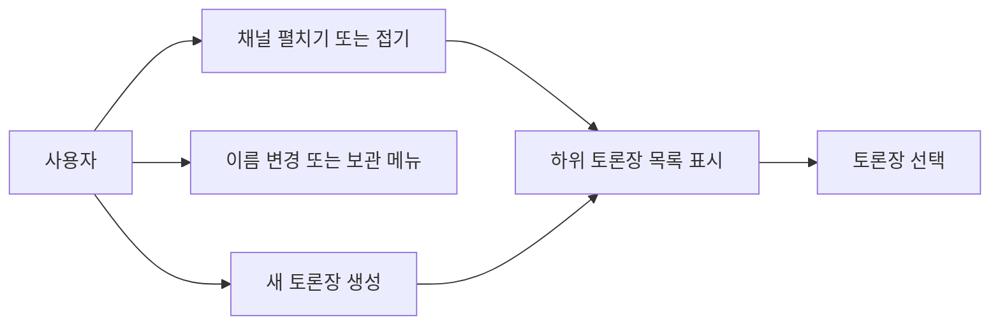
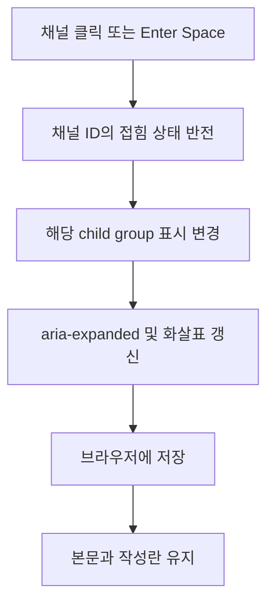
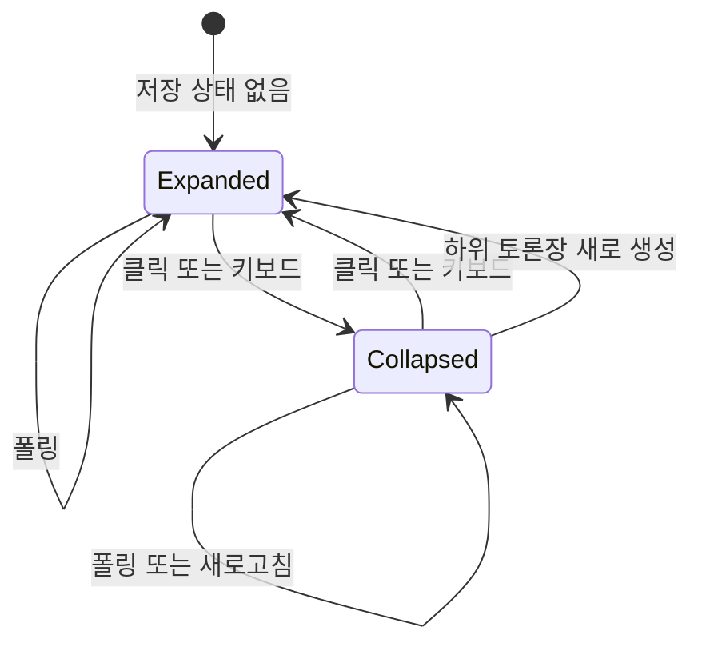

<!-- sr:plan
{"document_type":"decision","reader_questions":["채널 클릭은 무엇을 바꾸나","접힌 상태와 활성 토론장은 어떻게 유지하나","기존 메뉴와 보관 기능은 유지되나"],"visual_plan":[{"kind":"flowchart","content":"채널 클릭과 표시 상태 갱신","required":true},{"kind":"state_diagram","content":"채널 접힘과 펼침","required":true}],"visual_waiver":[]}
-->

# 채널별 토론장 접기와 펼치기

> 채널은 목록을 접고 펼치며, 선택한 토론장과 작성 중 입력은 유지한다.

## 한눈에 보기

- 목적: 채널 아래 여러 토론장을 탐색하기 쉽게 만든다.
- 현재 상태: 구현과 실제 브라우저 인수·공유 기능 회귀 검증을 완료했다.
- 핵심 결론: 채널 ID별 펼침 상태를 브라우저에 저장하고, 접기는 하위 목록에만 적용한다.
- 원인 또는 판단 근거: 기존 채널 제목에는 좌클릭 동작이 없고 목록이 폴링마다 다시 만들어진다.
- 결정: 기본 펼침인 접근 가능한 버튼을 쓰며 기존 우클릭 메뉴는 유지한다.
- 다음 행동: 검증된 실행판을 사용하며, exe 패키징은 다음 작업으로 남긴다.
- 최종 갱신: 2026-10-26.

## 선택지

기존 고정 목록, 채널 클릭 토글과 브라우저 영속, 서버 계정별 표시 상태 동기화를 비교했다.

## 평가기준

사용자가 요청한 계층 탐색, 활성 대화 보존, 단일 PC 앱에서의 구현 비용을 기준으로 삼았다.

## 비교

| 선택지 | 계층 직접 조작 | 대화 보존 | 저장 범위·비용 |
|---|---|---|---|
| 기존 고정 목록 | 불가 | 기존 동작 | 추가 없음 |
| 채널 토글·브라우저 저장 | 가능 | 표시 상태만 변경 | 현재 브라우저, 낮음 |
| 서버 동기화 | 가능 | 별도 설계 필요 | 계정·기기 정책 추가 필요 |

## 결정

채널 토글·브라우저 저장을 채택한다. 현재 개인용 로컬 앱에서 요청한 동작을 만족하며 서버의 토론 상태와 분리할 수 있다.

## 결과

실제 브라우저의 채널 조작 6개 수용 기준을 독립 검토에서 통과했다. 격리된 검증 앱에서 생성·보관 경로를 실행한 뒤, 기존 4318 앱에서도 새 모듈 로드와 채널 접기·대화 보존을 확인했다. exe 패키징은 보류한다.

## 재검토 조건

여러 기기·브라우저에서 동일한 탐색 상태를 요구하면 서버 동기화 정책을 다시 정한다.

## 1. 의도

채널 제목을 좌클릭하면 하위 토론장 목록을 접거나 펼친다. drt-notebookLM의 프로젝트와 채팅 목록처럼 계층을 직접 조작한다. 사용자가 2026-10-26 이 기능과 공유 기능 검증을 요청했으므로 이 범위로 진행한다. exe 패키징은 이번 범위에 포함하지 않는다.

불변식은 활성 토론장·대화·작성 중 입력·채널 ID를 보존하는 것이다. 접기는 표시 상태만 바꾸며 보관이나 삭제가 아니다. 새 채널은 기본 펼침이다. 상태는 현재 브라우저에 채널 ID별로 저장한다. 다른 브라우저로의 상태 동기화는 이번 범위가 아니다.

## 2. 수용 기준

| ID | 사용자에게 보이는 결과 | intended runtime | 검증 방법·증거 |
|---|---|---|---|
| AC-1 | 채널 좌클릭으로 자기 하위 목록만 접고 펼친다. | 로컬 앱 | 실제 클릭 전후 child visibility, 펼침 표시와 aria-expanded 확인 |
| AC-2 | Enter와 Space로 같은 동작을 한다. | 로컬 앱 | 실제 키보드 조작 및 DOM 동작 검증 |
| AC-3 | 우클릭·Shift+F10 이름 변경/보관 메뉴가 유지되고 메뉴 열기로 접힘이 바뀌지 않는다. | 로컬 앱 | 컨텍스트 메뉴 실제 호출 및 이벤트 검증 |
| AC-4 | 채널별 접힘 상태가 폴링·새로고침 후 유지된다. | 로컬 앱 | 두 채널 독립 토글, 새로고침 및 저장 실패 fixture |
| AC-5 | 활성 토론장의 부모를 접어도 본문·선택·미전송 입력을 유지한다. | 로컬 앱 | 선택 ID·작성란 내용·타임라인을 실제 UI에서 비교 |
| AC-6 | 새 토론장은 부모를 펼쳐 표시하고 미소속·보관 표시도 정상 동작한다. | 로컬 앱 | 생성·보관 표시·미소속 그룹 fixture와 실제 UI 경로 |

## 3. 확정 사실

| 사실 | 확인 위치 | 제약 |
|---|---|---|
| 도입 전 채널 제목은 div이며 클릭 이벤트가 없었다. | apps/desktop/app.js renderNav | 실제 button과 child group으로 교체 완료 |
| 목록은 폴링 때 다시 렌더링한다. | refresh/openRoom/renderNav | 폴링이 접힘 상태나 포커스를 초기화하지 않아야 함 |
| 채널·토론장 메뉴는 contextmenu 및 Shift+F10으로 열린다. | bindNavContextMenu | 키보드 토글과 메뉴 이벤트를 함께 유지 |
| 보관 항목은 기본 숨김, 미소속 그룹에는 채널 ID가 없다. | visibleRooms/renderNav | 실제 ID와 별도 미소속 key를 구분 |

## 4. 유스케이스

## 5. 처리 흐름

## 6. 상태 전이

| 상태/상황 | 저장 | UI 반응 |
|---|---|---|
| 펼침 | channel ID = expanded | 목록과 아래 방향 화살표 |
| 접힘 | channel ID = collapsed | 목록 숨김과 오른쪽 방향 화살표 |
| 저장소 실패 또는 손상 | 기본값 사용 | 앱 사용 가능, 동작은 메모리에 유지 |
| 활성 부모 접기 | 선택 ID 불변 | 본문과 초안 불변 |

## 9. 변경 지점

| 파일 | 변경 |
|---|---|
| `apps/desktop/app.js` | 채널 버튼·토론장 group·생성 시 펼침 |
| `apps/desktop/style.css` | 트리 버튼과 표시 스타일 |
| `apps/desktop/channel-nav.js` (신규) | ID 기반 표시 상태와 안전한 영속 |
| `tests/channel-nav.test.js` (신규) | 토글·상태 보존·메뉴 회귀 |
| `services/coordinator/server.js` | 정적 module 제공 |

## 10. 잠재 문제

| 위험 | 대응 |
|---|---|
| 폴링이 선택/접힘을 초기화 | ID 상태를 렌더와 분리 |
| 메뉴용 key handler가 토글을 덮음 | native button click과 메뉴 이벤트를 분리 |
| 접힌 부모에 만든 방이 보이지 않음 | 명시적 생성 시 부모 펼침 |
| 저장소 접근 불가 | try/catch와 메모리 상태 |

## 11. 착수 순서

- [x] 채널 토글·접근성·메뉴 보존 — AC-1, AC-2, AC-3.
- [x] 상태 영속과 활성 토론장·새 방 보존 — AC-4, AC-5, AC-6.
- [x] 실제 앱 인수 검증 및 공유 기능 회귀 — AC-1, AC-2, AC-3, AC-4, AC-5, AC-6.

## 함께 검증할 공유 기능

기존 0010 명세의 조사·상호 검토·자료 보존 기준에 따라 agent A가 올린 논거 파일을 agent B가 같은 원본 바이트로 읽고, B의 이모지가 B 신원으로 기록되며 A와 좌장에게 피드백되는지 실제 HTTP로 검증한다. 안건 질문과 검토 요청에서 첨부 ID·파일명·hash·원문 메시지 연결을 유지한다. 여러 논거의 첨부가 메시지당5개를 넘더라도 나머지 참조를 조용히 버리지 않는다. 공유 전 비공개 업로드·다른 방·철회된 등록·읽기 전용 쓰기를 거부한다. 실제 native CLI 실행과 인증 HTTP 시뮬레이션은 결과에서 구분한다.

## 인수 기록

| 기준 | 결과 | 직접 관찰한 근거 |
|---|---|---|
| AC-1 | PASS | 자료 채널 접힘 시 자기 목록만 숨김, 다른 채널은 펼침 유지, aria-controls·aria-expanded 일치 |
| AC-2 | PASS | Enter 펼침 → Space 접힘 |
| AC-3 | PASS | 우클릭·Shift+F10 메뉴 동일, 접힘 유지, 이름 변경 저장 성공 |
| AC-4 | PASS | 폴링·이름 변경·새로고침 후 접힘 유지, 잘못된 JSON·저장 거부 단위 fixture 통과 |
| AC-5 | PASS | 활성 토론장의 제목·원문·선택·미전송 초안 유지 |
| AC-6 | PASS | 접힌 채널·미소속에 생성한 방 즉시 노출, 보관 목록 접기와 기본 숨김 정상 |

브라우저 관찰 13개는 `docs/validation/channel-tree.json`, 실제 화면은 `docs/screenshots/channel-tree.png`에 보관한다. 기존 앱 데이터의 원래 컬럼은 채널 3개·토론장 6개·세션 8개·메시지 63개·결정 3개·출처 17개에서 보존했다. (직접 실행·측정, 2026-10-26)

## 참고

[[inter-session-index]], [[agenda-deliberation]]. 실제 Codex·Claude의 자동 입력과 무인 진행 제한은 0010의 별도 검증 범위를 따른다. 이번 채널 UI 검증에서 외부 provider를 다시 실행하지 않았다.

## 2026-10-26 행 빠른 작업

채널·토론장 행에 마우스를 올리거나 키보드 포커스를 두면 연필·보관 아이콘을 표시한다. 기존 우클릭 메뉴와 같은 이름 변경·보관 경로를 사용한다. 보관된 항목은 보관 해제 아이콘으로 바뀐다. `채널 없음`에는 수정할 채널 객체가 없으므로 채널용 아이콘을 두지 않는다.

| 확인 항목 | 동작·검증 |
|---|---|
| 마우스·키보드 노출 | 일반 상태는 숨김, 실제 포인터 hover와 키보드 focus에서 표시. 터치 포인터에서는 접근을 위해 상시 표시 |
| 이름 변경 | 채널 펼침 상태와 활성 토론장·미전송 초안을 보존 |
| 보관·복원 | 하위 미보관 토론장이 있으면 채널 보관 비활성 및 사유 툴팁, 모두 보관한 뒤 허용. 보관 목록에서 채널·토론장 복원 |
| 탐색·포커스 | 아이콘은 제목 버튼의 형제이며 클릭 전파를 차단. 폴링 후 같은 ID·동작의 버튼에 포커스 복원 |

로컬 NotebookLM의 `frontend/src/components/ChatPanel/index.tsx`에서 hover 연필·보관과 클릭 전파 차단을 확인했다. `frontend/src/app/globals.css`의 Windows WebView hover 제약을 참고해 기본 데스크톱 hover 규칙에 미디어 조건을 두지 않았다. (로컬 소스 직접 확인, 2026-10-26)

변경은 `apps/desktop/app.js`, `apps/desktop/style.css`에 국한한다. 기존 컨텍스트 메뉴·보관 API·채널 접힘 상태 저장 규칙은 유지한다. 검증 근거는 `docs/validation/nav-hover-actions.json`에 기록한다.
