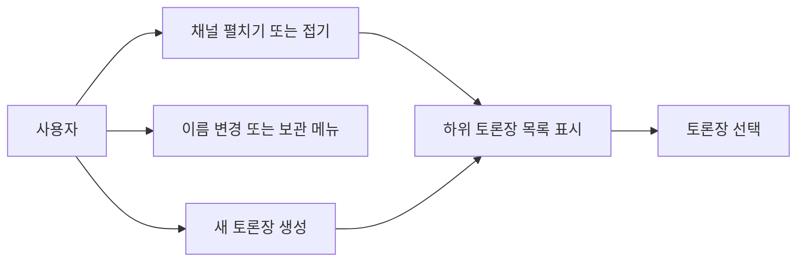
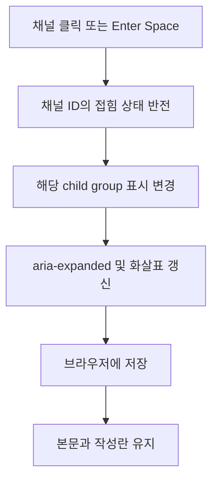
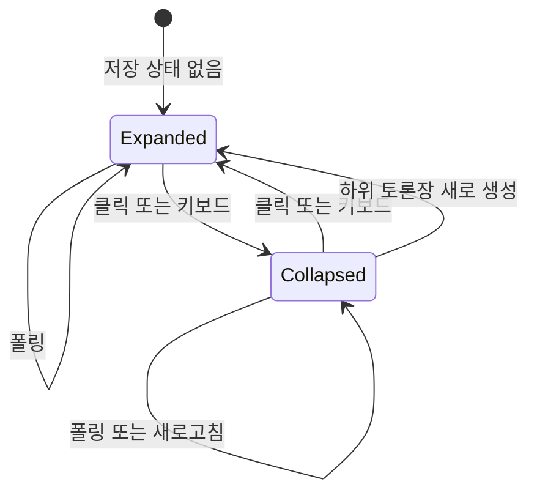

<!-- sr:plan
{"document_type":"decision","reader_questions":["채널 클릭은 무엇을 바꾸나","접힌 상태와 활성 토론장은 어떻게 유지하나","기존 메뉴와 보관 기능은 유지되나"],"visual_plan":[{"kind":"flowchart","content":"채널 클릭과 표시 상태 갱신","required":true},{"kind":"state_diagram","content":"채널 접힘과 펼침","required":true}],"visual_waiver":[]}
-->

# 채널별 토론장 접기와 펼치기

## 1. 의도

채널 제목을 좌클릭하면 하위 토론장 목록을 접거나 펼친다. drt-notebookLM의 프로젝트와 채팅 목록처럼 계층을 직접 조작한다. 사용자가 2026-10-26 이 기능과 공유 기능 검증을 요청했으므로 이 범위로 진행한다. exe 패키징은 이번 범위에 포함하지 않는다.

불변식은 활성 토론장·대화·작성 중 입력·채널 ID를 보존하는 것이다. 접기는 표시 상태만 바꾸며 보관이나 삭제가 아니다. 새 채널은 기본 펼침이다. 상태는 현재 브라우저에 채널 ID별로 저장한다. 다른 브라우저로의 상태 동기화는 이번 범위가 아니다.

## 2. 수용 기준

| ID | 사용자에게 보이는 결과 | intended runtime | 검증 방법·증거 |
|---|---|---|---|
| AC-1 | 채널 좌클릭으로 자기 하위 목록만 접고 펼친다. | 로컬 앱 | 실제 클릭 전후 child visibility, 펼침 표시와 aria-expanded 확인 |
| AC-2 | Enter와 Space로 같은 동작을 한다. | 로컬 앱 | 실제 키보드 조작 및 DOM 동작 검증 |
| AC-3 | 우클릭·Shift+F10 이름 변경/보관 메뉴가 유지되고 메뉴 열기로 접힘이 바뀌지 않는다. | 로컬 앱 | 컨텍스트 메뉴 실제 호출 및 이벤트 검증 |
| AC-4 | 채널별 접힘 상태가 폴링·새로고침 후 유지된다. | 로컬 앱 | 두 채널 독립 토글, 새로고침 및 저장 실패 fixture |
| AC-5 | 활성 토론장의 부모를 접어도 본문·선택·미전송 입력을 유지한다. | 로컬 앱 | 선택 ID·작성란 내용·타임라인을 실제 UI에서 비교 |
| AC-6 | 새 토론장은 부모를 펼쳐 표시하고 미소속·보관 표시도 정상 동작한다. | 로컬 앱 | 생성·보관 표시·미소속 그룹 fixture와 실제 UI 경로 |

## 3. 확정 사실

| 사실 | 확인 위치 | 제약 |
|---|---|---|
| 채널 제목은 현재 div이며 클릭 이벤트가 없다. | apps/desktop/app.js renderNav | 실제 button과 child group을 도입 |
| 목록은 폴링 때 다시 렌더링한다. | refresh/openRoom/renderNav | 폴링이 접힘 상태나 포커스를 초기화하지 않아야 함 |
| 채널·토론장 메뉴는 contextmenu 및 Shift+F10으로 열린다. | bindNavContextMenu | 키보드 토글과 메뉴 이벤트를 함께 유지 |
| 보관 항목은 기본 숨김, 미소속 그룹에는 채널 ID가 없다. | visibleRooms/renderNav | 실제 ID와 별도 미소속 key를 구분 |

## 4. 유스케이스

## 5. 처리 흐름

## 6. 상태 전이

| 상태/상황 | 저장 | UI 반응 |
|---|---|---|
| 펼침 | channel ID = expanded | 목록과 아래 방향 화살표 |
| 접힘 | channel ID = collapsed | 목록 숨김과 오른쪽 방향 화살표 |
| 저장소 실패 또는 손상 | 기본값 사용 | 앱 사용 가능, 동작은 메모리에 유지 |
| 활성 부모 접기 | 선택 ID 불변 | 본문과 초안 불변 |

## 9. 변경 지점

| 파일 | 변경 |
|---|---|
| `apps/desktop/app.js` | 채널 버튼·토론장 group·생성 시 펼침 |
| `apps/desktop/style.css` | 트리 버튼과 표시 스타일 |
| `apps/desktop/channel-nav.js` (신규) | ID 기반 표시 상태와 안전한 영속 |
| `tests/channel-nav.test.js` (신규) | 토글·상태 보존·메뉴 회귀 |
| `services/coordinator/server.js` | 정적 module 제공 |

## 10. 잠재 문제

| 위험 | 대응 |
|---|---|
| 폴링이 선택/접힘을 초기화 | ID 상태를 렌더와 분리 |
| 메뉴용 key handler가 토글을 덮음 | native button click과 메뉴 이벤트를 분리 |
| 접힌 부모에 만든 방이 보이지 않음 | 명시적 생성 시 부모 펼침 |
| 저장소 접근 불가 | try/catch와 메모리 상태 |

## 11. 착수 순서

- [ ] 채널 토글·접근성·메뉴 보존 — AC-1, AC-2, AC-3.
- [ ] 상태 영속과 활성 토론장·새 방 보존 — AC-4, AC-5, AC-6.
- [ ] 실제 앱 인수 검증 및 공유 기능 회귀 — AC-1, AC-2, AC-3, AC-4, AC-5, AC-6.

## 함께 검증할 공유 기능

기존 0010 명세의 조사·상호 검토·자료 보존 기준에 따라 agent A가 올린 논거 파일을 agent B가 같은 원본 바이트로 읽고, B의 이모지가 B 신원으로 기록되며 A와 좌장에게 피드백되는지 실제 HTTP로 검증한다. 안건 질문과 검토 요청에서 첨부 ID·파일명·hash·원문 메시지 연결을 유지한다. 여러 논거의 첨부가 메시지당5개를 넘더라도 나머지 참조를 조용히 버리지 않는다. 공유 전 비공개 업로드·다른 방·철회된 등록·읽기 전용 쓰기를 거부한다. 실제 native CLI 실행과 인증 HTTP 시뮬레이션은 결과에서 구분한다.
