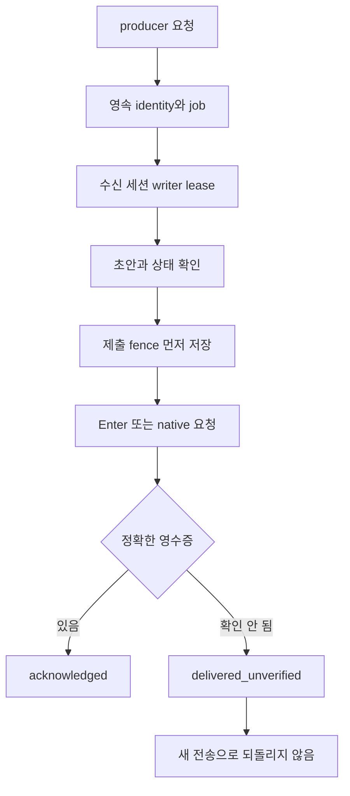

<!-- sr:plan
{
  "document_type": "research",
  "reader_questions": [
    "무엇을 조사했는가",
    "기존 세션을 어떻게 연결하는가",
    "어떤 부분을 채택하는가",
    "미검증 사항은 무엇인가"
  ],
  "visual_plan": [
    {
      "kind": "comparison_table",
      "content": "관측 사실과 근거 및 채택/보류 비교",
      "required": true
    },
    {
      "kind": "flowchart",
      "content": "연결 및 전달 처리 경로",
      "required": true
    }
  ],
  "visual_waiver": []
}
-->

# agentmux — 영속 전달 대기열과 실행 소유권

> 2026-10-22 기준의 개인용 Windows 세션 토론장 벤치마킹 자료.

## 한눈에 보기

- 목적: 실제 연결·전달·응답·복구 경계를 파악한다.
- 현재 상태: 고정 커밋 소스와 로컬 가이드 정적 조사. 제품 설치·LLM 실행은 수행하지 않았다.
- 핵심 결론: 대기열·영수증·불확실성 보존은 핵심 벤치마킹 대상이다. native backend는 Windows 지원이나 외부 세션 무중단 연결을 뜻하지 않는다.
- 원인 또는 판단 근거: 아래 파일·행 근거와 수집 manifest에 범위를 명시했다.
- 결정: 코드 재사용과 기본 정책은 아직 확정하지 않는다.
- 다음 행동: 전달 보장만 독립 계약으로 추출하고 자동 실행 권한 정책 및 호스트 소유권을 별도로 설계한다.
- 최종 갱신: 2026-10-22, Asia/Seoul.

## 질문

장시간 실행과 재시작을 견디는 전달 설계는 무엇인가. tmux를 제외한 native backend가 기존 외부 세션을 그대로 제어한다는 뜻인가.

## 짧은 답

Node.js 조율 계층은 요청을 disk spool에 먼저 저장하고 세션별 writer, 제출 fence, 정확한 transcript 영수증을 조합한다. native backend도 있지만 해당 runtime이 소유하는 agent를 대상으로 하며, 다른 앱의 실행 중 세션에 보편적으로 붙는 기능으로 해석하면 안 된다.

## 근거

고정 revision: `3d4244dd7f69254b379814d8bc1231f42c4d93ae`. LICENSE는 MIT다. GitHub latest release API는 Android Link APK 태그를 반환하므로 이를 조율 runtime의 최신 검증 버전으로 사용할 수 없다.

| ID | 소스에서 확인한 동작 | 고정 근거 |
|---|---|---|
| A-1 | 요청 identity와 disk spool | [core/delivery-queue.mjs:120–170](https://github.com/adelost/agentmux/blob/3d4244dd7f69254b379814d8bc1231f42c4d93ae/core/delivery-queue.mjs#L120-L170); [core/delivery-queue.mjs:194–209](https://github.com/adelost/agentmux/blob/3d4244dd7f69254b379814d8bc1231f42c4d93ae/core/delivery-queue.mjs#L194-L209) |
| A-2 | 제출 전 불확실성 기록 | [core/delivery-fence.mjs:49–58](https://github.com/adelost/agentmux/blob/3d4244dd7f69254b379814d8bc1231f42c4d93ae/core/delivery-fence.mjs#L49-L58) |
| A-3 | 불확실한 전달을 미전송과 구분 | [core/delivery-queue-policy.mjs:3–31](https://github.com/adelost/agentmux/blob/3d4244dd7f69254b379814d8bc1231f42c4d93ae/core/delivery-queue-policy.mjs#L3-L31) |
| A-4 | 세션 writer lease | [core/delivery-writer.mjs:5–37](https://github.com/adelost/agentmux/blob/3d4244dd7f69254b379814d8bc1231f42c4d93ae/core/delivery-writer.mjs#L5-L37) |
| A-5 | 기존 native agent 채택 시 신원 검사 | [core/native-runtime-client.mjs:139–165](https://github.com/adelost/agentmux/blob/3d4244dd7f69254b379814d8bc1231f42c4d93ae/core/native-runtime-client.mjs#L139-L165) |
| A-6 | 채택된 agent도 automation으로 맞추는 경로 | [core/native-runtime-client.mjs:185–215](https://github.com/adelost/agentmux/blob/3d4244dd7f69254b379814d8bc1231f42c4d93ae/core/native-runtime-client.mjs#L185-L215) |
| A-7 | 자동 실행 권한의 실제 내용 | [core/execution-safety.mjs:1–43](https://github.com/adelost/agentmux/blob/3d4244dd7f69254b379814d8bc1231f42c4d93ae/core/execution-safety.mjs#L1-L43) |
| A-8 | 앱 소유 Codex runtime의 resume/start | [spikes/web-ui/server.mjs:1790–1820](https://github.com/adelost/agentmux/blob/3d4244dd7f69254b379814d8bc1231f42c4d93ae/spikes/web-ui/server.mjs#L1790-L1820) |
| A-9 | 영수증 의미와 JSONL 직접 변경 금지 설명 | [docs/codex-delivery-evidence.md:5–30](https://github.com/adelost/agentmux/blob/3d4244dd7f69254b379814d8bc1231f42c4d93ae/docs/codex-delivery-evidence.md#L5-L30) |

### 처리 흐름

### 사용·운영 특성

| 차원 | 관측 또는 판단 |
|---|---|
| 재시작 | 지속 job과 submit fence에 복구 사실을 보존 |
| 다중 producer | Discord·CLI 등이 공통 대기열을 통과하도록 설계 |
| 첨부 | enqueue에서 첨부 백업을 생성하는 경로가 있음 |
| native | tmux와 다른 runtime transport 의미. native Windows 의미가 아님 |
| 권한 | 앱 소유/채택 agent를 automation 정책으로 맞추는 경로가 있음 |
| UI | Discord ChatOps와 spikes/web-ui가 함께 존재. 원하는 토론장 레이아웃의 완성본은 아님 |
| 시험 증거 | delivery-storage-recovery, delivery-fence, native-session-identity 및 runtime canary 소스 존재. 실행하지 않음 |

추가 확인: native와 tmux 사이에 암묵적 fallback을 두지 않는 계약이 별도로 명시되어 있다 ([core/native-runtime-client.mjs:1–4](https://github.com/adelost/agentmux/blob/3d4244dd7f69254b379814d8bc1231f42c4d93ae/core/native-runtime-client.mjs#L1-L4)).

## 상충 근거

native agent ID를 정확히 채택하는 검사가 있어도, 이는 runtime 내부 agent를 특정하는 검사다. Orca나 별도 CLI가 현재 소유한 외부 프로세스와 제어권을 공유하는 증거는 아니다.

권한 상수와 채택 후 PATCH 경로는 기존 정책 유지라는 우리 초안의 기본안과 다르다. 자동 실행이 필요한 개인용 도구에서는 가능한 선택이지만, 연구 단계에서 이를 사용자 선호로 확정하거나 그대로 복사하지 않는다.

## 한계

- FIFO·lease·영수증 설계의 소스 경로를 확인했으며 장애 주입 결과를 확보한 것은 아니다.
- 문서의 Linux/macOS/WSL 지원과 node/tmux 전제를 확인했다. native Windows에서 실행하지 않았다.
- Android 최신 태그와 branch HEAD의 runtime 코드를 구분했다. release asset 존재만으로 desktop 설치 가능성을 판단하지 않는다.
- producer부터 provider 완료까지 전 경로의 자동 검증 통과를 주장하지 않는다.

## 권고

| 항목 | 제안 |
|---|---|
| 채택 후보 | 지속 request identity, 수신 세션 writer, 제출 전 fence, unknown/unverified 보존 |
| 단순화 후보 | 개인용 첫 버전에서는 동일 불변식을 SQLite outbox와 event로 표현할지 비교 |
| 별도 결정 | 기존 권한 유지와 선택적 자동 실행 모드 |
| 재사용 보류 | 전체 runtime·Discord·tmux·Android 구조를 하나의 베이스로 가져오는 것 |

전달 성공, provider 입력 관측, 실제 작업 완료는 계속 별도 상태로 유지한다.

## 관련 노트

- [[inter-session-index]]
- [[benchmark-sources]]
- [[benchmark-analysis]]

