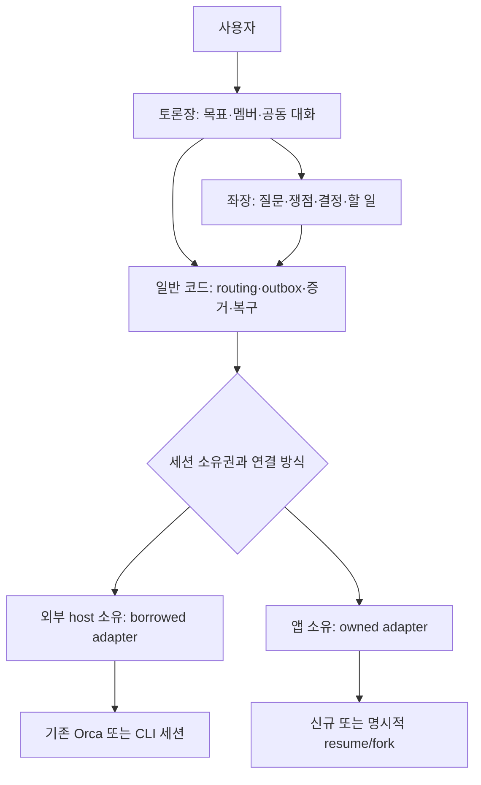
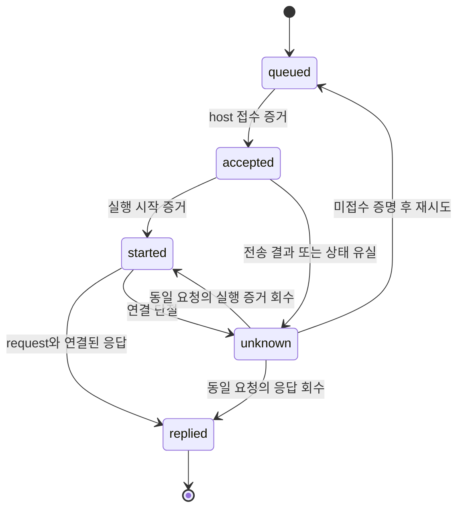

<!-- sr:plan
{"document_type":"research","reader_questions":["구현 전에 무엇을 배웠는가","어떤 제품을 어떤 층위에서 참고하는가","기존 초안의 무엇을 수정해야 하는가","아직 검증해야 할 것은 무엇인가"],"visual_plan":[{"kind":"comparison_table","content":"제품별 기존 세션/Windows/응답/복구/권한 비교","required":true},{"kind":"flowchart","content":"실행 소유권과 토론장 계층의 분리","required":true},{"kind":"state_diagram","content":"수신 접수와 실행·응답의 분리","required":true}],"visual_waiver":[]}
-->

# 벤치마킹 종합 분석 — 기존 세션 협업 앱의 설계 근거

> 개인 사용 흐름에 맞춘 분석이다. 제품 시장성·인기도 순위와 별개로 기존 Windows/Orca 작업의 연속성을 기준으로 평가한다.

## 한눈에 보기

- 목적: 기존 제품을 면밀히 조사해 이미 해결된 부분과 새로 구현할 부분을 구분한다.
- 현재 상태: 공개 제품 4종 고정 소스와 기준 플랫폼·로컬 UI의 정적 조사를 마쳤다. 실제 제품/LLM 연결 실행은 미검증이다.
- 핵심 결론: 전달 버스의 기본 구조는 충분한 선례가 있다. 새 앱의 핵심은 정확한 기존 세션 참여·공동 토론 UX·좌장 조율이며, 연결 방식과 성공 상태의 의미를 먼저 고정해야 한다.
- 원인 또는 판단 근거: 제품별 소스에서 resume fallback, 자동 steer, claim 기반 running, automation 권한 전환, Unix host 의존성이 각각 확인됐다.
- 결정: 전체 앱 fork나 기술 스택을 확정하지 않는다. 참고할 계약과 제외할 암묵적 동작부터 명시한다.
- 다음 행동: [[benchmark-validation-plan]]의 identity/host capability 조사부터 시작하고 실제 세션 전달은 검증 범위를 정한 뒤 수행한다.
- 최종 갱신: 2026-10-22, Asia/Seoul.

## 질문

현재 PC에서 작업 중인 이종 provider 세션들을 한 토론장에 모으려면 어떤 선례를 채택하고 어떤 가정을 피해야 하는가.

## 짧은 답

새 모델을 여러 개 시작하는 문제보다 기존 실행 host의 세션을 정확하게 식별하고, 원래 맥락·실행 주체·사용자 입력을 유지한 채 요청과 응답을 연결하는 문제가 더 중요하다.

작업 중인 외부 세션, 저장된 대화의 재개, 맥락을 분기한 새 세션, 앱 소유 신규 세션을 구분해야 한다. 이 구분이 없으면 기존 세션 초대가 실제로는 별도 실행이나 잘못된 대상 선택으로 바뀔 수 있다.

## 근거

비교의 출처는 제품별 고정 소스 조사와 현재 host 관측이다. 세부 파일·행 근거는 연결된 조사 노트와 claim ledger에 보존했다.

### 핵심 비교

기준은 개인용 Windows, Orca와의 병행, cross-project 참가, 정확한 요청·응답과 복구다. 아래는 정적 관측이며 사용성 점수나 실측 성능 순위가 아니다.

| 대상 | 기존 세션 연결 의미 | native Windows 근거 | 응답 계약 | 복구·중복 관측 | UI/권한 차이 |
|---|---|---|---|---|---|
| magents | live socket/IPC 실패 시 CLI resume | 무조건 UnixStream 경로, release에 Windows asset 없음 | 별도 mailbox send/reply | live 시도 후 mailbox 기록 | MCP/CLI 중심, 연결 모드 구분 필요 |
| agent-intercom | daemon이 열린 세션에 push, 최근 세션 기본 선택 | Node mailbox와 Unix 기반 push/서비스 분리 필요 | reply_to를 참여자가 제출 | rename claim과 재시작 replay, 외부 실행 idempotency 미입증 | 자동 busy steer, 채널 UI 없음 |
| agentmux | tmux 또는 자체 native runtime, 정확한 native agent 채택 검사 | 문서상 Linux/macOS/WSL, native backend와 Windows는 다른 의미 | receipt와 runtime history/응답 경로 | durable queue, writer, submit fence, unverified | Discord/웹 UI, automation 정책 전환 경로 |
| Orchestra | 앱이 관리하는 같은 프로젝트 세션 inbox | Unix socket·PTY·Setsid 포팅 필요 | 수신자 검증 및 명시 run reply | request identity·claim·atomic history, 중단 후 무조건 재전송 안 함 | 요청별 카드, claim을 running으로 표시 |
| 현재 Orca | host의 기존 세션 handle과 구조화 Run/Dispatch | 설치 binary 1.4.229 관측 | inbox/reply/receipt 문서 존재 | enqueue와 best-effort wake를 구분 | 일반 그룹은 Run 소속으로 제한 |
| OpenClaw | 자신의 Gateway 세션 주소 공간 | 이번 native Windows 조사 대상 아님 | 세션별 send/reply/provenance | idempotencyKey·현재 접근 검사 경로 | 사용자 입력과 세션 간 입력 출처 구분 |

근거: [[magents-benchmark]], [[intercom-benchmark]], [[agentmux-benchmark]], [[orchestra-benchmark]], [[host-reference-benchmark]]. 고정 revision·개별 소스 행·확인 범위는 각 문서와 [[benchmark-sources]]에 연결했다.

### 초안에서 재검토해야 할 항목

| 기존 가정 또는 오해 가능성 | 이번 소스 관측 | 설계 반영 제안 |
|---|---|---|
| 기존 세션 대상이면 항상 원래 프로세스에 직접 전달 | magents는 live 실패 시 resume로 이동 | 연결 모드를 UI·API에 명시하고 암묵적 전환 금지 |
| 즉시 전달은 원래 작업을 방해하지 않음 | intercom은 busy Codex를 자동 steer | 일반 대기 요청과 즉시 방향 수정을 별도 모드로 표현 |
| 파일 claim이면 실행이 한 번만 일어남 | intercom은 pushing 복구 후 재처리 | provider 접수 후 응답 유실을 unknown으로 남기고 재조정 |
| running이면 실제 에이전트가 실행 중 | Orchestra는 claim만으로 running 저장 | claimed/accepted/started/replied의 증거를 구분 |
| native backend면 Windows 대응 또는 외부 live attach | agentmux는 자체 runtime 경로, 다른 host 소유권은 별개 | OS와 transport 및 runtime 소유권을 각각 검증 |
| 기존 정책이 자동으로 유지됨 | agentmux adopted agent에도 automation PATCH 경로 | 현재 정책 유지/사용자 선택 자동 실행을 명시적으로 비교 |
| 작은 Markdown UI는 그대로 재사용 가능 | NotebookLM MarkdownImage에도 notebook API 결합 | URL resolver와 메시지 DTO 등 도메인 경계부터 분리 |
| Orca에 메시징·순차 조율이 없음 | 현재 설치 가이드에 관련 기능이 있음 | 오래된 조사 대신 현재 capability로 통합 가능성 검토 |

### 책임 분리 제안

좌장은 의미 판단을 맡고, 전달 기록·중복 방지·복구·정확한 수신자 지정은 일반 코드가 맡는 안을 권고한다. 좌장이 메시지를 기억하지 못해도 outbox와 요청 ID는 유지되어야 한다.

### 성공 상태의 의미 제안

이 그림은 공통 의미 모델 제안이다. 각 adapter의 실제 transport 상태·취소·실패 전체를 확정한 구현 명세는 아니다.

### UI 벤치마킹 반영

| 네가 원하는 경험 | 참고할 선례 | 추가로 만들 부분 |
|---|---|---|
| 여러 세션 상태를 상단에서 확인 | Orca 상태·handle, NotebookLM 패널 경험 | 참석자 카드와 연결 방식·소유권 표시 |
| Slack 같은 공동 대화 | 메시지 원문·reply-to·request 카드 | cross-provider room timeline과 쟁점별 thread |
| 개별/전체/좌장에게 입력 | 정확한 대상 식별과 요청 ID | 수신자 선택 및 전체 전송 snapshot |
| 참여자끼리 논의 | mailbox와 명시 reply | 토론 멤버십과 공개 범위, 출처 표시 |
| 좌장 정리 | OpenClaw provenance와 source identity | 근거 인용, 미합의 구분, 결정·담당·할 일 |
| 기존 작업으로 돌아가기 | session ID·cwd 보존 | 토론 이탈과 원래 프로세스 종료를 분리 |

## 상충 근거

기존 제품들로 메시지 전달의 상당 부분을 해결할 수 있다. 따라서 모든 전달 기능을 새로 발명해야 한다는 결론은 근거가 약하다.

반대로 선택한 제품 하나를 그대로 가져오면 네가 원하는 Windows의 기존 Orca 세션·cross-project 토론·참석자 UI·좌장 조율이 모두 해결된다는 증거도 없다. “부분 구조를 참고할 수 있다”와 “전체 기반으로 적합하다”는 다른 판정이다.

정적 코드에서 발견한 위험 경로는 실제 결함의 발생을 입증한 것이 아니다. 오류 재현과 성능·신뢰도 비교는 다음 검증의 몫이다.

## 한계

- 전체 시장 조사, 모든 commit/issue 검토, 실제 설치 UX 비교를 수행한 것은 아니다.
- 고정 archive의 파일 수를 읽은 파일 수나 품질 지표로 사용하지 않았다.
- 현재 제품 버전에서 새로 생기거나 수정된 기능은 다음 수집과 차이 검토가 필요하다.
- 기존 세션의 동시 제어·원래 host UI 동기화·원문 응답 회수는 아직 실제 검증하지 않았다.
- Tauri/React/SQLite는 후보이며 이 조사만으로 backend 언어와 IPC transport를 확정하지 않는다.

## 권고

| 결정 영역 | 현재 권고 | 재검토 조건 |
|---|---|---|
| 전체 기반 | 독립 토론장 계층과 host adapter 경계를 우선 설계 | 기존 제품을 적은 수정으로 Windows/Orca에 통합할 실증이 나올 때 |
| 기존 세션 참여 | 정확한 신원과 연결 방식, 소유권부터 검증 | host가 보장하는 stable API와 응답이 확인될 때 |
| 전달 | 지속 request identity·원문·outbox·불확실성 보존 | 첫 연결 경로에서 필요 이상의 복잡성이 확인될 때 |
| UI 재사용 | NotebookLM의 작은 표현 패턴부터 의존성 분리 검토 | 추출 비용이 새 표시 컴포넌트 구현보다 커질 때 |
| 좌장 | 작업 세션과 분리된 논리적 역할, 원문 출처와 한도 유지 | 실제 사용자 논의 흐름에서 병목·비용이 확인될 때 |
| 다음 작업 | 연구 산출물 확인 후 읽기 전용 host capability 조사 | 현재 문서의 범위를 넘어 구현을 시작할 때 |

## 관련 노트

- [[inter-session-index]]
- [[benchmark-sources]]
- [[magents-benchmark]]
- [[intercom-benchmark]]
- [[agentmux-benchmark]]
- [[orchestra-benchmark]]
- [[host-reference-benchmark]]
- [[benchmark-validation-plan]]
- [[session-room-foundation]]

