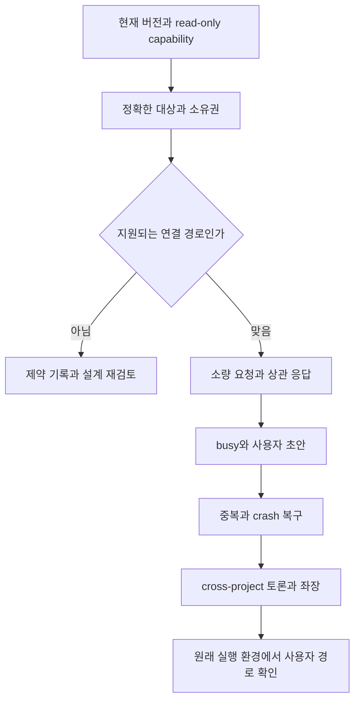

<!-- sr:plan
{"document_type":"research","reader_questions":["어떤 가정을 다음에 검증하는가","기존 세션을 어떻게 식별하는가","통과를 무엇으로 입증하는가","아직 하지 않은 것은 무엇인가"],"visual_plan":[{"kind":"comparison_table","content":"후속 검증 시나리오와 관측 증거","required":true},{"kind":"flowchart","content":"조회부터 제한된 실제 검증까지의 순서","required":true}],"visual_waiver":[]}
-->

# 기존 세션 연결 — 후속 검증 계획

> 계획 문서다. 아래 시나리오는 아직 실행하지 않았다.

## 한눈에 보기

- 목적: 벤치마킹에서 남은 연결·소유권·중복·UI 가정을 실제 환경의 관측으로 바꾼다.
- 현재 상태: 실행 전 검증 계획. 실제 LLM 세션 생성·메시지 전송·설정 변경은 수행하지 않았다.
- 핵심 결론: 첫 검증은 새 에이전트 여러 개를 띄우는 데모가 아니라 기존 Codex와 Claude 세션의 정확한 요청·응답이어야 한다.
- 원인 또는 판단 근거: [[benchmark-analysis]]의 연결 방식·상태·복구 차이에서 각 시나리오를 도출했다.
- 결정: 구현·실험 결과와 계획을 혼동하지 않도록 모든 시나리오를 미실행으로 기록한다.
- 다음 행동: 실제 host의 읽기 전용 discovery와 capability부터 확인하고 대상·제어권·한도를 정한다.
- 최종 갱신: 2026-10-22, Asia/Seoul.

## 질문

실제 세션을 건드리기 전에 무엇을 확인하고, 어떤 증거가 있어야 기존 세션 협업이 된다고 말할 수 있는가.

## 짧은 답

provider, host, native session ID, cwd를 함께 확인한다. 외부 host 소유권을 유지하는 연결과 별도 프로세스 재개를 구분한다. 요청마다 저장 ID·host 접수·turn 시작·상관 응답을 대조하고, 모호한 전송은 완료나 미전송으로 바꾸지 않는다.

## 근거

근거는 제품별 정적 소스에서 발견한 경계이며 테스트 성공 결과가 아니다. 연결 방식은 [[magents-benchmark]], busy 입력은 [[intercom-benchmark]], 영속 전달은 [[agentmux-benchmark]], claim과 응답은 [[orchestra-benchmark]], host/UI 수명은 [[host-reference-benchmark]]를 참조한다.

### 실행 전 기록할 항목

| 항목 | 필요한 기록 |
|---|---|
| 대상 환경 | Windows/Orca/provider 버전, native/WSL 여부, transport |
| 기존 대상 | 정확한 provider·host·session ID·cwd와 원래 실행 주체 |
| 제어 범위 | 조회만 가능한지, 입력 전달·steer·응답 관측이 가능한지 |
| 원래 상태 | idle/busy, 사용자 입력 초안, 작업 중 파일·프로세스 |
| 모델 사용 | 실제 provider/model/effort, 소량 canary 요청 수와 중단 한도 |
| 복구 증거 | client request ID, host request/turn ID, 시각, 마지막 확정 상태 |
| 보관 범위 | canary·요청 ID·상태만 최소 기록. 개인 대화 전체를 복제하지 않음 |

### 시나리오

| ID | 시나리오 | 통과 판단을 위한 증거 | 현재 상태 |
|---|---|---|---|
| V-01 | 기존 두 provider 세션 식별 | before/after provider·host·session ID·cwd 동일 | 미실행 |
| V-02 | 같은 이름·유사 ID의 세션 여러 개 | 모호한 대상은 거부, 잘못된 세션 수신 없음 | 미실행 |
| V-03 | idle 세션에 요청하고 답 받기 | 정확히 연결된 request/turn/reply와 원래 host의 이력 | 미실행 |
| V-04 | busy 상태에 일반 후속 요청 | 현재 turn을 steer하지 않고 대기 후 한 번 처리 | 미실행 |
| V-05 | 명시적 방향 수정 | 지원되는 host만 예상 turn ID에 추가하고 출처 보존 | 미실행 |
| V-06 | 사용자가 초안을 입력 중 | 초안이 덮이거나 요청과 이어 붙지 않음 | 미실행 |
| V-07 | 전송 전 서비스 종료 | 복구 후 미전송 대기 요청만 정해진 순서로 전달 | 미실행 |
| V-08 | provider 접수 직후 응답 유실/서비스 종료 | 자동 중복 전송 없이 unknown 유지 후 동일 요청 증거 회수 | 미실행 |
| V-09 | 같은 요청 키의 반복 제출 | 동일 payload는 동일 요청, 다른 payload는 충돌 표시 | 미실행 |
| V-10 | cross-project 전체 요청과 멤버 변경 | 전송 시점 멤버 snapshot에만 전달, 중간 초대자에 소급 전송 안 함 | 미실행 |
| V-11 | 같은 세션이 토론 두 곳에 참여 | 세션 단위 입력 직렬화와 요청별 응답 목적지 유지 | 미실행 |
| V-12 | 토론 정지·이탈·창 닫기 | 새 배포는 중지, 외부 원래 프로세스는 보존 | 미실행 |
| V-13 | 좌장과 두 세션의 논의 | 원문 출처·미합의·결정·담당 보존, 설정 한도에서 종료 | 미실행 |

### 검증 순서

### 상태별 판정 규칙

| 관측 | 말할 수 있는 것 | 아직 말할 수 없는 것 |
|---|---|---|
| archive 다운로드 성공 | 특정 소스를 확보함 | 해당 제품이 이 PC에서 동작함 |
| mailbox/outbox 저장 성공 | 요청이 영속 접수됨 | 상대가 실행함 |
| 입력 수락 영수증 | host가 입력을 접수함 | 모델이 요청을 읽고 완료함 |
| turn 시작 | 해당 turn 실행이 시작됨 | 요청 작업이 성공함 |
| idle/프로세스 생존 | 대기 또는 생존 상태 관측 | 응답 성공 또는 작업 완료 |
| request-correlated 정상 응답 | 해당 요청의 응답을 회수함 | 후속 파일 변경까지 검증됨 |
| 권한/파일/작업 증거 | 관측한 결과가 확인됨 | 다른 host와 버전의 보편적 호환 |

## 상충 근거

새 세션으로 canary 대화를 성공시키는 것은 별도 프로세스 기동 능력의 증거다. 현재 Orca에서 작업 중인 기존 세션을 보존하며 협업했다는 증거로 대체할 수 없다.

같은 session ID로 resume했다고 기존 프로세스가 계속 그 세션을 소유하고 UI가 동기화된다고 단정할 수 없다. 실행 주체와 동시 접근을 별도로 확인해야 한다.

## 한계

아직 실제 latency·token·비용·전달 성공률을 측정하지 않았다. 임의 수치 목표나 제품 순위를 만들지 않았다. 첫 실제 검증에서 관측한 원자료로만 수치를 채운다.

상세 구현·실험 승인 범위는 기존 설계의 의도·수용 기준과 이 조사 결과를 함께 반영해 정한다. 이 문서 자체는 전역 MCP 설치나 타 세션 메시지 전송을 수행한 기록이 아니다.

## 권고

읽기 전용 capability 확인에서부터 순서대로 진행한다. 어떤 단계가 불가하면 성공한 데모로 바꿔치기하지 않고 원래 요구와 차이를 기록한다. 결과에는 항상 “코드 확인 / 격리 실행 / 원래 환경 실행”의 범위를 표시한다.

## 관련 노트

- [[inter-session-index]]
- [[benchmark-analysis]]
- [[benchmark-sources]]
- [[session-room-foundation]]

