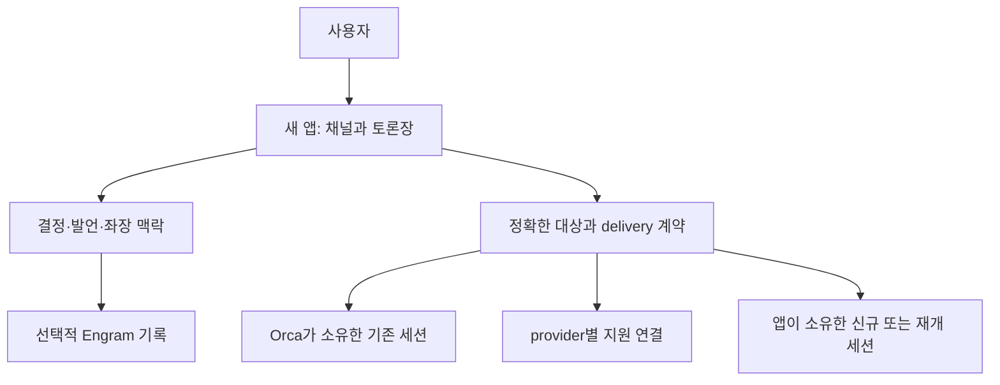

<!-- sr:plan
{"document_type":"research","reader_questions":["OpenClaw에서 배울 계약은 무엇인가","현재 Orca는 어디까지 제공하는가","NotebookLM UI를 얼마나 재사용할 수 있는가","무엇을 실제 검증해야 하는가"],"visual_plan":[{"kind":"comparison_table","content":"OpenClaw와 Orca 및 로컬 UI의 경계 비교","required":true},{"kind":"flowchart","content":"기존 host와 새 토론장 계층의 역할","required":true}],"visual_waiver":[]}
-->

# OpenClaw·Orca·NotebookLM — 연결 계약과 재사용 경계

> 2026-10-22. 제품 4종의 비교를 보완하는 기준 플랫폼과 로컬 소스 조사.

## 한눈에 보기

- 목적: 토론장 계층과 기존 실행 host의 책임을 분리한다.
- 현재 상태: OpenClaw 선택 소스 9개, 설치된 Orca 가이드, 로컬 NotebookLM 파일 7개를 정적으로 확인했다.
- 핵심 결론: OpenClaw의 세션 의미론, Orca의 현재 조율 인터페이스, NotebookLM 표시 패턴을 각각 참고하되 서로 대체 가능한 구현으로 보지 않는다.
- 원인 또는 판단 근거: 고정 소스, 설치 가이드 JSON, 로컬 파일 hash를 별도 manifest로 보존했다.
- 결정: 기존 실행 host와 원본 앱을 수정하거나 새 프로세스를 시작하지 않는다.
- 다음 행동: host별 capability·소유권·응답 계약을 실제 Windows 환경에서 분리 검증한다.
- 최종 갱신: 2026-10-22, Asia/Seoul.

## 질문

원래 아이디어의 OpenClaw, 현재 작업 환경인 Orca, 재사용 후보 NotebookLM은 각각 어떤 층위를 제공하는가.

## 짧은 답

OpenClaw는 자신이 관리하는 Gateway 세션의 메시지·출처·권한·응답 소유권을 다룬다. Orca는 현재 설치본에 이미 구조화 메시징과 작업 조율을 갖고 있다. NotebookLM은 Windows 앱과 채팅 표현 소스가 있지만 노트북 도메인과 실행 소유권이 결합되어 있다.

## 근거

근거는 OpenClaw의 고정 소스와 현재 Orca 가이드, 직접 읽은 로컬 UI 파일이다. 각 항목에 확인 위치와 정적 관측의 범위를 연결했다.

### OpenClaw: 세션 의미론의 참고 대상

고정 revision은 `d920bfc80fe14a6fac9a0019fc7887da66dfa189`다. 전체 저장소 대신 선택 소스 9개를 수집했고 각 파일 hash를 host-reference-manifest.json에 저장했다. LICENSE는 MIT로 확인했다.

| 관측 | 고정 근거 | 적용할 판단 |
|---|---|---|
| 입력의 source metadata와 isUser=false 표시 | [src/sessions/input-provenance.ts:187–204](https://github.com/openclaw/openclaw/blob/d920bfc80fe14a6fac9a0019fc7887da66dfa189/src/sessions/input-provenance.ts#L187-L204) | 사용자 직접 명령과 참여 세션 발언의 출처를 구분 |
| 세션 visibility 및 A2A 접근 확인 | [src/agents/tools/sessions-send-tool.ts:400–425](https://github.com/openclaw/openclaw/blob/d920bfc80fe14a6fac9a0019fc7887da66dfa189/src/agents/tools/sessions-send-tool.ts#L400-L425) | 참가자 등록과 메시지 접근 범위를 별도 모델로 표현 |
| notify와 실행 요청의 분리 및 idempotencyKey | [src/agents/tools/sessions-send-tool.ts:550–570](https://github.com/openclaw/openclaw/blob/d920bfc80fe14a6fac9a0019fc7887da66dfa189/src/agents/tools/sessions-send-tool.ts#L550-L570) | 채널 게시만 할 때와 대상 실행을 요구할 때를 구분 |

이 소스가 외부 Orca·Codex·Claude 프로세스를 직접 연결하는 증거는 아니다. OpenClaw의 Gateway 내부 대상과 임의 host가 소유한 실행 세션을 구분해야 한다.

### Orca: 설치된 host 기능

설치 파일의 ProductVersion은 1.4.229다. 이 값은 현재 가이드 조회 시 함께 읽은 binary metadata이며 외부 공개 source revision과 연결하지 않았다.

| 항목 | 설치 가이드에서 확인한 내용 | 증거 |
|---|---|---|
| 기존 대상 접근 | runtime handle, worktree, 세션 검색 경로가 있음 | orca-cli-guide.json |
| 전달 증거 | terminal 입력 접수와 turn 시작 stage 구분 | orca-cli-guide.json |
| 구조화 조율 | Run·Task·Dispatch, inbox·reply·wait가 있음 | orca-orchestration-guide.json |
| enqueue와 실행 | send 성공은 durable enqueue, wake는 best-effort | orca-messaging-guide.json |
| 그룹 대상 | 일반 그룹은 발신자의 Run 소속 live Dispatch 대상 | orca-messaging-guide.json |
| 권한·소유권 | Dispatch lifecycle과 실제 실행 host의 권한 구분 | orca-orchestration-guide.json |

이전 Wiki의 2026-07 Orca 조사에서 공유 컨텍스트·순차 조율이 없다고 한 내용은 현재 기능 판정 근거로 재사용하면 안 된다. 이번 문서는 현재 설치 가이드를 기준으로 갱신한 조사이며, 가이드 조회와 실제 메시지 E2E는 여전히 다르다.

### NotebookLM: 로컬 UI 후보

현재 HEAD는 `fc60ae3531f95fee914ca715ff882f540bf6abae`다. 검사 대상은 실제 worktree 파일이며 HEAD와 같다고 가정하지 않고 파일별 hash와 행 수를 local-reuse-manifest.json에 보존했다.

| 파일/관측 | 직접 읽은 위치 | 재사용 판단 |
|---|---|---|
| React/Next.js·Tauri·Markdown 라이브러리 구성 | frontend/package.json, src-tauri/tauri.conf.json | 기술 선택의 후보, 이번 프로젝트 스택 확정 아님 |
| ChatPanel의 useChat·useNotebook·notebook API 결합 | frontend/src/components/ChatPanel/index.tsx:7–11 | 전체 복사 대신 도메인 의존성 제거 필요 |
| TerminalPanel은 새 PowerShell PTY를 생성 | frontend/src/components/TerminalPanel/index.tsx:81 | 기존 외부 세션의 attach 컴포넌트가 아님 |
| unmount 시 PTY 종료 | frontend/src/components/TerminalPanel/index.tsx:102 | borrowed와 owned session 수명 분리 필요 |
| MarkdownImage는 source raw API에 결합 | frontend/src/components/shared/MarkdownImage.tsx:4–16 | 순수 표시 컴포넌트로 가정하지 말고 URL resolver 분리 |
| MarkdownCodeBlock은 MermaidBlock과 스타일에 의존 | frontend/src/components/shared/MarkdownCodeBlock.tsx:1–4,46 | 의존성·스타일을 확인한 뒤 작은 단위 추출 검토 |

앞선 초안의 “작은 표시 컴포넌트부터 재사용”은 후보 수준이다. 특히 MarkdownImage도 현재는 notebook API 의존성이 있으므로 무수정 재사용 가능하다고 볼 수 없다.

### 계층 구분

## 상충 근거

- 오래된 Orca 조사를 현재 제한으로 취급하면 이미 있는 조율 기능을 다시 만들 수 있다.
- native runtime이라는 명칭은 Windows native 지원을 의미하지 않는다.
- UI 컴포넌트가 존재한다고 외부 세션 연결이나 세션 수명 보존이 해결되는 것은 아니다.
- OpenClaw의 세션 그룹과 이 프로젝트의 cross-host 토론장 참가자는 같은 주소 공간이 아니다.

## 한계

실제 Orca 세션 목록·대화 내용·개인 설정·token을 수집하지 않았다. 설치 가이드와 공개 소스 및 재사용 후보의 코드만 읽었다. 기존 세션에 메시지를 보내거나 제어권을 옮기지 않았다.

OpenClaw 전체 runtime, NotebookLM 전체 의존성, Orca 내부 비공개 구현을 감사한 것은 아니다. 현재 소스·가이드에 확인된 계약만 벤치마킹 근거로 삼았다.

## 권고

| 계층 | 채택 후보 | 추가 검증 |
|---|---|---|
| 토론장 의미론 | source provenance, 게시/실행 분리, 정확한 멤버십 | 좌장과 참여자가 실제로 읽는 입력의 출처 유지 |
| 기존 host | 현재 Orca 메시지·응답/receipt 인터페이스 | 임의 기존 세션, cross-project, 실행 중/idle 차이 |
| provider | 공식 또는 host가 제공하는 지원된 연결 경로 | resume와 live attach 및 동시 제어의 차이 |
| UI | NotebookLM의 표시·코드블록·패널 경험 | API·CSS·수명 의존성 추출 비용 |

## 관련 노트

- [[inter-session-index]]
- [[benchmark-sources]]
- [[benchmark-analysis]]
- [[claude-app-integration]]

