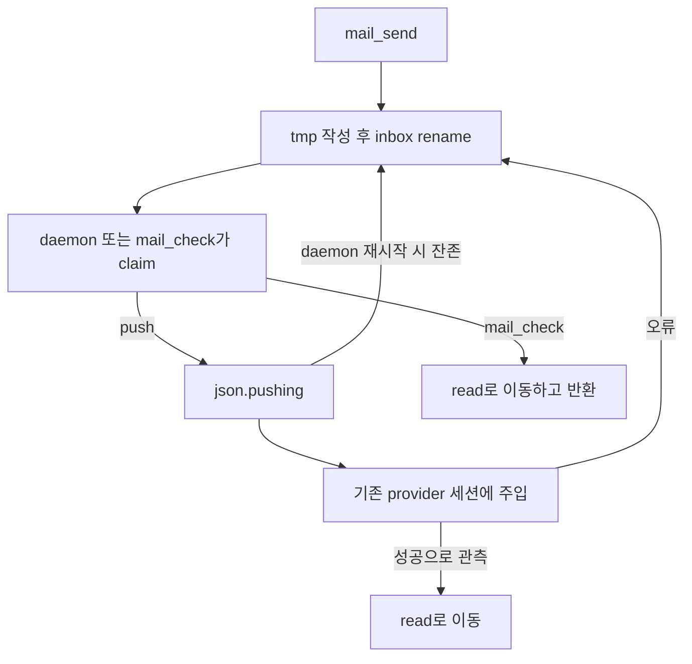

<!-- sr:plan
{
  "document_type": "research",
  "reader_questions": [
    "무엇을 조사했는가",
    "기존 세션이 실제로 어떻게 연결되는가",
    "어떤 부분을 재사용할 수 있는가",
    "미검증 사항은 무엇인가"
  ],
  "visual_plan": [
    {
      "kind": "comparison_table",
      "content": "관측 사실과 근거, 채택 및 보류 항목 비교",
      "required": true
    },
    {
      "kind": "flowchart",
      "content": "메시지 전달과 응답 및 실패 분기",
      "required": true
    }
  ],
  "visual_waiver": []
}
-->

# agent-intercom — mailbox와 실시간 push

> 2026-10-22 기준의 개인용 Windows 세션 토론장 벤치마킹 자료.

## 한눈에 보기

- 목적: 기존 작업 세션의 연결·전달·응답·복구 구조를 비교한다.
- 현재 상태: 고정 커밋 소스의 선택 경로 정적 검토. 설치와 실제 LLM 실행은 하지 않았다.
- 핵심 결론: 작은 메시지 버스의 구조는 명료하지만 전달 성공의 증거와 crash 이후 중복 실행 보장은 별도 설계가 필요하다.
- 원인 또는 판단 근거: 아래 파일·행 위치와 수집 manifest에 직접 확인한 범위를 명시했다.
- 결정: 구현 채택은 아직 확정하지 않고 구조와 검증 항목을 추출한다.
- 다음 행동: 원자적 claim과 provider 실행의 경계를 나누고 unknown 상태 복구 시나리오를 먼저 정의한다.
- 최종 갱신: 2026-10-22, Asia/Seoul.

## 질문

열린 이종 CLI 세션에 바로 메시지를 넣는 최소 구조는 무엇인가. claimed 파일 복구가 실제 실행의 중복 방지까지 보장하는가.

## 짧은 답

Node.js stdio MCP mailbox와 별도 push daemon으로 구성된다. 기본 mailbox 이름에 세션 접미사를 붙여 대상을 고를 수 있으며, 미지정 시 최근 활동 세션을 선택한다. Codex가 실행 중이면 일반 요청도 steer로 들어간다.

## 근거

고정 revision: `610cc64f489cba940bab27ff88d0e5f77c004359`. 수집한 LICENSE는 MIT다.

| ID | 소스에서 확인한 동작 | 고정 근거 |
|---|---|---|
| I-1 | 원자적 파일 공개와 reply_to | [server.js:75–100](https://github.com/iambashar/agent-intercom/blob/610cc64f489cba940bab27ff88d0e5f77c004359/server.js#L75-L100) |
| I-2 | 기본 대상은 최근 활동 세션, 지정 시 첫 매칭 | [pushd.js:27–34](https://github.com/iambashar/agent-intercom/blob/610cc64f489cba940bab27ff88d0e5f77c004359/pushd.js#L27-L34) |
| I-3 | Claude는 애플리케이션 ACK 대신 연결 유지로 추정 | [pushd.js:46–69](https://github.com/iambashar/agent-intercom/blob/610cc64f489cba940bab27ff88d0e5f77c004359/pushd.js#L46-L69) |
| I-4 | Codex 실행 중 입력은 자동 steer | [pushd.js:74–99](https://github.com/iambashar/agent-intercom/blob/610cc64f489cba940bab27ff88d0e5f77c004359/pushd.js#L74-L99) |
| I-5 | claim → push → read 이동 및 실패 시 반환 | [pushd.js:142–159](https://github.com/iambashar/agent-intercom/blob/610cc64f489cba940bab27ff88d0e5f77c004359/pushd.js#L142-L159) |
| I-6 | 충돌 후 pushing 파일을 inbox로 복구 | [pushd.js:191–219](https://github.com/iambashar/agent-intercom/blob/610cc64f489cba940bab27ff88d0e5f77c004359/pushd.js#L191-L219) |
| I-7 | Unix daemon 탐색과 getuid 기본값 | [codex-ws.js:77–101](https://github.com/iambashar/agent-intercom/blob/610cc64f489cba940bab27ff88d0e5f77c004359/codex-ws.js#L77-L101) |
| I-8 | 설치 시 전역 설정 변경, 서비스 관리 OS 분기 | [cli.js:29–65](https://github.com/iambashar/agent-intercom/blob/610cc64f489cba940bab27ff88d0e5f77c004359/cli.js#L29-L65); [cli.js:107–141](https://github.com/iambashar/agent-intercom/blob/610cc64f489cba940bab27ff88d0e5f77c004359/cli.js#L107-L141) |

### 처리 흐름

### 사용·운영 특성

| 차원 | 관측 또는 판단 |
|---|---|
| 최소 API | mail_send, mail_check, mail_peers |
| 수신·응답 | body와 reply_to를 보존. 응답은 참여자가 다시 도구로 보내야 함 |
| 기본 대상 | 최근 활동 세션. 여러 세션 운영 시 정확한 identity 지정이 중요 |
| busy 정책 | Codex의 실행 중 turn을 자동 steer하는 구현 |
| Windows | mailbox core는 Node 파일 API지만 설치는 which, push 기본 경로는 getuid/Unix socket, 자동 서비스는 launchd/systemd에 의존 |
| 시험 증거 | test/pushd.test.js:62,100,128 등 socket·실패·claim 복구 테스트가 존재. 실행하지 않음 |

## 상충 근거

파일 rename 경쟁은 같은 파일을 mailbox reader와 daemon이 동시에 가져가는 것을 줄인다. 이것을 종단 간 exactly-once 실행 보장으로 확대할 수는 없다.

정적 관측: 재시작은 잔존 pushing 파일을 inbox로 되돌린다.

분석 가설: provider 접수 후 read 이동 전에 daemon이 종료되면 복구 후 중복 주입이 가능할 수 있다. 외부 실행의 idempotency를 따로 검증해야 한다.

실제 중복 발생을 재현한 결과는 없다.

Claude 경로의 연결 유지 판정은 메시지를 모델이 읽었거나 실제 작업을 시작했다는 ACK가 아니다.

## 한계

- CLI 내부 socket과 daemon 경로는 제품 코드가 전제하는 구현이며 공식 호환 계약으로 검증하지 않았다.
- native Windows에서의 mailbox·수동 daemon·CLI 설치를 실행하지 않았다.
- prefix가 여러 세션에 매칭되는 경우와 세션 전환 중 최신 대상 선택은 아직 실험하지 않았다.
- 로그인 서비스 설치, 전역 MCP 등록 및 실제 push는 수행하지 않았다.

## 권고

| 항목 | 제안 |
|---|---|
| 채택 후보 | 작은 MCP 표면, 원문과 reply_to, 로컬 mailbox와 daemon 분리 |
| 명시할 정책 | 정확한 session ID, 일반 follow-up과 steer 선택 |
| 추가 설계 | durable request ID와 외부 turn ID 대조, 불확실한 전송의 unknown 상태 |
| 보류 | 자동 최근 대상 선택과 무조건적인 claim replay를 안전한 기본값으로 채택 |

실험적 push는 native Windows 호스트별 관측을 확보하기 전까지 지원 확정으로 표시하지 않는다.

## 관련 노트

- [[inter-session-index]]
- [[benchmark-sources]]
- [[benchmark-analysis]]

