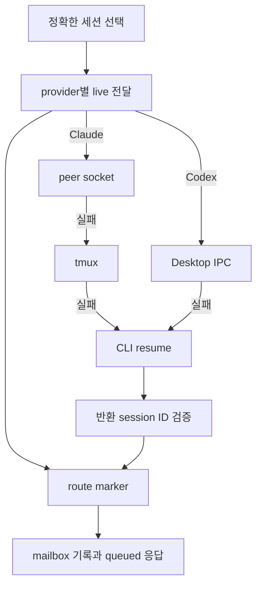

<!-- sr:plan
{
  "document_type": "research",
  "reader_questions": [
    "무엇을 조사했는가",
    "기존 세션이 실제로 어떻게 연결되는가",
    "어떤 부분을 재사용할 수 있는가",
    "미검증 사항은 무엇인가"
  ],
  "visual_plan": [
    {
      "kind": "comparison_table",
      "content": "관측 사실과 근거, 채택 및 보류 항목 비교",
      "required": true
    },
    {
      "kind": "flowchart",
      "content": "메시지 전달과 응답 및 실패 분기",
      "required": true
    }
  ],
  "visual_waiver": []
}
-->

# magents — 기존 세션 탐색과 전달 경로

> 2026-10-22 기준의 개인용 Windows 세션 토론장 벤치마킹 자료.

## 한눈에 보기

- 목적: 기존 작업 세션의 연결·전달·응답·복구 구조를 비교한다.
- 현재 상태: 고정 커밋 소스의 선택 경로 정적 검토. 설치와 실제 LLM 실행은 하지 않았다.
- 핵심 결론: 기존 세션 중심의 식별·검색 구조는 참고할 만하다. live 전달과 CLI 재개를 동일한 연결 능력으로 취급해서는 안 된다.
- 원인 또는 판단 근거: 아래 파일·행 위치와 수집 manifest에 직접 확인한 범위를 명시했다.
- 결정: 구현 채택은 아직 확정하지 않고 구조와 검증 항목을 추출한다.
- 다음 행동: Windows adapter 계약에 연결 방식과 실제 session ID 보존 증거를 명시한다.
- 최종 갱신: 2026-10-22, Asia/Seoul.

## 질문

이미 열린 Claude·Codex 대화를 찾아 맥락을 유지한 채 전달할 수 있는가. 전달 실패 시 어떤 실행 주체로 바뀌며 Windows에 그대로 적용할 수 있는가.

## 짧은 답

Rust 기반 MCP/CLI로 provider별 기존 대화를 찾아 전달한다. Claude는 peer socket과 tmux를 먼저 시도하고 실패하면 CLI 재개로, Codex는 Desktop IPC 실패 시 CLI 재개로 넘어간다. 재개 결과의 session ID를 검증하지만 원래 프로세스와의 제어권 공유를 보장하는 것은 아니다.

## 근거

고정 revision: `0dd29e28f8170150b0135d93e55ee1d3b8ffa45a`. 수집한 LICENSE는 MIT이며 원문은 snapshot에 보존했다.

| ID | 소스에서 확인한 동작 | 고정 근거 |
|---|---|---|
| M-1 | 기존 세션 탐색과 profile/cwd 분리 | [src/discover.rs:41–117](https://github.com/abnegate/magents/blob/0dd29e28f8170150b0135d93e55ee1d3b8ffa45a/src/discover.rs#L41-L117) |
| M-2 | Claude 전달: peer socket → tmux → CLI 재개 순서 | [src/deliver.rs:23–70](https://github.com/abnegate/magents/blob/0dd29e28f8170150b0135d93e55ee1d3b8ffa45a/src/deliver.rs#L23-L70) |
| M-3 | Codex 전달: IPC → CLI 재개 | [src/deliver.rs:80–101](https://github.com/abnegate/magents/blob/0dd29e28f8170150b0135d93e55ee1d3b8ffa45a/src/deliver.rs#L80-L101) |
| M-4 | Desktop IPC의 별도 요청 메서드와 설정 상속 | [src/codex_ipc.rs:29–78](https://github.com/abnegate/magents/blob/0dd29e28f8170150b0135d93e55ee1d3b8ffa45a/src/codex_ipc.rs#L29-L78) |
| M-5 | 전달 시도 이후 mailbox 기록, queued=true와 route marker 반환 | [src/mailbox.rs:174–193](https://github.com/abnegate/magents/blob/0dd29e28f8170150b0135d93e55ee1d3b8ffa45a/src/mailbox.rs#L174-L193) |
| M-6 | 재개 시 provider·session ID 일치 검사 | [src/runtime.rs:148–183](https://github.com/abnegate/magents/blob/0dd29e28f8170150b0135d93e55ee1d3b8ffa45a/src/runtime.rs#L148-L183) |
| M-7 | UnixStream 모듈이 조건 없이 포함됨 | [src/lib.rs:1–18](https://github.com/abnegate/magents/blob/0dd29e28f8170150b0135d93e55ee1d3b8ffa45a/src/lib.rs#L1-L18); [src/deliver.rs:1–14](https://github.com/abnegate/magents/blob/0dd29e28f8170150b0135d93e55ee1d3b8ffa45a/src/deliver.rs#L1-L14) |
| M-8 | 응답은 발신 세션을 찾아 별도 send 수행 | [src/mailbox.rs:196–238](https://github.com/abnegate/magents/blob/0dd29e28f8170150b0135d93e55ee1d3b8ffa45a/src/mailbox.rs#L196-L238) |

### 전달 흐름

### 사용·운영 특성

| 차원 | 관측 또는 판단 |
|---|---|
| 신원 | provider/session뿐 아니라 profile/config dir를 탐색 결과에 포함 |
| 공개 토론 UI | 검토 대상은 MCP/CLI이며 이 프로젝트의 참석자·채널 UI를 대신하지 않음 |
| 응답 | reply/inbox/await 계열은 별도 mailbox 경로. 실행 성공과 응답 완료가 분리됨 |
| 저장 | send 경로에서는 실제 전달 시도가 mailbox 영속 기록보다 먼저 일어남 |
| Windows | 조건 없는 UnixStream import가 있어 검토 revision을 native Windows에 그대로 가져오는 근거가 없음 |
| 시험 증거 | src/codex_ipc.rs의 mock socket 테스트와 tests/cli.rs 등은 존재하지만 실행하지 않음 |

## 상충 근거

기존 세션을 유지한다는 설명을 원래 실행 프로세스에만 전달한다는 뜻으로 읽으면 안 된다. 코드에는 실패 후 resume가 명시적으로 있다. `queued=true`도 모든 live 경로가 성공했다는 판정이 아니다.

## 한계

- 원래 세션이 실행 중인 상태에서 resume가 시도될 때의 실제 host 충돌은 재현하지 않았다.
- 전달 성공 후 mailbox 쓰기 실패 또는 프로세스 종료의 결과는 미실험이다. 정적 순서상 복구 경계가 분리되어 있다는 점만 확인했다.
- 선택한 핵심 경로를 읽었으며 저장소 전체의 정확성이나 성능을 평가한 것은 아니다.
- latest release API의 0.14.2와 조사한 branch HEAD revision은 동일하다고 가정하지 않는다.

## 권고

| 항목 | 제안 |
|---|---|
| 채택 후보 | provider/profile/session/cwd 식별 구조와 재개 결과의 ID 검증 |
| 변경 필요 | live attach·resume·fork를 명시적 capability로 분리 |
| 그대로 채택하지 않을 부분 | live 실패를 새 실행 주체의 재개로 자동 전환하는 정책 |
| 후속 확인 | 원래 host가 소유한 기존 세션의 정확한 요청·응답과 단일 실행 주체 증거 |

이 판정은 정적 분석에 기반한 설계 권고이며 실제 연결 성능 판정이 아니다.

## 관련 노트

- [[inter-session-index]]
- [[benchmark-sources]]
- [[benchmark-analysis]]

