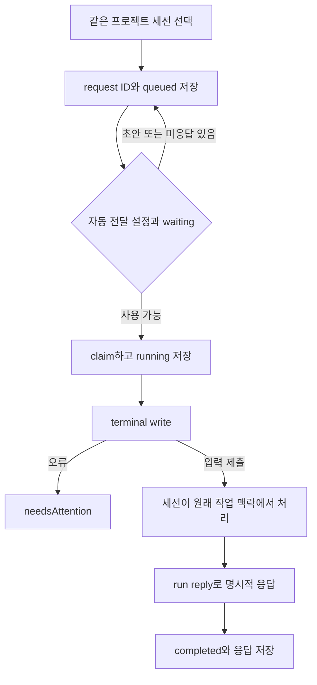

<!-- sr:plan
{
  "document_type": "research",
  "reader_questions": [
    "무엇을 조사했는가",
    "기존 세션을 어떻게 연결하는가",
    "어떤 부분을 채택하는가",
    "미검증 사항은 무엇인가"
  ],
  "visual_plan": [
    {
      "kind": "comparison_table",
      "content": "관측 사실과 근거 및 채택/보류 비교",
      "required": true
    },
    {
      "kind": "flowchart",
      "content": "연결 및 전달 처리 경로",
      "required": true
    }
  ],
  "visual_waiver": []
}
-->

# Orchestra — 세션 inbox와 자동 전달 UX

> 2026-10-22 기준의 개인용 Windows 세션 토론장 벤치마킹 자료.

## 한눈에 보기

- 목적: 실제 연결·전달·응답·복구 경계를 파악한다.
- 현재 상태: 고정 커밋 소스와 로컬 가이드 정적 조사. 제품 설치·LLM 실행은 수행하지 않았다.
- 핵심 결론: 요청·응답 UI와 idle/초안 보호는 유용하지만 같은 프로젝트 경계와 claim 기반 running 상태는 우리 요구에 맞게 바꿔야 한다.
- 원인 또는 판단 근거: 아래 파일·행 근거와 수집 manifest에 범위를 명시했다.
- 결정: 코드 재사용과 기본 정책은 아직 확정하지 않는다.
- 다음 행동: 토론장 멤버십을 프로젝트 소속과 분리하고 claimed와 실제 provider running을 구분한다.
- 최종 갱신: 2026-10-22, Asia/Seoul.

## 질문

가장 가까운 desktop 세션 메시징 UX는 어떤 계약 위에서 동작하는가. 서로 다른 프로젝트의 작업 세션을 한 토론에 초대할 수 있는가.

## 짧은 답

Go/Wails backend와 Vue/Vite UI가 기존 앱 세션 사이에 request ID 기반 inbox를 제공한다. 자동 전달은 waiting 상태·초안 없음·기존 미응답 없음 조건을 확인한다. 다만 backend와 UI 모두 같은 프로젝트의 세션을 대상으로 하며, 임의 외부 실행 세션의 범용 연결을 제공하는 근거는 아니다.

## 근거

고정 revision: `50ecf08e96be01c03eb3ee0e4a686d0dfe84b0c5`. LICENSE는 MIT다. latest release v0.9.0 asset은 macOS와 Linux용으로 수집됐다.

| ID | 소스에서 확인한 동작 | 고정 근거 |
|---|---|---|
| O-1 | 요청 이력과 원자 저장 | [internal/core/collaboration.go:22–96](https://github.com/theorchestradev/orchestra/blob/50ecf08e96be01c03eb3ee0e4a686d0dfe84b0c5/internal/core/collaboration.go#L22-L96) |
| O-2 | 같은 프로젝트만 요청 허용 | [internal/core/collaboration.go:300–338](https://github.com/theorchestradev/orchestra/blob/50ecf08e96be01c03eb3ee0e4a686d0dfe84b0c5/internal/core/collaboration.go#L300-L338) |
| O-3 | claim을 running으로 표현 | [internal/core/collaboration.go:340–372](https://github.com/theorchestradev/orchestra/blob/50ecf08e96be01c03eb3ee0e4a686d0dfe84b0c5/internal/core/collaboration.go#L340-L372) |
| O-4 | 응답자 검증과 idempotent reply | [internal/core/collaboration.go:374–418](https://github.com/theorchestradev/orchestra/blob/50ecf08e96be01c03eb3ee0e4a686d0dfe84b0c5/internal/core/collaboration.go#L374-L418) |
| O-5 | claim 후 terminal write | [internal/core/collaboration.go:638–667](https://github.com/theorchestradev/orchestra/blob/50ecf08e96be01c03eb3ee0e4a686d0dfe84b0c5/internal/core/collaboration.go#L638-L667) |
| O-6 | 자동 전달의 idle·초안 보호 | [internal/core/collaboration.go:670–698](https://github.com/theorchestradev/orchestra/blob/50ecf08e96be01c03eb3ee0e4a686d0dfe84b0c5/internal/core/collaboration.go#L670-L698) |
| O-7 | 세션 메시지 UI | [frontend/src/components/Messages.vue:6–21](https://github.com/theorchestradev/orchestra/blob/50ecf08e96be01c03eb3ee0e4a686d0dfe84b0c5/frontend/src/components/Messages.vue#L6-L21); [frontend/src/components/Messages.vue:58–89](https://github.com/theorchestradev/orchestra/blob/50ecf08e96be01c03eb3ee0e4a686d0dfe84b0c5/frontend/src/components/Messages.vue#L58-L89) |
| O-8 | Windows 포팅이 필요한 host 경로 | [internal/sessionhost/spawn_other.go:1–21](https://github.com/theorchestradev/orchestra/blob/50ecf08e96be01c03eb3ee0e4a686d0dfe84b0c5/internal/sessionhost/spawn_other.go#L1-L21); [internal/sessionhost/server.go:90–104](https://github.com/theorchestradev/orchestra/blob/50ecf08e96be01c03eb3ee0e4a686d0dfe84b0c5/internal/sessionhost/server.go#L90-L104) |
| O-9 | 프런트/백엔드 스택 | [frontend/package.json:14–26](https://github.com/theorchestradev/orchestra/blob/50ecf08e96be01c03eb3ee0e4a686d0dfe84b0c5/frontend/package.json#L14-L26); [go.mod:1–10](https://github.com/theorchestradev/orchestra/blob/50ecf08e96be01c03eb3ee0e4a686d0dfe84b0c5/go.mod#L1-L10) |

### 처리 흐름

### 사용·운영 특성

| 차원 | 관측 또는 판단 |
|---|---|
| 요청 identity | 명시 UUID와 payload 일치 검사, 동일 요청 재사용 |
| 응답 | 수신자만 응답 허용, 같은 응답의 재전달은 기존 결과 반환 |
| 수신자 점유 | 수신자별 동시에 한 running 요청만 claim |
| 취소 | 요청 상태 취소와 원래 세션 종료를 구분 |
| 기본 입력 UX | 개인 세션의 Messages dialog에서 대상 선택·원문·응답·Execute·Cancel |
| 토론장 적합성 | 상단 참석자와 공동 채널 타임라인은 별도 제품 계층이 필요 |
| Windows | Wails가 지원하는 OS 범위와 이 앱 host 구현의 범위는 다름. Unix socket·Setsid 경로가 포팅 대상 |
| 시험 증거 | collaboration_test.go의 이력·손상 복구·보존 검사 등 존재. 실행하지 않음 |

추가 확인: broker는 세션별 token을 대조하고 프로젝트 범위를 제한한다 ([internal/core/collaboration.go:478–504](https://github.com/theorchestradev/orchestra/blob/50ecf08e96be01c03eb3ee0e4a686d0dfe84b0c5/internal/core/collaboration.go#L478-L504)). 유지되지 않은 세션의 running 요청은 종료 시 interrupted로 기록하며 자동 재전송하지 않는 경로가 있다 ([internal/core/collaboration.go:437–449](https://github.com/theorchestradev/orchestra/blob/50ecf08e96be01c03eb3ee0e4a686d0dfe84b0c5/internal/core/collaboration.go#L437-L449)).

## 상충 근거

문서의 running을 실제 모델 실행 시작으로 읽으면 안 된다. inbox read/claim만으로 running이 되며, terminal write 전에 이미 running을 저장한다. 이는 제품의 의미 정의이며 우리 UI에서 그대로 실행 시작 상태로 쓰면 오해가 생긴다.

자동 전달은 초안이 없음을 검사하지만 수동 Execute에서는 사용자가 기존 초안을 먼저 지워야 한다는 UI 설명을 둔다. 자동·수동 경로가 같은 초안 보호를 보장한다고 확대하지 않는다.

## 한계

- macOS/Linux 설치본을 실행하지 않았고 Windows 빌드도 수행하지 않았다.
- 원래 Orca 세션을 Orchestra 세션으로 연속성 있게 가져오는 경로는 확인하지 못했다.
- provider별 진짜 idle과 terminal detector 상태의 일치율은 미측정이다.
- 저장·claim·terminal write 사이 crash 복구는 별도 실험이 필요하다.

## 권고

| 항목 | 제안 |
|---|---|
| 채택 후보 | 요청별 카드, 명시 reply, idle 자동 전달, draft 보호, 요청 취소와 프로세스 종료 분리 |
| 변경 필요 | cross-project ROOM_MEMBERSHIP 도입, claimed/accepted/running 분리 |
| 포팅 필요 | Unix session host·PTY·process lifecycle·IPC |
| 그대로 채택하지 않을 부분 | 전체 Wails/Vue 앱을 기존 React/Tauri 후보의 직접 기반으로 선택 |

동작 개념은 참고하되 UI 컴포넌트를 그대로 복사할 수 있다고 판단하지 않는다.

## 관련 노트

- [[inter-session-index]]
- [[benchmark-sources]]
- [[benchmark-analysis]]

