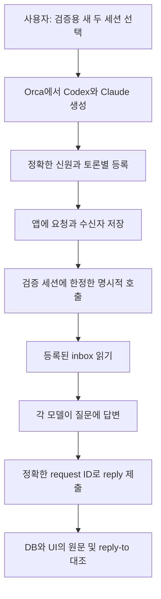

<!-- sr:plan
{"document_type":"experiment","reader_questions":["무엇을 구현했는가","실제로 어느 세션으로 검증했는가","어떤 증거가 있는가","아직 미완료인 것은 무엇인가"],"visual_plan":[{"kind":"comparison_table","content":"구현과 실제 실행 검증의 경계","required":true},{"kind":"flowchart","content":"검증용 두 세션의 요청과 상관 응답","required":true}],"visual_waiver":[]}
-->

# 세션 토론장 — 첫 구현과 런타임 검증

## 한눈에 보기

- 목적: 승인된 기능 명세를 로컬 실행 앱으로 옮기고 실제 두 provider의 요청·응답 경로를 검증한다.
- 현재 상태: 브라우저 실행판 구현 및 첫 검증 완료. 전체 명세는 building이며 기존 작업 세션 연결은 후속 검증 대상이다.
- 핵심 결론: 새 Codex·Claude의 요청·응답 3건과 근거 4개를 가진 좌장 제안 1건을 저장했다. 자동화 테스트 16개가 통과했다.
- 원인 또는 판단 근거: 앱의 request ID·reply-to·등록 신원, Orca 입력 접수/turn 시작 영수증, 별도 MCP stdio 조회와 실제 UI를 대조했다.
- 결정: 이 결과를 제한된 실행판의 검증으로 채택한다. 원래 V-01~V-13 및 기존 작업 세션의 자동 참여 통과로 확대하지 않는다.
- 다음 행동: 기존 세션의 신원·초안·권한·host 제출/응답을 함께 대조할 수 있는 연결 어댑터를 구현한다.
- 최종 갱신: 2026-10-22, Asia/Seoul.

## 결과

현재 실행판의 직접 관측과 원래 명세의 미검증 범위를 아래에 구분한다.

### 구현과 검증 범위

| 항목 | 실제 결과 | 판정 경계 |
|---|---|---|
| 로컬 앱 | 채널·토론·참석자·대상 입력·개별 출력·좌장 제안 표시 | 브라우저 실행판. 설치형 desktop shell 아님 |
| SQLite | 요청/수신자/outbox 원자 저장, writer/fence, 재시작 unknown, 멱등 접수·응답 | 격리 테스트로 검증. 실제 provider crash 전체 시나리오 아님 |
| 실제 모델 | Codex·Claude 신규 canary 두 개, 상관 응답 3건 completed | 응답 회수 판정이며 작업 성공 outcome과 다름 |
| 좌장 | Claude가 Codex에 질문, 답변을 포함한 원문 근거 4개로 제안 1건 | 별도 세 번째 좌장 없음. 제안은 proposed, 사용자 미확정 |
| MCP | 실제 stdio initialize·6개 도구 schema·토론 조회, HTTP 실패 isError | 모델은 HTTP helper를 사용. LLM 네이티브 MCP 등록 검증 아님 |
| 자동화 테스트 | npm test 16/16 통과 | storage 14, 실제 HTTP/MCP 통합 1, stdio 초기화 1 |
| UI | 1280×800·1440×900, 가로 넘침 없음, 보내기 버튼 하단 787/887px | 생성·초대·역할·한도·초안 유지·개별 출력 경로 확인 |
| 출력 조회 권한 | room/session 경로에서 멤버십·binding·rawInspect를 조회 전후 확인. 실제 Codex 출력 44행 | 선택한 canary만 허용. 무권한·비멤버·이전 unscoped 경로 거부 테스트 |

### 실제 토론 근거

토론 ID는 `4928678e-04b5-4d48-8cfe-ecd6ed894103`이다. 두 세션은 같은 프로젝트에서 새로 생성했다. 서로 다른 프로젝트의 기존 세션이라는 원래 조건을 충족하지 않는다.

| 발신/수신 | request ID | 회수된 reply 메시지 ID |
|---|---|---|
| 사용자 → Codex | 03155be9-2eff-49d0-8870-828deecc0859 | e39bea7c-ed81-4511-9959-64bfe7c3b8bd |
| 사용자 → Claude | b02dab92-251a-40c9-baba-dfc0070fe8d9 | 6b694ca9-9e3c-4632-8b62-e3827f05f61d |
| Claude 좌장 → Codex | 5804c64a-4c19-44f3-9fd3-7ae7e4e22e73 | 11cb1c3e-acab-47f0-87cb-e0633cad6653 |

결정 제안 ID는 `d11efa96-526b-4f86-8f56-52ee5a701b6c`이다. 근거는 위 세 응답 중 두 초기 응답과 좌장 질문 `6d8be375-f4dd-42f0-bbc5-0ebe3c0abc33`, 마지막 Codex 응답이다. 사용자 확정은 실행하지 않았다.

| provider | native session ID | host 소유권 |
|---|---|---|
| Codex | 01a1617d-0e24-7363-8b95-f9ef38f98440 | Orca borrowed |
| Claude | 4703f258-92f2-4ffd-9ccd-37d61b2f4144 | Orca borrowed |

검증자가 새 canary에만 Orca로 명시적 호출했다. 앱의 자동 wake로 작동한 것이 아니다. 앱 바깥에서 생성한 세션이므로 앱 소유 provider lifecycle 증거도 아니다.

### 수용 기준 판정

| 기준 | 현재 근거 | 전체 명세 판정 |
|---|---|---|
| AC-1 | 신규 두 세션 신원 확인·등록, Orca 읽기 전용 탐색 | UNVERIFIED: 기존 cross-project 작업 세션 미검증 |
| AC-2 | 실제 대상 요청 3건, snapshot·여러 room writer 격리 테스트 | UNVERIFIED: 실제 여러 room/전체 대상 E2E 미검증 |
| AC-3 | 미지원 steer 비활성, 초안 유지 UI | UNVERIFIED: host busy/draft 제어 없음 |
| AC-4 | 상관 응답 회수, 재시작 unknown·stale fence 격리 검증 | UNVERIFIED: host 제출/재대조 자동 경로 없음 |
| AC-5 | 실제 등록 신원·reply-to·원문, room 위조 거부 테스트 | UNVERIFIED: provider turn ID까지 자동 상관 없음 |
| AC-6 | 원자 저장·중복 접수/응답·충돌·재시작 테스트 | UNVERIFIED: 실제 provider crash/중복 부작용 미검증 |
| AC-7 | 좌장 질문·답변·근거 제안 저장 | UNVERIFIED: 별도 좌장·합의/불일치·담당·사용자 확정 전체 미검증 |
| AC-8 | 한도·정지·이탈·늦은 응답 격리 검증 | UNVERIFIED: 자동 좌장/외부 수명 전체 E2E 미검증 |
| AC-9 | 실제 두 해상도 UI 및 원래 출력 조회 | PASS: 현재 브라우저 실행판 범위 |
| AC-10 | 모드·borrowed·관측 정책 표시, 미지원 경로 명시 | UNVERIFIED: new/resume/fork·유효 정책 자동 검증 없음 |

### 발견과 수정

실제 좌장 요청에서 helper가 `requestKey`를 버려 저장 키가 null인 문제가 드러났다. helper가 명시 키 또는 입력 JSON의 결정적 hash를 전달하도록 수정했다. 원래 메시지와 그 결함을 지적한 좌장 제안은 보존했다. 수정 뒤 HTTP/MCP 중복 키 회귀 검증은 통과했지만, 같은 모델 turn을 다시 실행해 통과한 것으로 보고하지 않는다.

독립 검토에서 드러난 출력 조회 범위, 중복 응답, unknown 상태 후속 offer, 정지 이후 queue, archive 늦은 응답, 좌장 한도 경계를 수정했다. 최종 전체 테스트는 수정 후 16개 통과했으며 원래 전체 수용 기준은 미검증 판정을 유지했다.

로컬 리포 근거: `tests/*.test.js`, `docs/validation/runtime.json`, `docs/screenshots/rooms-1280x800.png`, `docs/screenshots/rooms-1440x900.png`. 실제 토론 원문은 Git 제외된 `.local` SQLite에 남긴다.

## 해석

서로 다른 실제 모델을 하나의 토론 데이터와 원문 근거로 묶을 수 있다는 가설은 이번 제한 조건에서 지지됐다. 수동 호출과 협력 inbox를 사용했으므로 기존 host 자동 입력·권한 보존·복구 전체를 입증하지는 못했다. 따라서 실행판 검증 결과와 전체 AC 미검증 판정을 함께 유지한다.

## 결정

현재 실행판을 후속 어댑터 개발의 기준점으로 보존한다. spec 상태는 building을 유지하며, 사용자 확정 전 좌장 제안은 proposed로 남긴다. 다음 구현은 기존 작업 세션의 지원된 제어·관측 경로에 집중한다.

## 한계

기존 작업 세션의 자동 wake·busy/draft 입력 제어, provider별 new/resume/fork 어댑터, 전용 세 번째 좌장과 자율 진행, 설치형 desktop shell은 아직 없다. 원래 V-01~V-13은 전체 절차 미완료다. 유사한 격리 테스트를 실제 host 시나리오 통과로 바꾸지 않는다.

Orca discovery는 handle/incarnation/cwd/provider를 주지만 native ID·실효 정책·초안·요청별 구조화 완료를 모두 제공하지 않는다. canary에서 별도로 확인한 신원을 일반 기존 세션에도 확인된 것으로 취급하지 않는다.

API는 loopback·Host/Origin·HttpOnly SameSite 쿠키·CSRF 및 room registration으로 범위를 제어한다. 같은 Windows 사용자 프로세스는 신뢰 경계 안에 있으며 OS 사용자 간 격리를 구현한 것은 아니다. Node 내장 SQLite는 experimental이다.

## 다음 행동

기존 작업 세션 연결을 우선한다. exact native ID·cwd·incarnation·유효 정책·busy/draft를 함께 확인하고, host 제출 전에 attempt/fence를 기록한 뒤 접수·시작·응답을 같은 request/turn으로 대조하는 어댑터가 다음 변경 지점이다. 그 경로에서 기존 세션 V-01~V-13을 순서대로 수행한다.

그 뒤 provider별 명시적 new/resume/fork, 별도 좌장 세션과 자동 진행 한도, desktop 패키징을 연결한다. 현재 문서 상태는 building을 유지한다.

## 목적

승인된 명세를 로컬 실행판으로 옮기고 두 provider의 실제 질문·응답·좌장 제안 경로를 확인한다. 사용자가 지정한 새 세션 두 개를 사용하며 기존 작업 세션에 대한 자동 연결 입증과 구분한다.

## 질문

기능 명세의 어떤 부분을 실제로 구현했고, 어떤 경로를 실행해서 확인했는가. 대조군은 구현 전 문서 기준점 b3bb253이며, 판정 기준은 [[session-room-foundation]]의 AC-1~AC-10이다. 통과 판정에는 코드 존재와 실제 모델·호스트·화면의 실행 증거를 구분한다.

## 가설

등록 신원과 request/reply-to를 영속화하면 다른 provider가 만든 응답을 같은 토론의 정확한 질문으로 회수할 수 있다. 반면 inbox 접근이나 host 입력 접수만으로 모델 실행·완료를 판정할 수는 없다.

## 기준선

Node v24.14.1, 내장 SQLite 3.51.2, Orca 1.4.229, Codex CLI 0.163.0, Claude Code 2.1.307을 이 PC에서 확인했다. npm 의존 패키지 설치 없이 로컬 HTTP 앱을 실행한다. SQLite API는 현재 Node에서 experimental 경고가 있다.

| 범위 | 현재 관측 | 판정 경계 |
|---|---|---|
| 앱 실행 | 127.0.0.1:4318에서 UI·HTTP·SQLite 실행 | Windows 설치형 패키지는 아님 |
| 모델 두 개 | 사용자가 지정한 새 Codex·Claude 검증 세션 READY 및 답변 | 원래 다른 작업 중이던 세션 검증을 대체하지 않음 |
| 요청·응답 | 토론 등록 신원과 request/reply-to가 대응 | helper는 room-scoped HTTP 호출, LLM에 MCP 서버를 전역 설치하지 않음 |
| MCP | 별도 실제 stdio gateway에서 6개 도구 목록과 같은 토론 조회 | LLM 클라이언트의 네이티브 MCP 연결 테스트와 구분 |
| 기존 Orca 세션 | 읽기 전용 목록과 handle/incarnation 확인 | native ID·draft·완료 응답까지 보편적으로 입증하지 못함 |

## 조건

대조군은 문서만 있던 b3bb253이며 실험군은 현재 Node·SQLite 실행판이다. 새 Orca Codex·Claude 두 세션을 같은 cwd에 생성했고, 검증자가 명시적으로 호출했다. 기존 세션이나 세 번째 전용 좌장, 자동 wake는 조건에 포함하지 않았다. 버전은 기준선 절에 기록한다.

## 판정 기준

앱 DB에 동일 request ID의 대상·응답·reply-to·등록 발신자가 일치해야 실제 회수 통과다. 좌장 제안은 실제 원문 근거를 참조하고 사용자 확정과 구분해야 한다. 테스트·UI는 각각 격리 프로토콜 및 두 해상도 사용자 경로 기준으로 판정한다. 원래 AC 전체 통과에는 기존 세션·host 증거까지 필요하다.

## 방법

토큰은 .local의 비공개 설정 파일에 저장하고 Git에서 제외했다. 프롬프트·명령 인자·검증 보고서에는 토큰을 넣지 않았다. 기존 다른 작업 세션에는 메시지를 보내지 않았다.

## 관련 노트

- [[session-room-foundation]] — 승인된 설계와 원래 수용 기준.
- [[benchmark-validation-plan]] — 전체 V-01~V-13.
- [[inter-session-index]] — 프로젝트 진입점.
